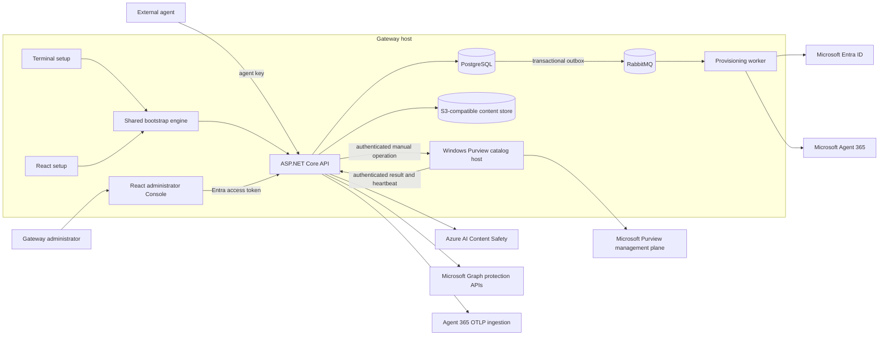
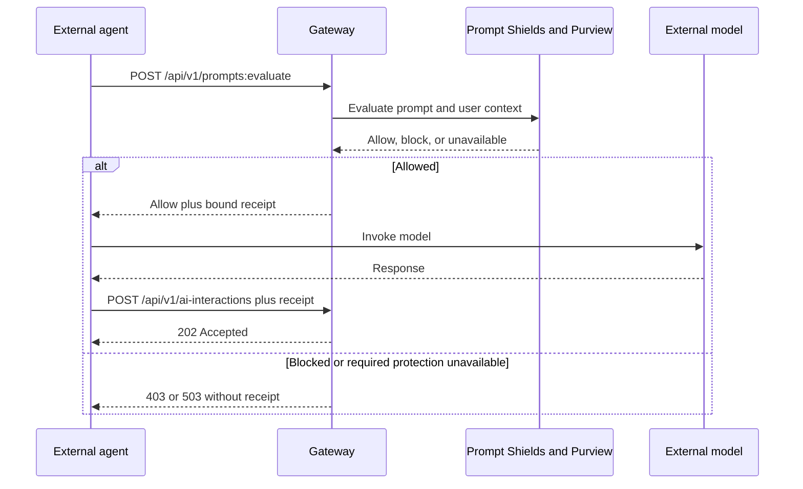
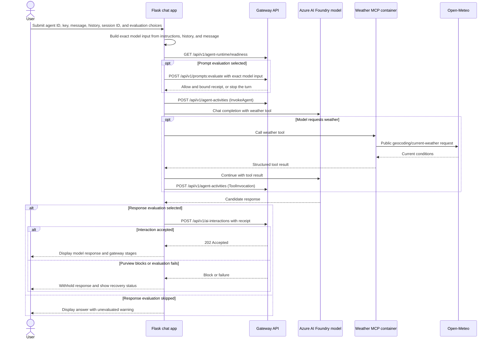

# A365 Custom Gateway

A365 Custom Gateway connects independently hosted AI agents to Microsoft Entra
agent identities, Microsoft Agent 365, Microsoft Purview DLP, and Azure AI
Content Safety Prompt Shields. The agent keeps its model, tools, and hosting. The
gateway supplies the identity, policy enforcement, telemetry, and administrative
control needed to operate it in a Microsoft 365 environment.

The result is one control point for registering external agents, issuing scoped
credentials, checking prompts before a model call, applying existing Purview
policies to individual agents, and sending Agent 365 activity and observability
data.

> **Current release scope:** the included Docker Compose topology is intended for
> local development and evaluation. The Agent 365 Registry integration uses a
> development-gated preview. Production hosting requires deployment-specific TLS,
> durable secret management, infrastructure hardening, and service supervision.

## Why this project exists

An external agent can run anywhere, but Microsoft governance features need a
stable identity and a trustworthy enforcement path. This gateway gives every
registered agent its own identity and API key, then keeps four concerns distinct:

- **Identity:** individual Entra agent identity and Agent 365 registration.
- **Admission:** revocable gateway access for that one registered agent.
- **Protection:** Prompt Shields and Purview decisions before the model runs.
- **Visibility:** activity and OpenTelemetry export to Agent 365 and Microsoft
  security experiences.

Purview policy authors retain ownership of policies, rules, sensitive information
types, classifiers, actions, and exclusions. Gateway administrators select from
the existing compatible policy catalog and apply a policy to the exact individual
agent identity. The gateway does not create DLP policy content.

Policy owners can separately run the [standalone Purview agent DLP script](tools/scripts/setup/purview-agent-dlp.md)
on their Windows PC to create a new Application-plane policy using existing SITs.
The single script needs no Gateway deployment or credentials. It previews by
default, verifies the tenant and individual identity, and creates only with
`-Apply`; existing policies and rules are never overwritten.

## Highlights

- Guided terminal and React setup experiences backed by the same PowerShell
  bootstrap engine.
- Individual agent registration under a reusable Entra Agent ID blueprint.
- One-time, revocable, per-agent gateway credentials.
- Inline prompt evaluation with fail-closed behavior for required protection.
- Independent per-agent Prompt Shields configuration.
- Existing Purview policy discovery and reviewed per-agent assignment.
- Agent 365 activity and direct OpenTelemetry export.
- Administrator Console with persistent light and dark themes.
- Clear loading, refreshing, success, warning, blocked, and failure feedback that
  preserves the last confirmed state while background checks run.
- Built-in agent simulator that exercises the real gateway APIs without calling
  a language model.
- Single-file Python echo sample that shows the pre-model protection boundary with
  one Gateway API call and no UI, model, framework, or package dependency.
- Standalone Python/Flask live-agent sample that calls an Azure AI Foundry
  deployment, discovers a public-weather tool through a separately supervised MCP
  container, and uses a registered agent's real gateway protection and interaction
  path. An optional Windows logon supervisor restores the loopback Flask process
  without a repeating trigger or visible terminal window.
- Gateway-only Disable and Enable controls, plus confirmed permanent Agent 365
  deregistration.
- Generated OpenAPI JSON/YAML and an interactive API reference.

## Architecture



The API and worker use .NET 10. PostgreSQL is the system of record for agent,
protection, receipt, audit, idempotency, and outbox state. RabbitMQ carries
provisioning work. The S3-compatible store holds interaction content outside the
relational database. Docker Compose runs these services and the React Console.
The base stack also starts a Vault development container, but the current
application does not use it as a secret store. Bootstrap keeps deployment secrets
in ignored host files and generates `deploy/runtime/.env.runtime` for Compose.

Purview has two separate integration paths:

1. A Windows certificate-backed catalog host reads existing policies and applies
   reviewed target changes through the Purview management plane.
2. The gateway evaluates prompts at runtime through Microsoft Graph protection
   scope and `processContent` APIs using the individual agent identity.

Bootstrap installs the catalog host as one headless listener under the
certificate-owning Windows user. A logon-only scheduled task starts the listener;
the task has exactly one logon trigger and no repeating, minute-based, hourly,
calendar, or other time trigger. Both the listener and each bounded provider child
start without a visible console window. Bootstrap supplies its already verified
initial catalog once. Later provider reads occur only after a Gateway Administrator
selects **Connect**, **Reconnect**, or **Manual sync**. Page loads, GET requests, idle
heartbeats, and ordinary API, Docker, or listener restarts do not create provider
work. Restart recovery may resume only an already accepted, unexpired operation.
The Console keeps reading that durable operation while the API reports it as live;
an unchanged step or percentage is still valid status evidence because a Microsoft
catalog read can take several minutes. Progress stops only when the API reports a
terminal outcome or operation status cannot be read, in which case the Console
offers an explicit status check without inventing a failure.

If local connector reconciliation briefly contends with an administrator
submission, the Gateway retries that database transaction within a bounded window.
It preserves the same idempotency key and reviewed precondition, rereads current
state, and cannot create a second connector operation or provider read.

The API accepts authenticated connector results into PostgreSQL. That accepted
snapshot, rather than the mutable transport file, is the catalog authority used
by policy listing and assignment review. A failed refresh keeps the previous
accepted snapshot and marks the connection degraded.

The Gateway keeps two policy digests separate. The catalog's public `revision`
uses the exact deployed legacy digest: policy identity and display name, complete
location scope, mode, enforcement planes, rules, provider policy/rule timestamps,
and legacy array behavior. The Console submits it with assignment review
so a stale write cannot overwrite another administrator's scope change. That
legacy shape is retained so existing installations can recognize persisted
pre-upgrade revisions safely.

The signed connector catalog also carries an internal `definitionRevision` over
the policy identity, mode, planes, and rule definition. It excludes all locations
and targets, provider timestamps, and the policy display name. It sorts only the
known outer set-like collections and preserves unknown nested-array order, then
becomes the durable assignment identity after confirmed readback.

Adding another individually reviewed agent target changes public `revision`, but
does not invalidate an existing agent whose `definitionRevision` is unchanged and
whose exact application location still grants all accounts without exclusions.
Removing that exact target, narrowing or excluding it, changing material
enforcement semantics, or making the policy incompatible marks only the affected
assignment **Needs attention** and advances that agent's protection revision.
An authenticated assignment-result file that is legacy, incomplete, or otherwise
invalid terminates only its matching pending operation as unconfirmed. The Gateway
does not infer success, delete the evidence, retry the provider write, or let that
file prevent later assignments from being processed. This includes an oversized
result file; its failure is contained to that operation before the file is read.
`ASSIGNMENT_RESULT_INVALID` means the Catalog Host or assignment transport produced
evidence that is incompatible with the current Gateway contract. Inspect the
connector and operation status, then repair the bootstrap-owned Catalog Host
assignment transport before refreshing the catalog or reviewing another
assignment. Immediate retry or resubmission is not a repair path.

Every accepted policy must provide complete exact-scope evidence: unique
individual application IDs and a non-null, unique all-accounts list that is a
subset of those individual IDs. A signed catalog that omits or contradicts that
evidence is rejected, and the previous accepted catalog stays authoritative. The
connection records the failed refresh without adopting any malformed catalog
state. Connector envelopes also require nonblank authenticated payload and MAC
fields. A malformed heartbeat is ignored; a malformed operation result safely ends
that operation without replacing the accepted catalog. Catalog publication keeps
every raw application-location occurrence so validation can detect duplicates; it
never collapses repeated IDs first. Two locations for the same agent, including an
exact all-accounts location plus a narrower location, are invalid duplicate
evidence and fail closed.

On the first compatible refresh after an upgrade, a pre-upgrade assignment can be
rebased to `definitionRevision` without changing its protection revision only when
its stored legacy digest exactly matches the current public revision and its exact
all-accounts target and compatibility checks still pass. Ambiguous evidence stays
fail closed and requires review.

The listener emits an authenticated heartbeat every five seconds. If the Gateway
misses heartbeats for thirty seconds, the Console reports the connector as
degraded while retaining the last accepted catalog, or disconnected when no
accepted catalog exists. A newly imported bootstrap catalog receives that same
thirty-second window for its first persisted heartbeat; an already persisted
heartbeat is never masked by the startup window. Heartbeat recovery restores local readiness without
reading Purview; only an explicit **Connect**/**Reconnect** or **Manual sync**
operation retrieves policy content.

A heartbeat confirms that the listener is alive, not that a refresh succeeded.
An authenticated result completed after its original deadline reports a timeout
and preserves the previous catalog. See the [runtime recovery guide](docs/runtime/README.md)
when refresh work stops progressing.

Docker services use `restart: unless-stopped` and return when Docker starts. The
API and worker tolerate the short PostgreSQL recovery window that can occur when
Docker restores all containers together; they retry transient database startup
failures for a bounded period before stopping with a clear error. The Console's
same-origin proxy resolves the Compose `api` service through Docker DNS while it
is running, so replacing or recreating the API container does not require a
Console restart. Requests can return a temporary availability error while the API
is absent or becoming ready, then recover after the bounded DNS refresh interval.

Runtime Graph scope checks and `processContent` remain automatic. The last verified
policy list is cached locally in PostgreSQL without an age limit. **Manual sync**
retrieves policy additions or changes when the administrator chooses. See the
[manual-refresh design and verification record](docs/spec/purview-connector-vnext.md)
and [vNext milestones](SPEC-VNEXT.md). The local Windows M1–M5 increment is
implemented. Server/cloud connector work (M6) remains on hold, and live tenant
enforcement still requires the explicitly gated operator validation.

The cached list remains available for selection and review during sync, after a
sync failure, and while the connector is temporarily unavailable. Its last sync
time stays visible. A successful manual sync replaces the list; a failure retains
it. Applying a reviewed assignment still reads the selected policy live and checks
its revision and exact agent target before making a change.

See [SPEC.md](SPEC.md) for the normative technical specification and
[AGENTS.md](AGENTS.md) for repository governance.

## Prerequisites

The complete local feature set currently requires a Windows x86-64 host because
the Purview management connector uses the Windows certificate store and Security
& Compliance PowerShell.

Install:

- Git
- PowerShell 7 or later (`pwsh`)
- .NET SDK `10.0.400` or a newer `10.0.4xx` patch, as pinned by `global.json`
- Docker Desktop or Docker Engine with the Compose plugin and Linux containers
- Azure CLI
- Bicep CLI when bootstrap provisions Content Safety (`az bicep install`)
- Node.js 20 and npm only for local frontend development; Docker image builds
  install frontend dependencies themselves
- Python 3.11 or later only for the optional Python samples

The [Linux dependency installer](tools/scripts/setup/README.md) supports Ubuntu
22.04, 24.04, and 26.04 on x86-64. Linux can build and run the containerized
gateway, but the current Purview catalog and assignment host still requires its
configured Windows account. A fully self-contained remote connector is documented
as deferred work and is not part of this release.

## Download and deploy

Clone the repository:

```powershell
git clone https://github.com/patrick-shim/a365-custom-gateway.git
cd a365-custom-gateway
```

For the guided terminal installation on Windows:

```powershell
.\gateway.cmd up
```

`up` collects configuration when needed, checks prerequisites and Microsoft
sign-in, shows the exact plan, asks for acceptance, provisions owned resources,
builds and starts the containers, and verifies the local endpoints.

For explicit control over each stage:

```powershell
.\gateway.cmd init
.\gateway.cmd plan
.\gateway.cmd apply
.\gateway.cmd verify
.\gateway.cmd open
```

For the graphical installer:

```powershell
.\gateway.cmd gui
```

For a Linux development host after installing the documented prerequisites:

```bash
chmod +x ./gateway
./gateway up
```

Choose Purview disabled for this profile. The current Linux runtime cannot
provision or run the certificate-backed Purview management component.

The terminal and graphical installers collect the same settings and invoke the
same bootstrap engine. Setup explicitly covers tenant identity, Agent 365,
Content Safety, and Purview management access. It never creates Purview policies,
rules, classifiers, or sensitive information types.

Local installation state is stored in ignored files:

- `bootstrap/config.json` contains the selected non-secret configuration.
- `.bootstrap/` contains checkpoints, generated credentials, certificates,
  source-bound plans, and provider transport material.
- `deploy/runtime/.env.runtime` contains generated runtime configuration.

Keep these files secure and preserve them across normal rebuilds. Never commit
them or copy their secret values into issues, logs, or documentation.

## Local endpoints

| Address | Purpose |
| --- | --- |
| `http://127.0.0.1:5081` | Administrator Console |
| `http://127.0.0.1:5081/docs` | Interactive API reference through the Console |
| `http://127.0.0.1:5080/docs` | Interactive reference on the API listener |
| `http://127.0.0.1:5080/openapi/v1.json` | Generated OpenAPI JSON |
| `http://127.0.0.1:5080/openapi/v1.yaml` | Generated OpenAPI YAML |
| `http://127.0.0.1:5080/health` | API liveness |
| `http://127.0.0.1:5080/health/ready` | API and database readiness |

Ports are configurable during setup. The listeners bind to loopback in the local
Compose profile.

## First use

1. Sign in to the Console with a user assigned an appropriate Gateway role.
2. Register an agent under an existing or new gateway-owned blueprint.
3. Complete the displayed Agent 365 Registry confirmation when required.
4. Copy the gateway API key, which is shown only once, into the external agent's
   secret store.
5. Configure Prompt Shields for the agent.
6. Select an existing compatible Purview policy and confirm assignment to the
   individual agent identity.
7. Use **Test Agent** to send a normal and a synthetic-sensitive prompt through
   the real gateway path.
8. Verify gateway decisions, policy scope, Agent 365 activity, Purview visibility,
   and Defender ingestion as separate pieces of evidence.

Assignment confirmation is not proof that a policy has propagated or blocked a
request. Test the selected agent and a same-blueprint sibling independently.

External agent IDs are 3–128 characters, start with a letter or number, and may
contain letters, numbers, dots, hyphens, and underscores. The Console validates
this before submission, and the API returns a field-level `400` response for an
invalid ID instead of starting registration.

Agent 365 Registry confirmation is bounded by the interactive request window. If
Microsoft Graph throttles the request or has not made the exact record readable,
the Gateway pauses safely and reports that the outcome is unconfirmed. Wait
briefly, refresh status, and reconcile the same operation;
the Gateway does not blindly create a second Registry record.

## Agent request flow

External agents must evaluate the exact prompt before invoking their model:



The receipt is bound to the agent, interaction, prompt hash, user context,
timestamp, protection revision, and current assignment evidence. It expires and
can be consumed only once. An agent must not call its model after a block or an
unavailable required protection response.

Purview catalog freshness, public whole-scope `revision`, and durable internal
`definitionRevision` are separate checks. Refreshing a trusted catalog, renaming
the policy, or adding an unrelated exact agent target does not invalidate another
agent's in-flight receipt when its all-accounts target remains present and its
`definitionRevision` is unchanged. Removing that agent's target, narrowing or
excluding it, changing its enforcement definition or compatibility, or changing
the agent setting or protection revision invalidates the receipt and requires a
new protected turn.

Minimal PowerShell example:

```powershell
$base = 'http://127.0.0.1:5080'
$externalAgentId = Read-Host 'Registered external agent ID'
$headers = @{
    Authorization = "Bearer $env:GATEWAY_AGENT_KEY"
    'Idempotency-Key' = [guid]::NewGuid().ToString()
}
$request = @{
    externalAgentId = $externalAgentId
    interactionId = [guid]::NewGuid().ToString()
    occurredAtUtc = [DateTime]::UtcNow.ToString('o')
    userContext = @{ tenantUserObjectId = $env:GATEWAY_TENANT_USER_ID }
    prompt = @{ contentType = 'text/plain'; content = 'Explain what a gateway does.' }
}

$evaluation = Invoke-RestMethod "$base/api/v1/prompts:evaluate" `
    -Method Post -Headers $headers -ContentType 'application/json' `
    -Body ($request | ConvertTo-Json -Depth 8)

if (-not $evaluation.allowed -or
    -not $evaluation.evaluationId -or
    $evaluation.evaluationId -ne $evaluation.evaluationReceiptId) {
    throw 'The gateway did not authorize the model call.'
}

$modelResponse = 'A gateway connects services.' # Replace with the real model call.
$request.response = @{ contentType = 'text/plain'; content = $modelResponse }
$request.promptEvaluationReceiptId = $evaluation.evaluationReceiptId
$headers['Idempotency-Key'] = [guid]::NewGuid().ToString()

Invoke-RestMethod "$base/api/v1/ai-interactions" `
    -Method Post -Headers $headers -ContentType 'application/json' `
    -Body ($request | ConvertTo-Json -Depth 8)
```

Administrative endpoints use an Entra access token for the Gateway API. Agent
ingress endpoints use a gateway-issued agent key. Both use the Bearer header, but
the credentials are not interchangeable. Preserve an idempotency key when retrying
the same uncertain operation and generate a new key for a new operation.

## Minimal Python echo sample

[`samples/echo-agent.py`](samples/echo-agent.py) is the smallest runnable external
agent example. It prompts for an existing Active external agent ID, that
registration's matching Gateway key, an Entra user object ID, and a message. Press
Enter at the message prompt to send `hello world`.

```powershell
python samples/echo-agent.py
```

The script uses only the Python standard library and makes exactly one
`POST /api/v1/prompts:evaluate` call. It prints the Gateway's allow or block result
and stops. It does not register or provision an agent, call a model, submit
activity, or submit a completed interaction. An allow receipt returned by this
demonstration is intentionally unused and expires. Use the Console to create the
registration and save its key before running the script. The result demonstrates
the pre-model Gateway boundary; it is not proof of visibility in Agent 365,
Purview, or Defender. Set `GATEWAY_BASE_URL` only when the API is not at the local
default `http://127.0.0.1:5080`; a non-loopback address must use HTTPS.

## Live Python weather agent sample

[`samples/python-foundry-weather-agent/`](samples/python-foundry-weather-agent/README.md)
is a standalone Flask chat application that demonstrates the external-agent
contract with a real model and tool. For each test run, the operator selects any
valid, Active external agent ID and the matching Gateway key that was revealed
when that registration was created. There is no configured default or silent
fallback identity. For this loopback POC, the Flask UI stores both values in that
browser profile's `localStorage`, restores them after reload, and provides an
explicit action to remove the saved values. It sends them together only with the
same-origin chat request. The key remains the selected registration's reusable
bearer credential until it is rotated or revoked; Flask never persists, logs,
caches, or echoes it.

The selected external agent ID binds the in-memory conversation. Changing it
starts a new session and clears prior history so content and telemetry cannot cross
registrations. Flask validates the ID before any external side effect, then the
Gateway verifies the exact, case-sensitive ID/key pair. A mismatch stops before
Foundry or MCP runs. This lets an operator register an agent in the Console and
immediately test that exact registration without changing sample configuration.

Two request-scoped switches let the operator compare latency without changing the
agent's Gateway configuration. Both **Evaluate prompt** and **Evaluate response**
start on after every page load and are never persisted. Prompt on/response on uses
the full receipt-bound flow. Prompt on/response off keeps the pre-model gate but
does not submit or evaluate the completed interaction. Turning prompt evaluation
off also turns response evaluation off because response intake requires the prompt
receipt. Any skipped phase is labeled as unevaluated; it is never reported as a
Gateway allow, accepted interaction, or proof of downstream visibility. Gateway
admission and activity telemetry remain required in all three valid modes.



Each Gateway stage in the sample timeline adds a `gatewayRequest` descriptor for
the HTTP method and relative API route that the server actually attempted. The
allowlist is `GET /api/v1/agent-runtime/readiness`,
`POST /api/v1/prompts:evaluate`, `POST /api/v1/agent-activities`, and
`POST /api/v1/ai-interactions`. The descriptor is generated from the same endpoint
constants used by the Python client and never contains the Gateway host, query
string, headers, registration key, idempotency key, request body, prompt, or
response content. Existing correlation and conditional reconciliation references
remain separate stage metadata. Foundry and MCP execution stages do not pretend to
be Gateway calls, and a skipped evaluation is not displayed as an executed request.

Prompt Shields evaluates the input prompt only. Purview participates in the
pre-model gate and can also reject the completed interaction when it evaluates
the response. When response evaluation is selected, the app withholds the
candidate model response until the receipt-bound interaction submission succeeds.
When it is skipped, the response is released only with an unevaluated warning. The
app never treats `202 Accepted` as
proof of delivery to Agent 365, Purview AI Explorer, or Defender. The activity
calls are separate telemetry signals. Failure to confirm the pre-model
`InvokeAgent` activity fails closed before Foundry runs. A post-model
`ToolInvocation` activity failure is shown as an unconfirmed warning while the
receipt-bound interaction is still submitted once; neither activity outcome turns
confirmed interaction acceptance into downstream proof.

The pre-model allow path requires `evaluationId` and `evaluationReceiptId` to be
the same nonempty value. Purview must also report one of the explicit permitted
allow states: `Allowed`, `AuditOnly`, `AuditLogged`, `PurviewDisabled`,
`SimulationUnavailable`, or `SimulatedBlock`. `Blocked`, skipped, unknown, or
contradictory states fail closed before the model call.

The sample does not automatically retry model calls, tool calls, or Gateway
mutations. An ambiguous Gateway result ends the turn as unconfirmed; the current
sample has no resume path that reuses the original idempotency key and exact body.
The UI exposes the opaque idempotency value as a reconciliation reference alongside
any correlation ID; it treats an unexpected successful HTTP status as equally
unconfirmed. After reconciliation, a new user action starts a new turn with new
identifiers.

The browser stores the selected external agent ID and current password-field value
in `localStorage` for this loopback POC and restores both after reload. It exposes
a one-step clear action. For each test run it sends the exact ID/key pair with the
current message, prior displayed history, and session ID to Flask. Changing the ID
starts a new session and clears history. Neither value enters a URL, transcript,
result, response, or server cache. Flask holds the key only for the current request,
uses it only for that turn's Gateway authorization, and never persists, logs,
caches, or echoes it. Flask validates the external ID before any
side effect and uses the exact, case-sensitive value for every Gateway call in the
turn. A mismatched ID/key pair fails Gateway admission before Foundry or MCP.
Flask constructs the canonical model input that the Gateway evaluates and Foundry
receives. Foundry resource
configuration remains in local environment variables. Each model turn
creates and closes its
`AsyncAzureOpenAI` client and asynchronous `DefaultAzureCredential` inside the
same request event loop, so Flask requests never share an async transport across
closed loops and token acquisition remains within the cancellable turn. Credential
cleanup still runs if Foundry client cleanup reports an error. Azure
Identity obtains the Foundry token from the signed-in developer identity or
deployed managed identity. The configured
endpoint must be an HTTPS resource root under `.cognitiveservices.azure.com` or
`.openai.azure.com`; the sample does not send that bearer token to arbitrary
hosts. The sample requirements include the asynchronous Azure Identity HTTP
transport needed by that path. Foundry tokens never enter browser state or HTML;
neither Gateway keys nor Foundry tokens enter application logs, caches, responses,
  or checked-in files. The sample does not modify or join the Gateway Compose
  runtime. Its sample-specific Compose file supervises only the weather MCP
  container with a health check and restart policy. On Windows, an optional
  current-user logon task can supervise the loopback Flask process directly with
  the sample virtual environment's `pythonw.exe`. The task has one logon trigger,
  no recurrence, no shell wrapper, and no visible terminal, so it preserves the
  host Azure CLI identity used by `DefaultAzureCredential` without reviving the
  retired repeating-terminal behavior. Detailed setup, recovery, and removal are
  in the [sample guide](samples/python-foundry-weather-agent/README.md).
Expected weather lookup failures are returned as bounded MCP tool errors; they do
not dump a traceback, requested location, or provider response into container logs.

Browser key persistence is intentionally limited to this local concept demo. A
remote or production deployment must remove it and use authenticated callers plus
an approved server-side secret or credential-exchange design.

The sample uses a dark burgundy visual system so it is immediately distinguishable
from the blue Gateway Console. Burgundy is the sample's brand and surface palette;
success, warning, failure, focus, disabled, and unevaluated states retain distinct,
accessible semantic colors, visible keyboard focus, and reduced-motion behavior.

The Flask listener and request `Host` must be lexical loopback addresses, and API
origins must match that trusted host. A server-owned whole-turn deadline is
configurable from 30 to 90 seconds and defaults to 90 seconds, shorter than the
browser's 120-second transport timeout. It cancels asynchronous Foundry/MCP work
before later Gateway mutations can begin. Gateway calls use a
10-second default timeout capped at 20 seconds. If an HTTP status contradicts an
otherwise allowed response body, the browser classifies the turn as unconfirmed
and neither displays nor stores the candidate answer.

## Administration and operations

The Console provides:

- registration status and seven-step provisioning progress;
- Prompt Shields, data protection, identity, API key, and activity views;
- existing Purview policy selection and per-agent assignment status;
- gateway-only bulk Disable and Enable actions;
- confirmed permanent deregistration from this gateway and Agent 365 Registry;
- a real API-path agent simulator with a clearly labeled simulated response;
- Purview connection diagnostics, explicit Connect/Manual sync actions, and
  current accepted-catalog status.

Disabling an agent immediately rejects new prompt, activity, batch, and
interaction requests at this gateway. It does not change the Agent 365 Registry,
the Entra identity, or Purview policy configuration. Permanent deregistration
requires explicit confirmation and verified Registry removal; Entra identities,
shared blueprints, policies, and audit history are retained.

Useful commands:

```powershell
.\gateway.cmd status
.\gateway.cmd verify
.\gateway.cmd doctor
.\gateway.cmd diagnose
```

`status` reports persisted checkpoints. `verify` performs live local endpoint
checks. `doctor` examines prerequisites and sessions without provisioning.
`diagnose` writes a sanitized support bundle. Health checks do not prove policy
enforcement or downstream Microsoft visibility.

## Repository map

| Path | Responsibility |
| --- | --- |
| `src/Gateway.Api/` | HTTP API, authentication, authorization, middleware, and OpenAPI |
| `src/Gateway.Application/` | Commands, queries, validation, and use-case orchestration |
| `src/Gateway.Domain/` | Entities, state machines, interfaces, and domain models |
| `src/Gateway.Infrastructure/` | PostgreSQL, outbox, RabbitMQ, storage, and credential services |
| `src/Gateway.Agent365/` | Entra Agent ID, Registry, provisioning, and direct OTel adapters |
| `src/Gateway.Purview/` | Runtime Purview policy evaluation and catalog/assignment contracts |
| `src/Gateway.ContentSafety/` | Azure AI Content Safety Prompt Shields adapter |
| `src/Gateway.Provisioning.Worker/` | Asynchronous provisioning workflow |
| `src/Gateway.Purview.CatalogHost/` | Windows certificate-backed policy reader and assignment host |
| `web/console/` | React administrator Console |
| `web/setup/`, `tools/Gateway.Setup/` | React installer and local setup host |
| `bootstrap/` | Shared configuration, planning, provisioning, and lifecycle engine |
| `deploy/runtime/` | Local Docker Compose topology |
| `infrastructure/bicep/` | Optional Content Safety resource provisioning |
| `src/ExternalAgent.Sample/` | C# external-agent integration sample |
| `samples/echo-agent.py` | Minimal standard-library prompt-evaluation example |
| `samples/python-foundry-weather-agent/` | Standalone Flask, Foundry, MCP, and Open-Meteo live-agent sample |
| `tests/` | Executable regression and opt-in integration checks |
| `tools/scripts/` | Setup, diagnostics, maintenance, and explicit live probes |
| `docs/`, `operations/` | Detailed design and operating guidance |

## Develop and validate

```powershell
dotnet build Gateway.slnx
npm --prefix web/console run typecheck
npm --prefix web/console test
npm --prefix web/setup test
pwsh -NoProfile -File tools/scripts/maintenance/Test-RepositoryLayout.ps1
```

The repository also contains executable .NET regression programs and PowerShell
bootstrap tests. Follow [tests/README.md](tests/README.md) for the complete suite
and the explicit environment variables required by integration tests. A missing
live dependency must produce a skipped result, never a claimed pass.

## Documentation

- [Technical specification](SPEC.md)
- [vNext specification and milestones](SPEC-VNEXT.md)
- [Repository governance](AGENTS.md)
- [Documentation index](docs/README.md)
- [Bootstrap guide](bootstrap/README.md)
- [Runtime operations](docs/runtime/README.md)
- [API contract](docs/api/api-contract.md)
- [Checked-in OpenAPI schema](docs/api/openapi.yaml)
- [System architecture](docs/architecture/system-architecture.md)
- [Purview policy consumption](docs/architecture/purview-policy-consumption.md)
- [Purview catalog host](docs/architecture/purview-catalog-host.md)
- [Console design](docs/console/design.md)
- [Python Foundry/MCP weather agent sample](samples/python-foundry-weather-agent/README.md)
