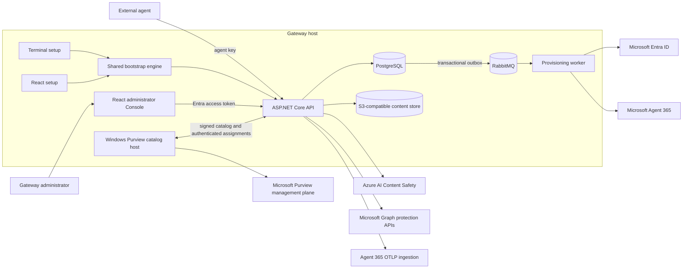
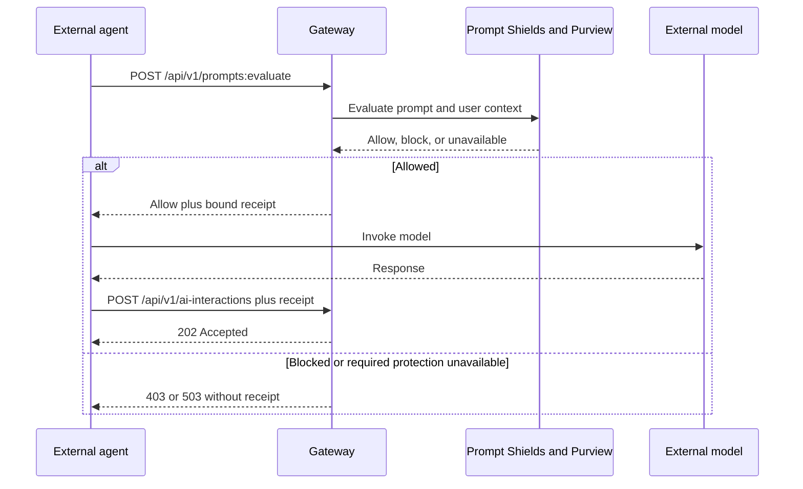

# A365 Custom Gateway

A365 Custom Gateway connects independently hosted AI agents to Microsoft Entra
agent identities, Microsoft Agent 365, Microsoft Purview DLP, and Azure AI
Content Safety Prompt Shields. The agent keeps its model, tools, and hosting. The
gateway supplies the identity, policy enforcement, telemetry, and administrative
control needed to operate it in a Microsoft 365 environment.

The result is one control point for registering external agents, issuing scoped
credentials, checking prompts before a model call, applying existing Purview
policies to individual agents, and sending Agent 365 activity and observability
data.

> **Current release scope:** the included Docker Compose topology is intended for
> local development and evaluation. The Agent 365 Registry integration uses a
> development-gated preview. Production hosting requires deployment-specific TLS,
> durable secret management, infrastructure hardening, and service supervision.

## Why this project exists

An external agent can run anywhere, but Microsoft governance features need a
stable identity and a trustworthy enforcement path. This gateway gives every
registered agent its own identity and API key, then keeps four concerns distinct:

- **Identity:** individual Entra agent identity and Agent 365 registration.
- **Admission:** revocable gateway access for that one registered agent.
- **Protection:** Prompt Shields and Purview decisions before the model runs.
- **Visibility:** activity and OpenTelemetry export to Agent 365 and Microsoft
  security experiences.

Purview policy authors retain ownership of policies, rules, sensitive information
types, classifiers, actions, and exclusions. Gateway administrators select from
the existing compatible policy catalog and apply a policy to the exact individual
agent identity. The gateway does not create DLP policy content.

## Highlights

- Guided terminal and React setup experiences backed by the same PowerShell
  bootstrap engine.
- Individual agent registration under a reusable Entra Agent ID blueprint.
- One-time, revocable, per-agent gateway credentials.
- Inline prompt evaluation with fail-closed behavior for required protection.
- Independent per-agent Prompt Shields configuration.
- Existing Purview policy discovery and reviewed per-agent assignment.
- Agent 365 activity and direct OpenTelemetry export.
- Administrator Console with persistent light and dark themes.
- Built-in agent simulator that exercises the real gateway APIs without calling
  a language model.
- Gateway-only Disable and Enable controls, plus confirmed permanent Agent 365
  deregistration.
- Generated OpenAPI JSON/YAML and an interactive API reference.

## Architecture



The API and worker use .NET 10. PostgreSQL is the system of record for agent,
protection, receipt, audit, idempotency, and outbox state. RabbitMQ carries
provisioning work. The S3-compatible store holds interaction content outside the
relational database. Docker Compose runs these services and the React Console.
The base stack also starts a Vault development container, but the current
application does not use it as a secret store. Bootstrap keeps deployment secrets
in ignored host files and generates `deploy/runtime/.env.runtime` for Compose.

Purview has two separate integration paths:

1. A Windows certificate-backed catalog host reads existing policies and applies
   reviewed target changes through the Purview management plane.
2. The gateway evaluates prompts at runtime through Microsoft Graph protection
   scope and `processContent` APIs using the individual agent identity.

Bootstrap installs the catalog host as a bounded Windows scheduled task. It runs
when the certificate-owning user signs in and every five minutes afterward.
Docker services use `restart: unless-stopped` and return when Docker starts.

See [SPEC.md](SPEC.md) for the normative technical specification and
[AGENTS.md](AGENTS.md) for repository governance.

## Prerequisites

The complete local feature set currently requires a Windows x86-64 host because
the Purview management connector uses the Windows certificate store and Security
& Compliance PowerShell.

Install:

- Git
- PowerShell 7 or later (`pwsh`)
- .NET SDK `10.0.400` or a newer `10.0.4xx` patch, as pinned by `global.json`
- Docker Desktop or Docker Engine with the Compose plugin and Linux containers
- Azure CLI
- Bicep CLI when bootstrap provisions Content Safety (`az bicep install`)
- Node.js 20 and npm only for local frontend development; Docker image builds
  install frontend dependencies themselves

The [Linux dependency installer](tools/scripts/setup/README.md) supports Ubuntu
22.04, 24.04, and 26.04 on x86-64. Linux can build and run the containerized
gateway, but the current Purview catalog and assignment host still requires its
configured Windows account. A fully self-contained remote connector is documented
as deferred work and is not part of this release.

## Download and deploy

Clone the repository:

```powershell
git clone https://github.com/patrick-shim/a365-custom-gateway.git
cd a365-custom-gateway
```

For the guided terminal installation on Windows:

```powershell
.\gateway.cmd up
```

`up` collects configuration when needed, checks prerequisites and Microsoft
sign-in, shows the exact plan, asks for acceptance, provisions owned resources,
builds and starts the containers, and verifies the local endpoints.

For explicit control over each stage:

```powershell
.\gateway.cmd init
.\gateway.cmd plan
.\gateway.cmd apply
.\gateway.cmd verify
.\gateway.cmd open
```

For the graphical installer:

```powershell
.\gateway.cmd gui
```

For a Linux development host after installing the documented prerequisites:

```bash
chmod +x ./gateway
./gateway up
```

Choose Purview disabled for this profile. The current Linux runtime cannot
provision or run the certificate-backed Purview management component.

The terminal and graphical installers collect the same settings and invoke the
same bootstrap engine. Setup explicitly covers tenant identity, Agent 365,
Content Safety, and Purview management access. It never creates Purview policies,
rules, classifiers, or sensitive information types.

Local installation state is stored in ignored files:

- `bootstrap/config.json` contains the selected non-secret configuration.
- `.bootstrap/` contains checkpoints, generated credentials, certificates,
  source-bound plans, and provider transport material.
- `deploy/runtime/.env.runtime` contains generated runtime configuration.

Keep these files secure and preserve them across normal rebuilds. Never commit
them or copy their secret values into issues, logs, or documentation.

## Local endpoints

| Address | Purpose |
| --- | --- |
| `http://127.0.0.1:5081` | Administrator Console |
| `http://127.0.0.1:5081/docs` | Interactive API reference through the Console |
| `http://127.0.0.1:5080/docs` | Interactive reference on the API listener |
| `http://127.0.0.1:5080/openapi/v1.json` | Generated OpenAPI JSON |
| `http://127.0.0.1:5080/openapi/v1.yaml` | Generated OpenAPI YAML |
| `http://127.0.0.1:5080/health` | API liveness |
| `http://127.0.0.1:5080/health/ready` | API and database readiness |

Ports are configurable during setup. The listeners bind to loopback in the local
Compose profile.

## First use

1. Sign in to the Console with a user assigned an appropriate Gateway role.
2. Register an agent under an existing or new gateway-owned blueprint.
3. Complete the displayed Agent 365 Registry confirmation when required.
4. Copy the one-time gateway API key into the external agent's secret store.
5. Configure Prompt Shields for the agent.
6. Select an existing compatible Purview policy and confirm assignment to the
   individual agent identity.
7. Use **Test Agent** to send a normal and a synthetic-sensitive prompt through
   the real gateway path.
8. Verify gateway decisions, policy scope, Agent 365 activity, Purview visibility,
   and Defender ingestion as separate pieces of evidence.

Assignment confirmation is not proof that a policy has propagated or blocked a
request. Test the selected agent and a same-blueprint sibling independently.

## Agent request flow

External agents must evaluate the exact prompt before invoking their model:



The receipt is bound to the agent, interaction, prompt hash, user context,
timestamp, protection revision, and current assignment evidence. It expires and
can be consumed only once. An agent must not call its model after a block or an
unavailable required protection response.

Minimal PowerShell example:

```powershell
$base = 'http://127.0.0.1:5080'
$headers = @{
    Authorization = "Bearer $env:GATEWAY_AGENT_KEY"
    'Idempotency-Key' = [guid]::NewGuid().ToString()
}
$request = @{
    externalAgentId = $env:GATEWAY_EXTERNAL_AGENT_ID
    interactionId = [guid]::NewGuid().ToString()
    occurredAtUtc = [DateTime]::UtcNow.ToString('o')
    userContext = @{ tenantUserObjectId = $env:GATEWAY_TENANT_USER_ID }
    prompt = @{ contentType = 'text/plain'; content = 'Explain what a gateway does.' }
}

$evaluation = Invoke-RestMethod "$base/api/v1/prompts:evaluate" `
    -Method Post -Headers $headers -ContentType 'application/json' `
    -Body ($request | ConvertTo-Json -Depth 8)

if (-not $evaluation.allowed -or -not $evaluation.evaluationReceiptId) {
    throw 'The gateway did not authorize the model call.'
}

$modelResponse = 'A gateway connects services.' # Replace with the real model call.
$request.response = @{ contentType = 'text/plain'; content = $modelResponse }
$request.promptEvaluationReceiptId = $evaluation.evaluationReceiptId
$headers['Idempotency-Key'] = [guid]::NewGuid().ToString()

Invoke-RestMethod "$base/api/v1/ai-interactions" `
    -Method Post -Headers $headers -ContentType 'application/json' `
    -Body ($request | ConvertTo-Json -Depth 8)
```

Administrative endpoints use an Entra access token for the Gateway API. Agent
ingress endpoints use a gateway-issued agent key. Both use the Bearer header, but
the credentials are not interchangeable. Preserve an idempotency key when retrying
the same uncertain operation and generate a new key for a new operation.

## Administration and operations

The Console provides:

- registration status and seven-step provisioning progress;
- Prompt Shields, data protection, identity, API key, and activity views;
- existing Purview policy selection and per-agent assignment status;
- gateway-only bulk Disable and Enable actions;
- confirmed permanent deregistration from this gateway and Agent 365 Registry;
- a real API-path agent simulator with a clearly labeled simulated response;
- Purview connection diagnostics and current catalog status.

Disabling an agent immediately rejects new prompt, activity, batch, and
interaction requests at this gateway. It does not change the Agent 365 Registry,
the Entra identity, or Purview policy configuration. Permanent deregistration
requires explicit confirmation and verified Registry removal; Entra identities,
shared blueprints, policies, and audit history are retained.

Useful commands:

```powershell
.\gateway.cmd status
.\gateway.cmd verify
.\gateway.cmd doctor
.\gateway.cmd diagnose
```

`status` reports persisted checkpoints. `verify` performs live local endpoint
checks. `doctor` examines prerequisites and sessions without provisioning.
`diagnose` writes a sanitized support bundle. Health checks do not prove policy
enforcement or downstream Microsoft visibility.

## Repository map

| Path | Responsibility |
| --- | --- |
| `src/Gateway.Api/` | HTTP API, authentication, authorization, middleware, and OpenAPI |
| `src/Gateway.Application/` | Commands, queries, validation, and use-case orchestration |
| `src/Gateway.Domain/` | Entities, state machines, interfaces, and domain models |
| `src/Gateway.Infrastructure/` | PostgreSQL, outbox, RabbitMQ, storage, and credential services |
| `src/Gateway.Agent365/` | Entra Agent ID, Registry, provisioning, and direct OTel adapters |
| `src/Gateway.Purview/` | Runtime Purview policy evaluation and catalog/assignment contracts |
| `src/Gateway.ContentSafety/` | Azure AI Content Safety Prompt Shields adapter |
| `src/Gateway.Provisioning.Worker/` | Asynchronous provisioning workflow |
| `src/Gateway.Purview.CatalogHost/` | Windows certificate-backed policy reader and assignment host |
| `web/console/` | React administrator Console |
| `web/setup/`, `tools/Gateway.Setup/` | React installer and local setup host |
| `bootstrap/` | Shared configuration, planning, provisioning, and lifecycle engine |
| `deploy/runtime/` | Local Docker Compose topology |
| `infrastructure/bicep/` | Optional Content Safety resource provisioning |
| `src/ExternalAgent.Sample/` | C# external-agent integration sample |
| `tests/` | Executable regression and opt-in integration checks |
| `tools/scripts/` | Setup, diagnostics, maintenance, and explicit live probes |
| `docs/`, `operations/` | Detailed design and operating guidance |

## Develop and validate

```powershell
dotnet build Gateway.slnx
npm --prefix web/console run typecheck
npm --prefix web/console test
npm --prefix web/setup test
pwsh -NoProfile -File tools/scripts/maintenance/Test-RepositoryLayout.ps1
```

The repository also contains executable .NET regression programs and PowerShell
bootstrap tests. Follow [tests/README.md](tests/README.md) for the complete suite
and the explicit environment variables required by integration tests. A missing
live dependency must produce a skipped result, never a claimed pass.

## Documentation

- [Technical specification](SPEC.md)
- [vNext specification and milestones](SPEC-VNEXT.md)
- [Repository governance](AGENTS.md)
- [Documentation index](docs/README.md)
- [Bootstrap guide](bootstrap/README.md)
- [Runtime operations](docs/runtime/README.md)
- [API contract](docs/api/api-contract.md)
- [Checked-in OpenAPI schema](docs/api/openapi.yaml)
- [System architecture](docs/architecture/system-architecture.md)
- [Purview policy consumption](docs/architecture/purview-policy-consumption.md)
- [Purview catalog host](docs/architecture/purview-catalog-host.md)
- [Console design](docs/console/design.md)
