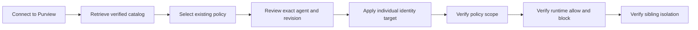
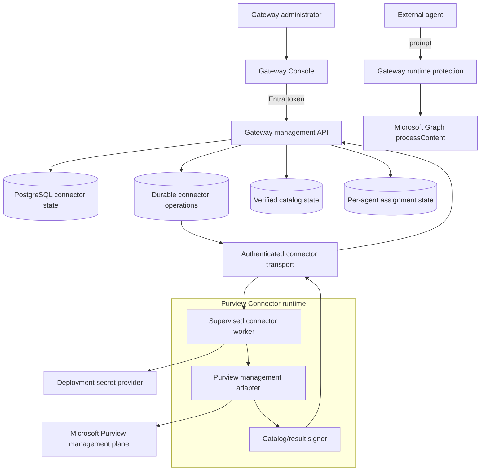
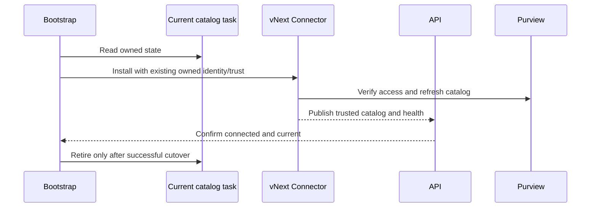

# A365 Custom Gateway vNext Specification and Development Milestones

**Status:** approved planning baseline; implementation is on hold
**Current implemented specification:** [`SPEC.md`](SPEC.md)
**Primary release theme:** managed, observable, restart-safe Purview connectivity
**Implementation trigger:** explicit operator request to begin vNext development

## 1. Document purpose

This document defines the intended next release of A365 Custom Gateway. It is a
future-state specification, not a description of current behavior. Until a
milestone is implemented, validated, and promoted into `SPEC.md`, the current
release contract remains authoritative.

vNext addresses the largest remaining operational gap: Purview catalog and policy
assignment management currently depends on a Windows scheduled task whose health
is not controlled or fully represented by the Gateway API and Console. vNext makes
that dependency an explicit **Purview Connector** with a durable lifecycle,
management API, Console experience, bootstrap ownership, and deployment-neutral
contract.

The release preserves the established per-agent governance model. It changes how
the gateway connects to Purview management services; it does not transfer policy
authorship to gateway administrators and does not weaken inline protection.

## 2. Release objectives

vNext must:

1. Make Purview connectivity visible and operable from **Data Protection** in the
   Gateway Console.
2. Let an authorized administrator initiate connection, request a catalog refresh,
   understand degradation, and follow a repair action without opening a separate
   terminal for routine operation.
3. Keep bootstrap as the authority for identities, credentials, permissions,
   connector installation, and secret-provider configuration.
4. Replace implicit host/process assumptions with a supervised connector contract
   that can run locally on Windows and later on remote infrastructure.
5. Preserve existing agents, API keys, individual policy assignments, audit
   history, and Microsoft-owned resources during upgrade.
6. Preserve exact individual-agent policy targeting and current fail-closed
   protection semantics.
7. Make connection state, catalog freshness, assignment processing, runtime policy
   readiness, and enforcement evidence distinct and observable.
8. Survive connector process failure, Docker restart, host restart, and remote
   worker replacement within the guarantees of the selected deployment profile.

## 3. Non-goals

vNext does not:

- create, edit, clone, enable, disable, or delete Purview DLP policies;
- create or edit rules, classifiers, sensitive information types, thresholds,
  actions, exclusions, or policy mode;
- widen an individual agent assignment to its shared blueprint;
- treat connection, catalog retrieval, or assignment readback as proof of runtime
  blocking;
- couple Prompt Shields enablement to Purview connection state;
- expose certificates, private keys, tokens, or raw provider responses to the
  browser;
- place long-running Microsoft management work inside an HTTP request;
- remove the existing pre-model `prompts:evaluate` protection boundary;
- silently rotate credentials or adopt similarly named tenant resources;
- promise a Linux connector until the exact Microsoft management module and
  authentication path pass the compatibility milestone.

## 4. User experience

### 4.1 Data Protection connection card

Data Protection will begin with a Purview connection card:

> Connect the gateway to Microsoft Purview to retrieve the existing DLP policy
> catalog and manage reviewed per-agent policy assignments.

The card presents one authoritative state and one primary action:

| State | Primary action | Required presentation |
| --- | --- | --- |
| `NotConfigured` | **Connect to Purview** | Explain that bootstrap-owned identity and permission settings are required. |
| `Connecting` | Disabled progress action | Show current operation step and elapsed time. |
| `Connected` | **Refresh catalog** | Show tenant, connector location, last success, next refresh, freshness, and policy count. |
| `Refreshing` | Disabled progress action | Keep the last verified catalog visible and identify it as the previous successful snapshot. |
| `Degraded` | **Try refresh** | Show that the last catalog is aging or the latest refresh failed; identify when assignments will be blocked. |
| `Disconnected` | **Reconnect** | Explain whether credentials, permissions, host availability, or tenant validation requires repair. |

The card also shows:

- connector deployment profile and instance identity;
- last connector heartbeat;
- last attempted and last successful refresh;
- next scheduled refresh;
- catalog age and trust status;
- number of compatible and incompatible policies;
- current operation ID and sanitized error/correlation data;
- a link to detailed diagnostics.

Progress animation represents a live operation and stops on success, failure,
timeout, cancellation, or a needs-attention state. Polling replaces state; it must
never append duplicate cards or make the page grow indefinitely.

### 4.2 Separation from policy assignment

Connection and policy assignment remain separate actions:

Connecting enables catalog discovery. It does not select a policy, change a policy,
or enable Purview for every agent. Assignment continues to require an explicit
review for an exact individual agent identity and policy revision.

### 4.3 Repair experience

Routine refresh is available in the Console. Durable setup or credential repair
remains bootstrap-owned. When a repair crosses that boundary, the Console shows a
sanitized reason and the exact bootstrap action to run; it does not ask for or
collect secrets in the browser.

Examples:

- missing role assignment → show permission repair requirement;
- expired/revoked certificate → show credential repair requirement;
- connector offline → show deployment-specific restart/health action;
- wrong tenant or invalid signature → stop using the catalog and require operator
  investigation;
- provider throttling/transient failure → retain the last trusted catalog, show
  degradation, and schedule bounded retry.

## 5. Target architecture

### 5.1 Component responsibilities

| Component | Responsibility |
| --- | --- |
| Console | Render connection state, initiate authorized operations, poll status, and display repair guidance. |
| Gateway management API | Authorize commands, create durable operations, expose status, validate connector results, update audit/state. |
| Connector operation store | Preserve commands and terminal outcomes across API or connector restarts. |
| Connector transport | Deliver authenticated, replay-protected commands and results without exposing secret material. |
| Purview Connector | Authenticate, read catalog, apply reviewed target additions, read back scope, sign results, and report health. |
| Secret provider | Hold certificate/private key or workload credentials outside the browser and application rows. |
| Runtime protection path | Continue inline scope computation and `processContent`; never wait for management PowerShell. |

### 5.2 Connector interface

The application depends on one connector abstraction with operations equivalent to:

- `GetHealth`
- `VerifyConnection`
- `RefreshCatalog`
- `ApplyReviewedAssignment`
- `ReadAssignmentScope`

Provider-specific PowerShell or SDK details remain behind the connector boundary.
Every command includes operation ID, tenant ID, connector identity, issued and
expiry times, action type, request hash, and action-specific exact identifiers.
Every result includes the same bindings, terminal status, provider revision or
readback evidence, sanitized failure data, and a verifiable signature/MAC.

Read-only refresh commands may be retried with bounded backoff. Assignment commands
reuse the same operation ID and reconcile provider state before another mutation.
An unknown result never authorizes a new target mutation.

## 6. Connection and operation state model

### 6.1 Connection state

```mermaid
stateDiagram-v2
    [*] --> NotConfigured
    NotConfigured --> Connecting: Connect requested
    Connecting --> Connected: Identity, permission, connector, and first catalog verified
    Connecting --> Disconnected: Terminal configuration failure
    Connected --> Refreshing: Manual or scheduled refresh
    Refreshing --> Connected: New trusted catalog accepted
    Refreshing --> Degraded: Refresh failed; previous catalog still trusted
    Degraded --> Refreshing: Retry
    Degraded --> Disconnected: Trust expired or connector unavailable beyond threshold
    Disconnected --> Connecting: Reconnect after repair
```

Connection state is derived from verified evidence rather than set directly by the
browser. A `Connected` state requires:

- expected tenant and management identity;
- required permission readback;
- reachable connector with current heartbeat;
- trusted signing material;
- a valid, fresh catalog from the expected tenant.

### 6.2 Operation state

Durable connector operations use:

- `Pending`
- `Running`
- `Succeeded`
- `Failed`
- `NeedsAttention`
- `TimedOut`
- `Cancelled` only when cancellation is known to be safe

Each operation has ordered steps, timestamps, bounded progress, retry metadata,
correlation ID, failure code, and a terminal result summary. Progress percentages
must be based on known steps and may not imply provider completion before readback.

## 7. Proposed management API

The route names below are planned contracts. They become authoritative only after
implementation, OpenAPI generation, and promotion into `SPEC.md`.

| Method and route | Authorization | Purpose |
| --- | --- | --- |
| `GET /api/v1/protection/purview/connection` | Gateway control-plane reader roles | Read connection, connector, freshness, and current-operation state. |
| `POST /api/v1/protection/purview/connection` | Gateway Administrator | Begin initial connection or post-repair verification using bootstrap-owned configuration. |
| `POST /api/v1/protection/purview/connection/refresh` | Gateway Administrator or Operator | Request an immediate bounded catalog refresh. |
| `GET /api/v1/operations/{operationId}` | Existing operation-read policy | Read authoritative progress and terminal outcome. |

### 7.1 Connect request

The request contains a current connection row version and explicit confirmation.
It does not contain a client secret, certificate, password, token, or arbitrary
PowerShell command. The API validates that bootstrap has installed a connector
configuration owned by this deployment before creating the operation.

### 7.2 Refresh request

Refresh requires an idempotency key and current connection row version. Duplicate
requests with the same canonical body return the same operation. A refresh already
running may return that operation rather than enqueue another. The operation does
not replace the last verified catalog until the new result passes all validation.

### 7.3 Responses and errors

- Mutations return `202 Accepted` with an operation resource.
- `202` never means connected or refreshed.
- Stale row versions return `412 Precondition Failed`.
- Conflicting in-flight actions return `409 Conflict` with the current operation.
- Missing bootstrap-owned setup returns a stable repair-required error.
- Error bodies use `application/problem+json`, sanitized `errorCode`, and
  `correlationId`.
- OpenAPI documents state, freshness, operation, and error schemas.

## 8. Planned persistence model

Exact entity names may change during the contract milestone, but the following
information must be durable.

### 8.1 Purview connector state

- deployment/tenant ID;
- management application ID and non-secret certificate identifier;
- connector profile and instance ID;
- connection state and row version;
- signing key identifier/public trust fingerprint;
- last heartbeat;
- last attempted and successful refresh;
- next scheduled refresh;
- last accepted catalog revision, timestamp, and policy counts;
- catalog trust/freshness status;
- current operation ID;
- last sanitized failure code and correlation ID;
- created/updated actor and timestamps.

### 8.2 Connector operation

- operation ID and idempotency request hash;
- operation type (`Connect`, `RefreshCatalog`, `RepairVerification`, or assignment
  operation through the common connector boundary);
- tenant and connector bindings;
- requested actor and timestamp;
- status, current step, attempt count, lease/expiry, and terminal timestamp;
- sanitized error code/summary and correlation ID;
- result revision and verified result hash;
- audit-event reference.

Secrets, tokens, private keys, raw provider output, and raw policy documents do not
belong in these rows.

## 9. Bootstrap and deployment profiles

### 9.1 Shared bootstrap responsibilities

Terminal and React bootstrap must identically:

1. collect tenant, organization, Purview enablement, and connector profile;
2. provision or reconcile the dedicated management application;
3. provision authentication material and minimum Purview role membership;
4. configure the deployment's secret provider;
5. install/deploy and supervise the connector runtime;
6. register connector identity and public trust material with the gateway;
7. perform first connection verification and catalog refresh;
8. verify restart recovery before reporting setup complete;
9. record exact owned resources and rollback information.

Reconciliation remains idempotent and ownership-bound. Missing credentials stop
with an explicit repair action. Bootstrap does not recreate Purview policies or
silently replace a certificate.

### 9.2 Local Windows profile

The first vNext implementation wraps the current certificate-backed management
path behind the connector contract. Bootstrap installs a bounded supervised runner
under the certificate-owning Windows account. The API and Console report task
state, heartbeat, execution result, and catalog freshness.

Acceptance requires recovery after:

- connector process termination;
- scheduled-task termination;
- Docker engine restart;
- Windows restart followed by the configured account sign-in;
- one transient provider failure;
- one stale-catalog interval.

### 9.3 Container-capable server profile

This profile proceeds only after a compatibility spike proves that the required
Purview management commands and non-interactive authentication are supported in
the selected container operating system. The connector runs as its own service,
not inside the API container. Private credentials are mounted only into the
connector and never into the Console.

Failure of the compatibility spike leaves this profile unsupported; it must not
produce a partial emulation that claims policy management.

### 9.4 Remote cloud profile

The connector runs as a managed worker or scheduled job. Secret material resides
in a platform secret store such as Azure Key Vault. Commands and signed results
use a durable authenticated transport. The profile must tolerate instance
replacement, scale-to-zero/startup behavior where selected, and absence of an
interactive administrator session.

The remote profile must define:

- workload identity and secret retrieval;
- network path to Microsoft management endpoints and the Gateway API/transport;
- durable operation delivery and deduplication;
- health, metrics, logs, and alerting;
- upgrade, rollback, and key/certificate rotation procedure;
- region, residency, and availability assumptions.

## 10. Migration and backward compatibility

### 10.1 Discovery

Upgrade reads current bootstrap ownership and identifies the existing management
application, certificate, role group membership, scheduled task, signed catalog,
assignment queue, and active per-agent assignments. Similar names without matching
ownership evidence are not adopted.

### 10.2 Side-by-side cutover

Existing agents, gateway keys, blueprints, Agent 365 registrations, protection
revisions, assignment rows, receipts already consumed, audit history, and owned
Microsoft resources remain intact. Migration does not rewrite policy content.

### 10.3 Rollback

Before cutover, failure leaves the current task active. After cutover, rollback
may reactivate the previous runner only when its credential and catalog trust are
still valid and no incompatible operation has been accepted. Rollback never
restores an unverified catalog or repeats an assignment with unknown outcome.

## 11. Security requirements

- Connection mutation requires Gateway Administrator; refresh may allow the
  existing Administrator-or-Operator boundary after threat review.
- Bootstrap remains the only component that provisions connector credentials and
  tenant permissions.
- The browser receives no secrets or raw provider responses.
- Connector messages bind operation, action, tenant, connector, target, issued
  time, expiry, and canonical request hash.
- Catalog and result signatures use explicit domains and pinned trust material.
- Replay, wrong tenant, wrong connector, expired message, changed policy revision,
  and target mismatch fail closed.
- The last valid catalog is identifiable but cannot authorize new assignments
  after the trusted freshness window expires.
- Logs use stable error codes and correlation IDs without tokens, private material,
  raw prompts, or sensitive policy payloads.
- Connection, refresh, repair, assignment, trust changes, and migration cutover
  produce audit events.
- Rotation is an explicit bootstrap operation with overlap and proof of new trust;
  missing credentials do not trigger implicit rotation.

## 12. Reliability and observability

The connector publishes health independent of catalog content:

- process/instance heartbeat;
- last command received and completed;
- provider connectivity status;
- authentication status without token details;
- current and last successful catalog revision;
- catalog age and expiry deadline;
- pending/running/failed operation counts;
- last sanitized failure and retry schedule.

Metrics and logs must support these questions:

1. Is a connector instance alive?
2. Can it authenticate to the expected tenant?
3. When was the last successful catalog refresh?
4. Is the catalog still trusted for reads and new assignments?
5. Is an assignment pending, failed, unknown, or confirmed by readback?
6. Did runtime `processContent` enforce an assigned policy?
7. Did Agent 365/Purview/Defender ingestion occur independently?

Retries use bounded exponential backoff with jitter for safe read operations.
Assignment mutation retry first reconciles scope. Circuit-breaking or throttling
must not convert an unavailable protection dependency into an allow.

## 13. Development milestones

Milestones are sequential release gates. Work may overlap only where contracts are
stable and tests isolate the boundary. No implementation milestone begins until
the operator explicitly releases the vNext hold.

| ID | Milestone | Status | Exit outcome |
| --- | --- | --- | --- |
| `M0` | Planning baseline | **Complete (documentation only)** | Root vNext specification, scope, milestones, and hold status are recorded. |
| `M1` | Contract and state foundation | **Planned / on hold** | Connection/operation domain model, API schemas, authorization, persistence migration, and OpenAPI are approved and tested. |
| `M2` | Connector abstraction and Windows adapter | **Planned / on hold** | Current Windows catalog/assignment implementation runs behind the connector contract with supervised health and durable commands. |
| `M3` | Management API orchestration | **Planned / on hold** | Connect, refresh, status, audit, idempotency, concurrency, and sanitized failures work end to end. |
| `M4` | Console Data Protection experience | **Planned / on hold** | State-driven Connect/Refresh/Reconnect UI, diagnostics, accessibility, and bounded polling pass UI tests. |
| `M5` | Bootstrap, migration, and recovery | **Planned / on hold** | Terminal/GUI parity, side-by-side upgrade, rollback, restart recovery, and preserved current state are proven. |
| `M6` | Server/cloud connector profile | **Planned / conditional** | Compatibility is proven, dedicated connector deployment and secret provider work without interactive sign-in, and replacement recovery passes. |
| `M7` | Full-system release validation | **Planned / on hold** | Security review, API/docs consistency, enforcement trials, telemetry verification, upgrade tests, and release evidence pass. |

### M1 — Contract and state foundation

Deliverables:

- connection and operation enums, entities, DTOs, validation, and concurrency;
- proposed management routes implemented behind feature gating;
- durable operation and audit records;
- public OpenAPI schemas and problem details;
- migration created without changing existing assignment semantics;
- unit/regression coverage for legal transitions, stale versions, idempotency,
  authorization, and secret exclusion.

Exit criteria:

- domain transition table is complete;
- controller/DTO/OpenAPI contract review passes;
- no provider work is performed synchronously in HTTP requests;
- old runtime behavior remains unchanged while the feature gate is off.

### M2 — Connector abstraction and Windows adapter

Deliverables:

- application connector interface and authenticated command/result envelope;
- adapter around the current policy catalog and assignment behavior;
- bounded runner, heartbeat, lease, timeout, deduplication, and readback;
- connector test harness with deterministic provider doubles;
- Windows scheduled runner supervision and diagnostics.

Exit criteria:

- current catalog and assignment regression suites pass through the new boundary;
- terminated runner recovers without duplicate assignment mutation;
- wrong-tenant, stale, replayed, and invalidly signed results are rejected;
- private certificate material remains outside containers and application rows.

### M3 — Management API orchestration

Deliverables:

- connection status projection;
- connect/reconnect verification and manual refresh operations;
- operation polling and terminal error mapping;
- audit records and role enforcement;
- freshness transitions and new-assignment gate;
- background reconciliation for abandoned leases and unknown outcomes.

Exit criteria:

- `202` operations progress to one terminal state;
- restart during every operation step resumes or reconciles safely;
- previous verified catalog remains identifiable during a transient failed refresh;
- expired trust blocks new assignments without disabling unrelated agent ingress.

### M4 — Console Data Protection experience

Deliverables:

- connection card and all six connection states;
- Connect, Refresh, Try refresh, and Reconnect actions;
- operation stepper, elapsed time, last success, next refresh, policy counts, and
  diagnostics;
- explicit separation between connection and policy assignment;
- responsive, keyboard-accessible, reduced-motion-aware implementation;
- UI tests for terminal polling, duplicate-submission prevention, and bounded DOM.

Exit criteria:

- page height and component count remain stable across repeated polling;
- progress stops on every terminal state;
- no secret is accepted, cached, or rendered;
- refresh failure leaves accurate previous-catalog and repair information.

### M5 — Bootstrap, migration, and recovery

Deliverables:

- terminal and React setup fields for connector profile;
- source-bound plan actions for install, verify, migrate, and rollback;
- ownership readback for existing identity, certificate, role, task, and catalog;
- side-by-side cutover and retirement of the old runner only after proof;
- `doctor`, `verify`, `status`, and sanitized diagnostics updates;
- host and Docker restart acceptance automation where feasible.

Exit criteria:

- a clean setup reaches Connected and a current catalog;
- upgrade preserves all existing agents, keys, assignments, and audit history;
- failed migration leaves the previous working path available;
- terminal and GUI produce equivalent plans and results;
- missing credentials stop with an explicit repair instruction.

### M6 — Server/cloud connector profile

Entry gate:

- documented proof that required Purview management operations and chosen
  non-interactive authentication work on the target runtime.

Deliverables:

- dedicated connector image or managed job;
- platform secret-provider integration;
- durable remote command/result transport;
- deployment health, logging, metrics, and alerting;
- instance replacement, upgrade, rollback, and credential rotation procedures;
- infrastructure templates for the supported profile.

Exit criteria:

- no interactive user session is required;
- instance replacement completes without lost or duplicated operations;
- private material is available only to the connector runtime;
- remote refresh and exact per-agent assignment pass the same contract suite as
  the Windows adapter.

If the entry gate fails, document the unsupported profile and continue the vNext
local release without claiming server/cloud Purview management support.

### M7 — Full-system release validation

Deliverables and gates:

- clean installation and current-release upgrade tests;
- Docker, connector, and host restart tests;
- provider throttling, timeout, credential loss, wrong tenant, invalid signature,
  stale catalog, and unknown assignment outcome tests;
- normal allow, synthetic DLP block, and same-blueprint sibling isolation trial;
- Prompt Shields independent enable/disable trial;
- Agent 365 activity, Purview, and Defender visibility checks recorded separately;
- threat review and secret/diagnostic scan;
- generated OpenAPI and all documentation updated to released behavior;
- migration of completed requirements from this file into `SPEC.md`.

## 14. Test matrix

| Area | Required evidence |
| --- | --- |
| State machine | Every legal and illegal connection/operation transition |
| Authorization | Reader, Operator, Administrator, and unauthorized behavior per route |
| Concurrency | Stale `If-Match`, duplicate idempotency key, concurrent refresh, connect-vs-refresh conflict |
| Catalog trust | Valid, stale, expired, wrong tenant, wrong signer, malformed, incomplete, duplicate policy IDs |
| Assignment | Exact individual target, preserved scope/exclusions, changed revision, unknown outcome reconciliation |
| Recovery | API restart, connector termination, Docker restart, Windows restart/sign-in, remote instance replacement where supported |
| UI | Responsive layout, keyboard/focus, reduced motion, bounded polling, terminal progress, sanitized errors |
| Migration | Existing agents, keys, assignments, roles, catalog, audit, and owned resources preserved |
| Security | No secrets in browser, database rows, logs, diagnostics, OpenAPI examples, or test artifacts |
| Enforcement | Normal allow, matching synthetic block, sibling isolation, independent Prompt Shields behavior |
| Visibility | Local acceptance, connector completion, Agent 365 export, Purview ingestion, and Defender ingestion reported independently |

## 15. Release acceptance

vNext is ready for release when all applicable milestones are complete and:

1. A clean bootstrap reaches `Connected` without a separately managed terminal.
2. Data Protection accurately shows connector and catalog health after restart.
3. Manual refresh creates a durable operation and accepts only a trusted catalog.
4. A connector failure degrades visibly and recovers without page growth or an
   endless progress state.
5. Existing Purview policies appear without policy authoring or destructive scope
   changes.
6. An existing policy can be reviewed and assigned to one individual identity.
7. Readback preserves unrelated targets and exclusions.
8. Runtime testing observes a normal allow and policy-specific synthetic block.
9. A same-blueprint sibling is independently verified outside the selected
   policy's exact target, subject to other applicable policies.
10. Prompt Shields remains independently configurable and testable.
11. Expired, wrong-tenant, malformed, or invalidly signed data fails closed with a
    clear repair action.
12. Upgrade preserves current agents, credentials, assignments, and audit state.
13. Every claimed deployment profile passes its restart/replacement guarantee.
14. OpenAPI, bootstrap, operations, architecture, README, `SPEC.md`, and release
    notes agree with the delivered implementation.

## 16. Milestone governance

- The current release remains supported while vNext work is feature-gated.
- Each milestone is a reviewable change set with its own tests and documentation.
- A milestone cannot claim completion from mocks alone when its exit criteria
  require Microsoft or restart evidence.
- Conditional profiles remain unclaimed until their compatibility gate passes.
- Security, identity, policy-scope, or migration failures block release.
- Scope changes update this document before implementation diverges.
- Completed vNext behavior moves into `SPEC.md`; this file then becomes the plan
  for the remaining unreleased milestones or is archived in Git history after the
  full release.

## 17. Development pickup

The vNext implementation remains paused. To begin, use an explicit instruction
such as:

> Implement A365 Custom Gateway vNext, starting with M1 in `SPEC-VNEXT.md`.

Start with the contract and state foundation. Do not begin with UI implementation
or replace the current connector before the state model, API contract, feature
gate, migration boundary, and rollback rules are reviewable.
