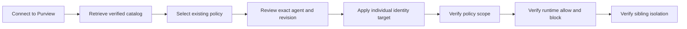
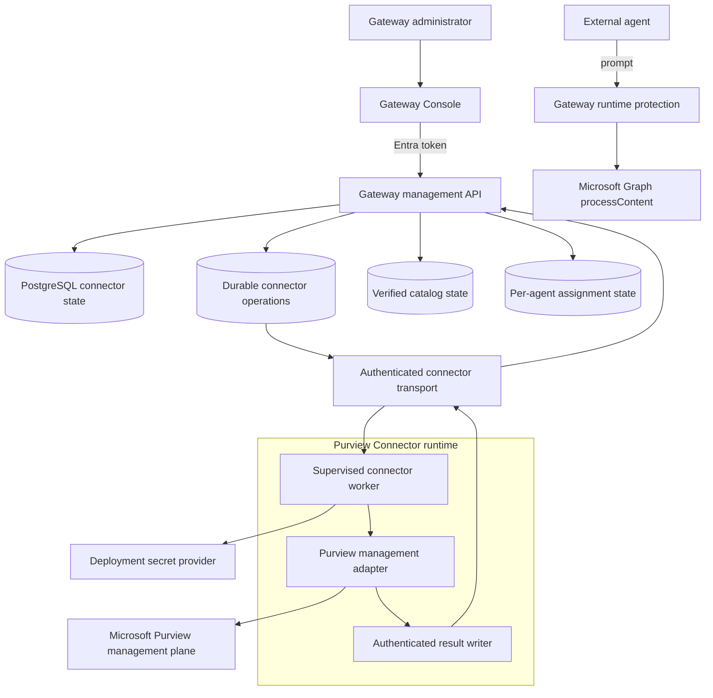
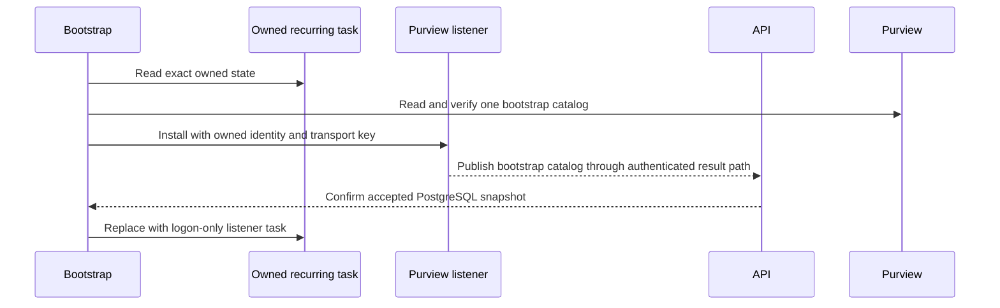

# A365 Custom Gateway vNext Specification and Development Milestones

**Status:** local M1–M5 implemented; applicable repository M7 checks in progress; M6 on hold
**Current implemented specification:** [`SPEC.md`](SPEC.md)
**Primary release theme:** manual Purview policy discovery with independent runtime protection
**Implementation trigger:** satisfied by the operator's Manual sync request
**Latest scope decision:** 2026-10-26; accepted catalogs remain usable without age
expiry until successful manual sync, local M1–M5 implemented, keep M6 on hold

## 1. Document purpose

This document records the local manual-refresh release design, development
milestones, verification boundary, and the still-held server/cloud follow-up.
Implemented current behavior is promoted into `SPEC.md`, which remains normative.
Requirements that need a live tenant, restart trial, or downstream observation
stay unverified here until the operator runs those gated checks.

The standalone policy-owner PowerShell authoring utility described in `SPEC.md`
is current-release tooling outside the Gateway runtime, Console, and bootstrap.
It creates new Application-plane policies from existing SITs under explicit
operator control. It does not add policy authoring to the local connector. See the
[standalone guide](tools/scripts/setup/purview-agent-dlp.md).

The current release already performs bounded retry for transient PostgreSQL
startup/recovery failures in the API and provisioning worker. That baseline
reliability fix is part of `SPEC.md`; it does not start any vNext milestone. The
restart acceptance below concerns the managed Purview Connector and its durable
operations in addition to the existing container runtime.

The current-release Console proxy also re-resolves the Compose `api` service
through Docker DNS after API recreation. This baseline container-lifecycle fix
preserves the current same-origin routes and does not begin a held vNext milestone.

The current Console also owns the general interaction baseline in `SPEC.md`:
confirmed content remains visible during refresh, mutations show bounded progress,
and sanitized errors provide specific recovery guidance. The implemented connector
states use that same baseline.

Current-release registration validation and Agent 365 Registry throttling
recovery also remain baseline work under `SPEC.md`. They do not start vNext:
invalid external IDs fail before persistence, and delegated Registry readback is
bounded, honors provider retry guidance, and preserves GET-only reconciliation
after an unconfirmed mutation.

The current release also includes `samples/echo-agent.py`, a dependency-free,
single-file illustration of one authenticated prompt-evaluation call for an
already registered external agent. It performs no registration, model, explicit
activity submission, or completed-interaction work and does not begin a vNext
milestone.

The standalone Python/Flask Foundry and containerized MCP weather-agent sample is
likewise a current-release external integration demonstration governed by
`SPEC.md`, including strict receipt/Purview-state binding, Azure-host-only Foundry
tokens, guaranteed per-turn async client and credential cleanup, loopback request trust,
cancellable 30-to-90-second whole-turn deadlines, a declared async identity
transport dependency, and bounded, privacy-safe weather lookup
failures. Its current Flask UI accepts any valid exact external agent ID and its
matching Gateway key for each test run, with no default or silent fallback
identity. For this loopback POC, both are restored from browser `localStorage` and
can be removed through one explicit UI action; Flask never persists, logs, caches,
or echoes the key. The selected ID binds the current conversation, and changing it
starts a new session with empty history. Remote or production hosting must remove
browser key persistence and adopt an approved credential design.
Server validation and exact case-sensitive Gateway admission occur before Foundry
or MCP. `GET /api/status` reports service state only. The sample also provides
non-persistent, request-scoped prompt and response evaluation switches for explicit
latency comparison. Both default on; prompt-off forces response-off because final
interaction evaluation requires the prompt receipt. Skipped phases are reported as
unevaluated and never as Gateway acceptance or downstream visibility. This
sample-only control does not change Gateway protection configuration. Its sample-owned
Compose file does not
change the Gateway runtime or start any held vNext milestone. These
current-release hardening changes do not authorize or begin any held vNext work.
The current timeline also adds a `gatewayRequest { method, route }` descriptor for
each Gateway request actually attempted. The allowed pairs are
`GET /api/v1/agent-runtime/readiness`, `POST /api/v1/prompts:evaluate`,
`POST /api/v1/agent-activities`, and `POST /api/v1/ai-interactions`. Those values
come from the client's endpoint constants; the descriptor excludes hosts, query
strings, headers, credentials, idempotency values, payloads, prompts, and responses.
Existing correlation and conditional reconciliation references remain separate
stage metadata. A later milestone must preserve that truthful, content-free
boundary if it changes the sample UI.
On Windows, current-release sample operations also provide an optional, hidden,
current-user logon task for the host Flask process. It invokes the sample virtual
environment's `pythonw.exe` directly, has no repeating trigger, and remains
independent from both the Gateway runtime and the MCP container restart policy.
This lifecycle correction does not begin a held milestone.
The sample's dark burgundy visual system distinguishes it from the blue Gateway
Console while preserving accessible semantic outcome colors and focus states.

The implemented runtime separates durable internal `definitionRevision` evidence
from display-catalog age and public whole-scope `revision` review concurrency.
The public value intentionally retains the exact deployed legacy algorithm,
including provider policy/rule timestamps and legacy array behavior, so
pre-upgrade rows remain comparable. The internal value excludes policy display
name, locations, and provider timestamps, sorts only known outer set-like
collections, and preserves unknown nested-array order.
Accepting an otherwise identical catalog does not invalidate an in-flight
protection receipt, and an old inventory alone does not expire the confirmed
binding. Adding another individually reviewed target to a shared policy likewise
preserves existing assignments whose exact all-accounts targets remain and whose
internal definition revisions are unchanged.
A refresh-proven removal, narrowing/exclusion, material rule/mode/definition
change, or incompatibility advances only the affected protection revision;
missing required live Graph evidence still fails closed. `SPEC.md` contains the
current invariant. This current-release correction does not start M6 or any held
vNext milestone.

The local increment closes the former operational gap by representing the Windows
dependency as an explicit **Purview Connector** with durable PostgreSQL state,
management API, Console experience, bootstrap ownership, and an authenticated
listener contract. It supersedes the recurring catalog reader and catalog-age-
based runtime gate. Server/cloud hosting remains a later conditional increment.

The release preserves the established per-agent governance model. It changes how
the gateway connects to Purview management services; it does not transfer policy
authorship to gateway administrators and does not weaken inline protection.

## 2. Release objectives

vNext must:

1. Make Purview connectivity visible and operable from **Data Protection** in the
   Gateway Console.
2. Let an authorized administrator initiate connection, request a catalog refresh,
   understand degradation, and follow a repair action without opening a separate
   terminal for routine operation.
3. Keep bootstrap as the authority for identities, credentials, permissions,
   connector installation, and secret-provider configuration.
4. Replace implicit host/process assumptions with a supervised connector contract
   that can run locally on Windows and later on remote infrastructure.
5. Preserve existing agents, API keys, individual policy assignments, audit
   history, and Microsoft-owned resources during upgrade.
6. Preserve exact individual-agent policy targeting and current fail-closed
   protection semantics.
7. Make connection state, catalog age, assignment processing, runtime policy
   readiness, and enforcement evidence distinct and observable.
8. Survive connector process failure, Docker restart, host restart, and remote
   worker replacement within the guarantees of the selected deployment profile.

### 2.1 Implemented local manual-management scope

- Initial setup publishes one already verified catalog. Later full reads occur
  only for an explicit Gateway Administrator **Connect**/**Reconnect** or
  **Manual sync** operation.
- Page loads, local GET polling, elapsed time, listener heartbeat, and ordinary
  restarts do not trigger a new Purview catalog read. A restart may recover an
  already accepted operation within its deadline.
- Policy review and confirmation use the last accepted catalog without age expiry.
  The client submits its public whole-scope `revision`, which is stored in
  `ReviewedRevision`. Assignment execution reads the selected policy live, rejects
  a stale reviewed revision, and verifies the exact target mutation.
- The signed result returns public `revision` plus internal `definitionRevision`;
  the latter is stored in `AssignedRevision`. Adding a reviewed individual target
  changes public revision for later writes but does not invalidate other confirmed
  targets on the same policy. Durable reconciliation uses internal definition
  revision plus each assignment's exact all-accounts target evidence.
- Public `revision` preserves the exact deployed legacy digest, including provider
  timestamps and legacy array behavior. A pre-upgrade `AssignedRevision` is
  rebased only when it exactly matches that current public digest and target and
  compatibility checks pass. The internal digest normalizes only known outer sets
  and treats unknown nested-array order as potentially semantic.
- A signed legacy or invalid assignment result terminates only its matching pending
  operation with `ASSIGNMENT_RESULT_INVALID`. It never infers success, deletes the
  evidence, repeats the provider mutation, or blocks processing of later rows.
  Oversized result files are contained at this same per-operation boundary. This
  code identifies incompatible Catalog Host or assignment-transport evidence, so
  the operator inspects connector and operation status and repairs the
  bootstrap-owned assignment transport before a new refresh or assignment review;
  the UI never recommends immediate retry or resubmission.
- Catalog acceptance requires unique individual targets and a non-null, unique
  all-accounts target set that is a subset of them. Malformed signed catalogs keep
  the prior accepted snapshot; connector status records the failed refresh without
  adopting malformed catalog values. Publication preserves each raw application-
  location occurrence until validation and never collapses repeated IDs. Exact
  all-accounts and narrower locations for the same agent are invalid duplicate
  evidence and fail closed. Null or blank authenticated payload/MAC fields
  are rejected centrally; malformed heartbeats are ignored and malformed connector
  results fail only their bound operation without replacing accepted catalog state.
- Existing configured agents do not depend on how recently the display catalog
  was refreshed. Live Graph scope computation, ETag change handling, required
  inline verdicts, and fail-closed provider handling remain automatic.
- Durable assignment and runtime scope evidence replace snapshot age as runtime
  authority. Receipt, command, review, certificate, and token expiry rules remain
  independent.
- The management host runs without visible console windows. Local queue listening
  and process supervision may run in the background, but the listener and every
  provider child are launched windowlessly. Idle listeners perform no Purview
  management reads or repeated sign-ins.
- The local M1–M5 foundation is implemented. Applicable M7 source and offline
  checks apply to this release. M6 server/cloud support remains on hold until the
  operator explicitly requests it.

Current local maintenance distinguishes authenticated completion after the original
deadline (`TimedOut`) from invalid transport evidence. Late results preserve the
accepted catalog. This correction retains the existing listener, transport, and
deadlines and does not release the held M6 milestone.

## 3. Non-goals

vNext does not:

- create, edit, clone, enable, disable, or delete Purview DLP policies;
- create or edit rules, classifiers, sensitive information types, thresholds,
  actions, exclusions, or policy mode;
- widen an individual agent assignment to its shared blueprint;
- treat connection, catalog retrieval, or assignment readback as proof of runtime
  blocking;
- couple Prompt Shields enablement to Purview connection state;
- expose certificates, private keys, tokens, or raw provider responses to the
  browser;
- place long-running Microsoft management work inside an HTTP request;
- remove the existing pre-model `prompts:evaluate` protection boundary;
- silently rotate credentials or adopt similarly named tenant resources;
- promise a Linux connector until the exact Microsoft management module and
  authentication path pass the compatibility milestone.

## 4. User experience

### 4.1 Settings / Purview connection card

Settings / Purview begins with a connection card:

> Connect the gateway to Microsoft Purview to retrieve the existing DLP policy
> catalog and manage reviewed per-agent policy assignments.

The card presents one authoritative state and one primary action:

| State | Primary action | Required presentation |
| --- | --- | --- |
| `NotConfigured` | **Connect to Purview** | Explain that bootstrap-owned identity and permission settings are required. |
| `Connecting` | Disabled progress action | Show current operation step and elapsed time. |
| `Connected` | **Manual sync** | Show tenant, connector location, manual refresh mode, last success, catalog age, and policy count. |
| `Refreshing` | Disabled progress action | Keep the last verified catalog visible and identify it as the previous successful snapshot. |
| `Degraded` | **Retry manual sync** | Show the failed management operation and retain the visibly dated previous snapshot; do not infer a runtime failure from catalog age. |
| `Disconnected` | **Reconnect** | Explain whether credentials, permissions, host availability, or tenant validation requires repair. |

The card also shows:

- connector deployment profile and instance identity;
- last connector heartbeat;
- last attempted and last successful refresh;
- manual refresh mode, with no next scheduled refresh;
- catalog age and verification status, separate from live runtime readiness;
- number of compatible and incompatible policies;
- current operation ID and sanitized error/correlation data;
- a link to detailed diagnostics.

Progress animation represents a live operation and stops on success, failure,
timeout, cancellation, a server-reported needs-attention state, or an operation-
status read error. Polling continues while the API reports `Pending` or `Running`
with polling recommended, even when the step and percentage remain unchanged for
several minutes. The server-owned operation deadline bounds that work. Polling
replaces state; it must never append duplicate cards or make the page grow
indefinitely.

### 4.2 Separation from policy assignment

Connection and policy assignment remain separate actions:

The last accepted catalog remains usable for selection and review during sync and
after a management-readiness failure, with no age-based expiry. The administrator
chooses **Manual sync** to retrieve changes. Only a successful sync replaces the
saved list. A newer accepted revision replaces the open page's view before its
next review; assignment execution still checks the selected policy live.

Connecting enables catalog discovery. It does not select a policy, change a policy,
or enable Purview for every agent. Assignment continues to require an explicit
review for an exact individual agent identity and client-submitted public
whole-scope `revision`.

### 4.3 Repair experience

Routine refresh is available in the Console. Durable setup or credential repair
remains bootstrap-owned. When a repair crosses that boundary, the Console shows a
sanitized reason and the exact bootstrap action to run; it does not ask for or
collect secrets in the browser.

Examples:

- missing role assignment → show permission repair requirement;
- expired/revoked certificate → show credential repair requirement;
- connector offline → show deployment-specific restart/health action;
- wrong tenant or invalid signature → stop using the catalog and require operator
  investigation;
- provider throttling/transient failure → retain the last trusted catalog, show
  degradation, and schedule bounded retry.

Retries belong to an accepted operation and stop at its attempt/deadline limit.
They do not create an unattended recurring catalog refresh. `Connected` describes
local management readiness and the last successful provider verification, not a
permanently open Purview session or proof of runtime enforcement.

## 5. Implemented local architecture and remote target

### 5.1 Component responsibilities

| Component | Responsibility |
| --- | --- |
| Console | Render connection state, initiate authorized operations, poll status, and display repair guidance. |
| Gateway management API | Authorize commands, create durable operations, expose status, validate connector results, update audit/state. |
| Connector operation store | Preserve commands and terminal outcomes across API or connector restarts. |
| Connector transport | Deliver authenticated, replay-protected commands and results without exposing secret material. |
| Purview Connector | Authenticate, read catalog, apply reviewed target additions, read back scope, authenticate results, and report health. |
| Secret provider | Hold certificate/private key or workload credentials outside the browser and application rows. |
| Runtime protection path | Continue inline scope computation and `processContent`; never wait for management PowerShell. |

The display catalog is previously verified administrative inventory accepted into
PostgreSQL. Runtime admission uses durable per-agent assignment bindings plus live
Graph scope and verdict evidence, never its retrieval timestamp. The local M1
evidence contract distinguishes internal signed `definitionRevision`, stored in
`AssignedRevision`, from public whole-scope `revision`, stored in
`ReviewedRevision` for assignment-review concurrency. Adding an unrelated
individual target changes only the latter. A refresh-proven removal of the
assigned identity, narrowing/exclusion, material rule/mode/definition change, or
incompatibility marks the assignment `NeedsAttention` and advances only the
affected protection revision.

### 5.2 Connector interface

The application depends on one connector abstraction with operations equivalent to:

- `GetHealth`
- `VerifyConnection`
- `RefreshCatalog`
- `ApplyReviewedAssignment`
- `ReadAssignmentScope`

Provider-specific PowerShell or SDK details remain behind the connector boundary.
Every command includes operation ID, tenant ID, connector identity, issued and
expiry times, action type, request hash, and action-specific exact identifiers.
Every result includes the same bindings, terminal status, signed public `revision`
and internal `definitionRevision` or readback evidence, sanitized failure data,
and a verifiable signature/MAC.

Read-only refresh commands may be retried with bounded backoff. Assignment commands
reuse the same operation ID and reconcile provider state before another mutation.
An unknown result never authorizes a new target mutation.

## 6. Connection and operation state model

### 6.1 Connection state

```mermaid
stateDiagram-v2
    [*] --> NotConfigured
    NotConfigured --> Connecting: Connect requested
    Connecting --> Connected: Identity, permission, connector, and first catalog verified
    Connecting --> Disconnected: Terminal configuration failure
    Connected --> Refreshing: Administrator requests Manual sync
    Connected --> Degraded: Authenticated heartbeat absent for 30 seconds; snapshot retained
    Refreshing --> Connected: New trusted catalog accepted
    Refreshing --> Degraded: Refresh failed; previous catalog still trusted
    Degraded --> Connected: Authenticated heartbeat restored after liveness-only degradation
    Degraded --> Refreshing: Retry
    Disconnected --> Connecting: Reconnect after repair
    Disconnected --> NotConfigured: Authenticated heartbeat restored and no catalog exists
```

Connection state is set only from durable operation outcomes or persisted,
authenticated listener-liveness evidence, never directly by the browser.
`Connected` records acceptance of a verified catalog from the expected tenant and
connector plus a heartbeat within the thirty-second readiness boundary. Six
missed five-second heartbeats change stable `Connected` state to `Degraded` with
`PURVIEW_CONNECTOR_UNAVAILABLE` while preserving the accepted snapshot; without a
snapshot the stable state is `Disconnected`. A freshly imported bootstrap catalog
uses its connection creation/update timestamp only for the first thirty-second
heartbeat window; once a heartbeat exists, that persisted heartbeat alone controls
liveness. A later authenticated heartbeat
restores only that liveness-induced state without a provider read. Catalog age
remains visible and does not itself change connection or runtime state.

### 6.2 Operation state

Durable connector operations use:

- `Pending`
- `Running`
- `Succeeded`
- `Failed`
- `NeedsAttention`
- `TimedOut`
- `Cancelled` only when cancellation is known to be safe

Each operation has ordered steps, timestamps, bounded progress, retry metadata,
correlation ID, failure code, and a terminal result summary. Progress percentages
must be based on known steps and may not imply provider completion before readback.

## 7. Management API

These local routes are implemented and are part of the current contract in
`SPEC.md` and the generated OpenAPI document.

| Method and route | Authorization | Purpose |
| --- | --- | --- |
| `GET /api/v1/protection/purview/connection` | Gateway Administrator | Read connection, listener health, catalog age, and current-operation state without a provider call. |
| `POST /api/v1/protection/purview/connection` | Gateway Administrator | Begin initial connection or post-repair verification using bootstrap-owned configuration. |
| `POST /api/v1/protection/purview/connection/refresh` | Gateway Administrator | Request an immediate bounded Manual sync operation. |
| `GET /api/v1/operations/{operationId}` | Existing operation-read policy | Read authoritative progress and terminal outcome. |

### 7.1 Connect request

The JSON body is `{ "confirmConnection": true }`; the request also carries the
current connection row version in `If-Match` and a canonical lowercase UUID v4
`Idempotency-Key`.
It does not contain a client secret, certificate, password, token, or arbitrary
PowerShell command. The API validates that bootstrap has installed a connector
configuration owned by this deployment before creating the operation.

### 7.2 Refresh request

Refresh uses an empty JSON body plus `Idempotency-Key` and the current connection
row version in `If-Match`. Exact replay returns the same operation. A different
request while another operation is Pending or Running conflicts and identifies
the active operation. The operation does not replace the last verified catalog
until the new result passes all validation.

Refresh is read-only at the Microsoft boundary. It does not create policies,
change targets, select a policy for an agent, or renew a certificate. Distinct
concurrent requests conflict or attach to the same authorized active operation;
they must not create duplicate provider work or bypass exact request-hash checks.

A transient database serialization or deadlock conflict before commit is retried
with a fresh transaction and state read while preserving the exact idempotency key,
request hash, `If-Match` value, actor, and correlation. Domain and precondition
conflicts return immediately. No command or provider work is published until one
transaction commits, so the bounded retry yields at most one accepted operation.

### 7.3 Responses and errors

- Mutations return `202 Accepted` with an operation resource.
- `202` never means connected or refreshed.
- Stale row versions return `412 Precondition Failed`.
- Conflicting in-flight actions return `409 Conflict` with the current operation.
- Missing bootstrap-owned setup returns a stable repair-required error.
- Error bodies use `application/problem+json`, sanitized `errorCode`, and
  `correlationId`.
- OpenAPI documents state, freshness, operation, and error schemas.

## 8. Implemented persistence model

### 8.1 Purview connector state

- tenant ID and stable connector instance ID;
- connector profile and instance ID;
- connection state, manual refresh mode, and next generation;
- last heartbeat;
- last attempted and successful refresh;
- accepted catalog retrieval timestamp and policy counts;
- catalog verification status;
- current operation ID;
- last sanitized failure code and correlation ID;
- creation/update timestamps and opaque row version.

### 8.2 Connector operation

- operation ID and idempotency request hash;
- operation type (`Connect` or `RefreshCatalog`); assignment operations retain
  their established separate durable model;
- tenant and connector bindings;
- requested actor and timestamp;
- status, current step, attempt count, lease/expiry, and terminal timestamp;
- sanitized error code/summary and correlation ID;
- verified result hash and accepted catalog hash where applicable;
- transport-cleanup timestamp. Correlated audit rows are stored separately.

Secrets, tokens, private keys, and unvalidated provider output do not belong in
these rows. `PurviewCatalogSnapshots` stores the validated catalog JSON and its
tenant, connector, operation, generation, canonical hash, retrieval/acceptance
times, and policy counts.

Previously verified catalog snapshots and versioned assignment evidence are
persisted separately. New authenticated results require operation/tenant/connector
binding, bounded result freshness, and monotonic acceptance so an old valid MAC cannot
replace a newer snapshot. Previously accepted inventory may remain visible as
historical data; it is not authority for a new mutation or a live allow verdict.

## 9. Bootstrap and deployment profiles

### 9.1 Shared bootstrap responsibilities

Terminal and React bootstrap must identically:

1. collect tenant, organization, Purview enablement, and connector profile;
2. provision or reconcile the dedicated management application;
3. provision authentication material and minimum Purview role membership;
4. configure the deployment's secret provider;
5. install/deploy and supervise the connector runtime;
6. register connector identity and public trust material with the gateway;
7. publish the one bootstrap-verified catalog into the durable accepted snapshot
   store without performing a second provider read;
8. install and read back the logon-only listener task and connector state; and
9. record exact owned resources and rollback information.

Reconciliation remains idempotent and ownership-bound. Missing credentials stop
with an explicit repair action. Bootstrap does not recreate Purview policies or
silently replace a certificate.

### 9.2 Local Windows profile

The first vNext implementation wraps the current certificate-backed management
path behind the connector contract. Bootstrap installs a headless, supervised
local command listener under the certificate-owning Windows account. It dispatches
bounded provider jobs only for accepted refresh, verification, and assignment
operations. Listener startup/health checks do not contact Purview.

The local startup mechanism may use a logon-only task to launch the listener
without a console. That task has one logon trigger and no repetition interval,
minute-based trigger, hourly trigger, calendar trigger, or other time trigger.
Every bounded provider child is also windowless. This is process supervision, not
periodic policy refresh; provider reads begin only for an accepted manual Connect,
Reconnect, Manual sync, or assignment operation. Preserve and disclose the existing
Windows account/sign-in requirement; a machine service or new certificate owner
requires separately proven credential access, not an implicit move to LocalSystem.
The API and Console report listener health and last management-operation results
independently of agent runtime readiness.

The implementation has repository-level recovery coverage for the listener and
durable operation protocol. These live restart cases remain gated acceptance
checks and are not claimed by the source implementation alone:

- connector process termination;
- listener startup/supervision failure;
- Docker engine restart;
- Windows restart followed by the configured account sign-in;
- one transient provider failure;
- an old display catalog with no pending operation and no new provider read.

### 9.3 Container-capable server profile

This profile proceeds only after a compatibility spike proves that the required
Purview management commands and non-interactive authentication are supported in
the selected container operating system. The connector runs as its own service,
not inside the API container. Private credentials are mounted only into the
connector and never into the Console.

Failure of the compatibility spike leaves this profile unsupported; it must not
produce a partial emulation that claims policy management.

### 9.4 Remote cloud profile

The connector runs as a managed worker or operation-triggered job. Secret material resides
in a platform secret store such as Azure Key Vault. Commands and signed results
use a durable authenticated transport. The profile must tolerate instance
replacement, scale-to-zero/startup behavior where selected, and absence of an
interactive administrator session.

The remote profile must define:

- workload identity and secret retrieval;
- network path to Microsoft management endpoints and the Gateway API/transport;
- durable operation delivery and deduplication;
- health, metrics, logs, and alerting;
- upgrade, rollback, and key/certificate rotation procedure;
- region, residency, and availability assumptions.

## 10. Migration and backward compatibility

### 10.1 Discovery

Upgrade reads bootstrap ownership and identifies the management application,
certificate, role-group membership, exact owned task, transport directories, and
active per-agent assignments. Similar names without matching ownership evidence
are not adopted. A valid owned signed-file catalog may be imported only when the
PostgreSQL connector state is empty; after that migration, PostgreSQL is the
catalog authority.

### 10.2 Implemented local cutover

The migration replaces the exact owned recurring task with one logon-only listener
task and keeps one authoritative assignment consumer. Bootstrap reuses the catalog
it already verified for publication, so installation does not perform a second
Purview read. Listener startup and restart do not create a refresh operation.

Existing agents, gateway keys, blueprints, Agent 365 registrations, protection
revisions, assignment rows, receipts already consumed, audit history, and owned
Microsoft resources remain intact. Migration does not rewrite policy content.

### 10.3 Recovery boundary

Failed installation retains ownership evidence and reports a repair path. Recovery
reconciles connector state and any accepted operation before retry; it never
restores an unverified catalog, reintroduces a periodic catalog reader, or repeats
an assignment with an unknown outcome.

## 11. Security requirements

- Connection and refresh requests require Gateway Administrator in this increment.
  Do not expand Operator rights implicitly.
- Bootstrap remains the only component that provisions connector credentials and
  tenant permissions.
- The browser receives no secrets or raw provider responses.
- Connector messages bind operation, action, tenant, connector, target, issued
  time, expiry, and canonical request hash.
- Bootstrap-file signatures and runtime command/result MACs use explicit domains
  and pinned trust material.
- Replay, wrong tenant, wrong connector, expired message, stale public whole-scope
  `revision`, and target mismatch fail closed before mutation. A changed internal
  `definitionRevision` or exact all-accounts target fails durable reconciliation.
- The last verified catalog remains usable for review and confirmation regardless
  of age or management availability, until an explicit sync replaces it.
  Review and confirmation bind the accepted revision; execution then reads and
  verifies the selected policy and exact target through the host.
- Indefinite accepted-snapshot reuse is separate from connector-result
  freshness. A newly completed provider operation still accepts only evidence
  retrieved within its fifteen-minute result-validation window.
  Snapshot age alone cannot deny configured runtime work; invalid tenant/identity
  evidence, replayed messages, expired receipts, and unavailable required runtime
  protection still fail closed.
- Logs use stable error codes and correlation IDs without tokens, private material,
  raw prompts, or sensitive policy payloads.
- Connection, refresh, repair, assignment, trust changes, and migration cutover
  produce audit events.
- Rotation is an explicit bootstrap operation with overlap and proof of new trust;
  missing credentials do not trigger implicit rotation.

## 12. Reliability and observability

The connector publishes health independent of catalog content:

- process/instance heartbeat;
- last command received and completed;
- provider connectivity status;
- authentication status without token details;
- current and last successful catalog revision;
- catalog age/manual refresh mode and independent operation/credential deadlines;
- pending/running/failed operation counts;
- last sanitized failure and retry schedule.

Metrics and logs must support these questions:

1. Is a connector instance alive?
2. Can it authenticate to the expected tenant?
3. When was the last successful catalog refresh?
4. When was the catalog verified, and has the selected policy been freshly read
   for this assignment operation?
5. Is an assignment pending, failed, unknown, or confirmed by readback?
6. Did runtime `processContent` return an inline verdict for this exact agent/user,
   without claiming attribution to a selected policy the provider did not identify?
7. Did Agent 365/Purview/Defender ingestion occur independently?

Retries use bounded exponential backoff with jitter for safe read operations.
Assignment mutation retry first reconciles scope. Circuit-breaking or throttling
must not convert an unavailable protection dependency into an allow.

## 13. Development milestones

Milestones are sequential release gates. Work may overlap only where contracts are
stable and tests isolate the boundary. The operator released the local M1–M5 hold
on 2026-10-22; M6 remains held.

| ID | Milestone | Status | Exit outcome |
| --- | --- | --- | --- |
| `M0` | Manual-refresh planning baseline | **Implemented** | Manual scope, evidence design, milestones, and hold status are recorded. |
| `M1` | Contract and state foundation | **Implemented; Purview regression suites passed** | Inventory/assignment/runtime evidence separation, receipt compatibility, operation/API contracts, authorization, persistence, and migration are implemented. |
| `M2` | Connector abstraction and Windows adapter | **Implemented; Purview regression suites passed** | The Windows host runs behind an authenticated, supervised listener with durable commands and no periodic provider read. |
| `M3` | Management API orchestration | **Implemented; Purview regression suites passed** | Connect, refresh, status, audit, idempotency, concurrency, reconciliation, and sanitized failures are implemented. |
| `M4` | Console Data Protection experience | **Implemented; automated coverage present** | State-driven Connect/Refresh/Reconnect UI, diagnostics, accessibility, and bounded polling are implemented. |
| `M5` | Bootstrap, migration, and recovery | **Implemented; offline coverage present** | Shared setup, exact-task migration, logon-only listener installation, and state-preserving recovery are implemented. Live host restart remains gated. |
| `M6` | Server/cloud connector profile | **Planned / on hold** | Compatibility is proven, dedicated connector deployment and secret provider work without interactive sign-in, and replacement recovery passes. |
| `M7` | Full-system release validation | **Source/offline subset in progress; live gates unverified** | Security review, API/docs consistency, enforcement trials, telemetry verification, upgrade tests, and release evidence pass. |

### M1 — Contract and state foundation

Deliverables:

- connection and operation enums, entities, DTOs, validation, and concurrency;
- separate catalog display, durable per-agent assignment binding, and live Graph
  scope/verdict evidence; no `DateTime.MaxValue` or ignored-error bypass;
- separate internal durable `definitionRevision` in `AssignedRevision` from public
  whole-scope review `revision` in `ReviewedRevision`, so an additive target does
  not invalidate existing individually confirmed assignments and no new database
  column or public API field is required;
- versioned receipt semantics and safe behavior for pre-upgrade in-flight receipts;
- implemented management routes and durable operation polling;
- durable operation and audit records;
- public OpenAPI schemas and problem details;
- versioned migration that preserves existing assignments and audits while
  removing catalog-age-based runtime admission;
- unit/regression coverage for legal transitions, stale versions, idempotency,
  authorization, and secret exclusion.

Exit criteria:

- domain transition table is complete;
- effective Graph scope is not misrepresented as proof of a specific internal
  policy `definitionRevision`; unresolved evidence ambiguity prevents releasing
  the new gate;
- controller/DTO/OpenAPI contract review passes;
- no provider work is performed synchronously in HTTP requests;
- PostgreSQL is authoritative after a one-time verified signed-file import.

### M2 — Connector abstraction and Windows adapter

Deliverables:

- application connector interface and authenticated command/result envelope;
- adapter around the current policy catalog and assignment behavior;
- bounded runner, heartbeat, lease, timeout, deduplication, and readback;
- connector test harness with deterministic provider doubles;
- headless Windows listener supervision and diagnostics, with no periodic Purview
  reads and no visible terminal on startup or command dispatch.

Exit criteria:

- current catalog and assignment regression suites pass through the new boundary;
- terminated runner recovers without duplicate assignment mutation;
- wrong-tenant, stale, replayed, and invalidly signed results are rejected;
- private certificate material remains outside containers and application rows.

### M3 — Management API orchestration

Deliverables:

- connection status projection;
- connect/reconnect verification and manual refresh operations;
- operation polling and terminal error mapping;
- audit records and role enforcement;
- operation/result freshness, snapshot replay protection, fresh accepted inventory
  for review/confirmation, and live selected-policy execution/readback;
- background reconciliation for abandoned leases and unknown outcomes.

Exit criteria:

- `202` operations progress to one terminal state;
- restart during every operation step resumes or reconciles safely;
- previous verified catalog remains identifiable during a transient failed refresh;
- unavailable management prevents new refresh/assignment work while previously
  configured runtime work can continue with valid local bindings and Graph checks;
- a failed required Graph check never becomes an allow because a saved catalog exists.

### M4 — Console Data Protection experience

Deliverables:

- connection card and all six connection states;
- Connect, Manual sync, Retry manual sync, and Reconnect actions;
- operation stepper, elapsed time, last success, manual refresh mode, policy counts, and
  diagnostics;
- explicit separation between connection and policy assignment;
- cached selection and review remain available regardless of catalog age,
  sync activity, or management connectivity;
- automatic adoption of a newer accepted catalog revision with obsolete
  stale-inventory feedback cleared;
- responsive, keyboard-accessible, reduced-motion-aware implementation;
- UI tests for terminal polling, duplicate-submission prevention, and bounded DOM.

Exit criteria:

- page height and component count remain stable across repeated polling;
- unchanged live progress continues polling until authoritative terminal state;
- progress stops on every terminal state or operation-status read error;
- no secret is accepted, cached, or rendered;
- refresh failure leaves accurate previous-catalog and repair information;
- a predictably stale review cannot be submitted, and a terminal successful
  refresh makes the new revision reviewable without retaining the old warning;
- page loads, focus changes, local GET retries, and elapsed time create no external
  refresh operation; age alone does not render runtime protection unavailable.

### M5 — Bootstrap, migration, and recovery

Deliverables:

- terminal and React setup fields for connector profile;
- source-bound plan actions for install, verify, migrate, and rollback;
- ownership readback for existing identity, certificate, role, task, and catalog;
- side-by-side cutover and retirement of the old runner only after proof;
- `doctor`, `verify`, `status`, and sanitized diagnostics updates;
- host and Docker restart acceptance automation where feasible.

Exit criteria:

- offline bootstrap tests prove publication, task migration, and connector
  reconciliation; a live clean-install result remains gated;
- upgrade preserves all existing agents, keys, assignments, and audit history;
- failed migration leaves the previous working path available;
- terminal and GUI produce equivalent plans and results;
- missing credentials stop with an explicit repair instruction;
- idle listener/status/restart paths issue no unsolicited Purview catalog read;
  live Docker restart and Windows listener recovery remain independent gated checks.

### M6 — Server/cloud connector profile

Entry gate:

- documented proof that required Purview management operations and chosen
  non-interactive authentication work on the target runtime.

Deliverables:

- dedicated connector image or managed job;
- platform secret-provider integration;
- durable remote command/result transport;
- deployment health, logging, metrics, and alerting;
- instance replacement, upgrade, rollback, and credential rotation procedures;
- infrastructure templates for the supported profile.

Exit criteria:

- no interactive user session is required;
- instance replacement completes without lost or duplicated operations;
- private material is available only to the connector runtime;
- remote refresh and exact per-agent assignment pass the same contract suite as
  the Windows adapter.

If the entry gate fails, document the unsupported profile and continue the vNext
local release without claiming server/cloud Purview management support.

### M7 — Full-system release validation

Deliverables and gates:

- clean installation and current-release upgrade tests;
- Docker, connector, and host restart tests;
- provider throttling, timeout, credential loss, wrong tenant, invalid signature,
  aged inventory, expired commands/receipts, replayed snapshots, and unknown
  assignment outcome tests;
- normal allow, synthetic DLP block, and same-blueprint sibling isolation trial;
- Prompt Shields independent enable/disable trial;
- Agent 365 activity, Purview, and Defender visibility checks recorded separately;
- threat review and secret/diagnostic scan;
- generated OpenAPI and all documentation updated to released behavior;
- migration of completed requirements from this file into `SPEC.md`.

## 14. Test matrix

| Area | Required evidence |
| --- | --- |
| State machine | Every legal and illegal connection/operation transition |
| Authorization | Reader, Operator, Administrator, and unauthorized behavior per route |
| Concurrency | Stale `If-Match`, duplicate idempotency key, concurrent refresh, connect-vs-refresh conflict, and dispatcher-vs-submission PostgreSQL serialization conflict with one accepted operation and no duplicate provider command |
| Catalog trust | Aged accepted inventory remains visibly dated; expired/replayed operation results, wrong tenant/signer, malformed/incomplete catalogs and duplicate IDs are rejected |
| Assignment | Exact individual target, preserved scope/exclusions, additive sibling target stability, changed internal `definitionRevision`, stale public whole-scope `revision`, unknown outcome reconciliation |
| Recovery | API restart, connector termination, Docker restart, Windows restart/sign-in, remote instance replacement where supported |
| UI | Responsive layout, keyboard/focus, reduced motion, bounded polling, terminal progress, sanitized errors |
| Migration | Existing agents, keys, assignments, roles, catalog, audit, and owned resources preserved |
| Security | No secrets in browser, database rows, logs, diagnostics, OpenAPI examples, or test artifacts |
| Enforcement | Normal allow and synthetic block with aged inventory and management offline; Graph scope changes, empty/offline-only scope, provider outage, sibling isolation, independent Prompt Shields behavior |
| Visibility | Local acceptance, connector completion, Agent 365 export, Purview ingestion, and Defender ingestion reported independently |

## 15. Release acceptance

The local implementation has passed source and offline regression checks. Release
claims that require Microsoft, Docker-engine, or Windows-restart evidence remain
gated until the operator runs them. The applicable acceptance set is:

1. A clean bootstrap reaches `Connected` without a separately managed terminal.
2. Data Protection accurately shows connector and catalog health after restart.
3. Manual refresh creates a durable operation and accepts only a trusted catalog.
   There are no recurring catalog scans or refresh-on-page-load side effects.
4. A connector failure degrades visibly and recovers without page growth or an
   endless progress state.
5. Existing Purview policies appear without policy authoring or destructive scope
   changes.
6. An existing policy can be reviewed and assigned to one individual identity.
7. Readback preserves unrelated targets and exclusions.
8. Runtime testing observes a normal allow and policy-specific synthetic block.
9. A same-blueprint sibling is independently verified outside the selected
   policy's exact target, subject to other applicable policies.
10. Prompt Shields remains independently configurable and testable.
11. Expired receipts/operation messages, wrong-tenant bindings, malformed or
    invalidly signed new results fail closed. Catalog age alone does not stop
    already configured agents with valid runtime evidence.
12. Upgrade preserves current agents, credentials, assignments, and audit state.
13. Every claimed deployment profile passes its restart/replacement guarantee.
14. Headless local operations produce no visible terminal; runtime protection
    continues with an old catalog and unavailable management when Graph checks pass.
15. OpenAPI, bootstrap, operations, architecture, README, `SPEC.md`, and release
    notes agree with the delivered implementation.

## 16. Milestone governance

- The local manual-refresh implementation is current release behavior.
- Each milestone is a reviewable change set with its own tests and documentation.
- A milestone cannot claim completion from mocks alone when its exit criteria
  require Microsoft or restart evidence.
- Conditional profiles remain unclaimed until their compatibility gate passes.
- Security, identity, policy-scope, or migration failures block release.
- Scope changes update this document before implementation diverges.
- Completed vNext behavior moves into `SPEC.md`; this file then becomes the plan
  for the remaining unreleased milestones or is archived in Git history after the
  full release.

## 17. Remaining development boundary

Local M1–M5 behavior is implemented. Applicable source and offline M7 checks are
part of this release; gated live tenant, Docker restart, and Windows restart checks
must be reported as unverified until they are actually run. M6 server/cloud work
remains on hold and must not begin until the operator explicitly releases it.
