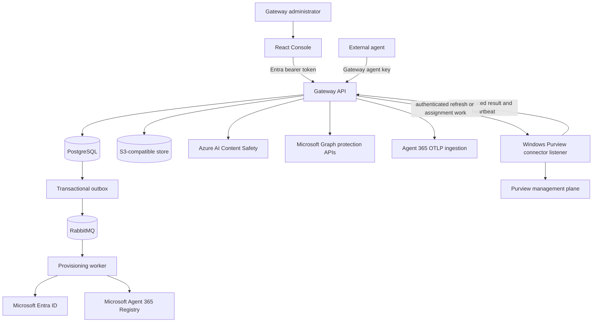
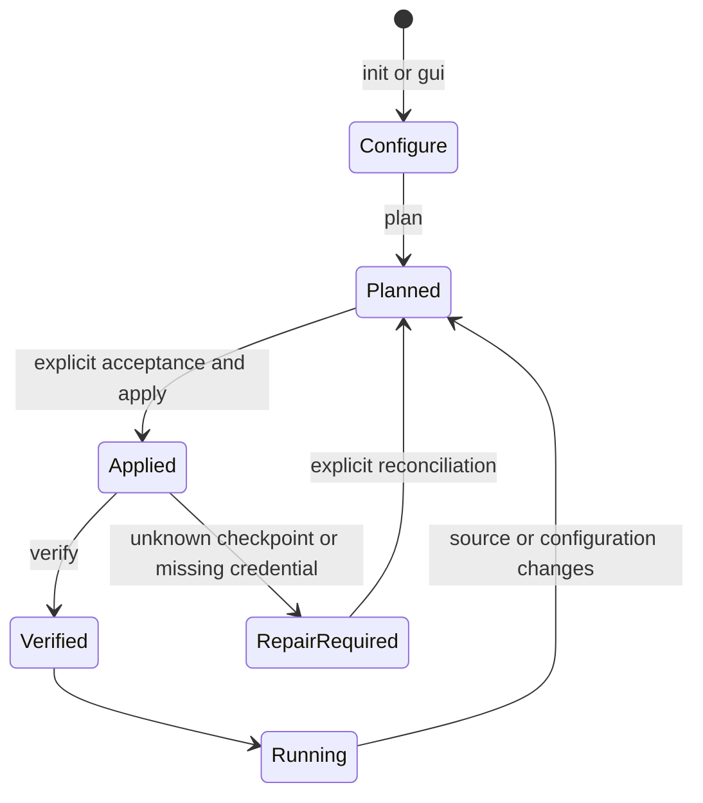
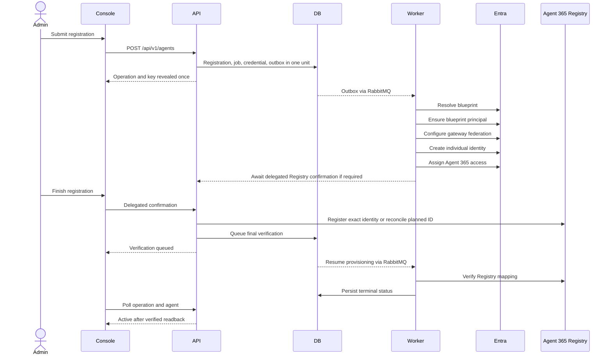
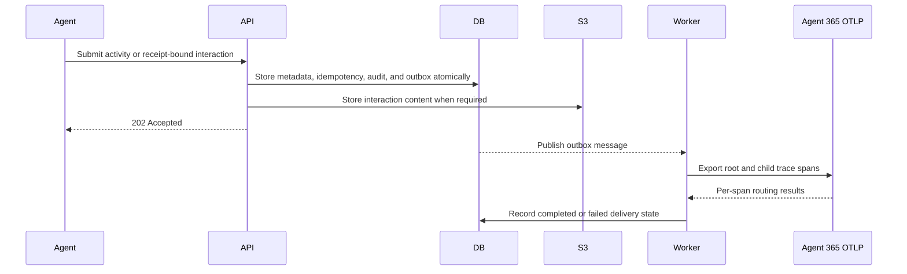

# A365 Custom Gateway Technical Specification

**Document status:** normative description of the implemented release
**Repository:** `patrick-shim/a365-custom-gateway`
**Deployment profile:** `runtime`
**Primary host profile:** Windows x86-64 with Docker Linux containers

## 1. Purpose

A365 Custom Gateway is an identity, protection, observability, and administration
layer for independently hosted AI agents. It does not host the agent's language
model or tools. It gives each external agent an individual Microsoft Entra agent
identity, a Microsoft Agent 365 registration, and a gateway credential, then
enforces configured protection before the external agent calls its model.

The system integrates five boundaries:

1. **External agent ingress** for prompt evaluation, interaction submission, and
   activity submission.
2. **Gateway control plane** for registration, lifecycle, credentials, feature
   configuration, Purview assignment, and audit history.
3. **Microsoft identity and Agent 365** for individual identities, Registry state,
   activity, and observability.
4. **Protection providers** for Prompt Shields and Purview DLP.
5. **Local runtime infrastructure** for durable state, queues, content, and secret
   storage during development and evaluation.

This specification describes what the checked-in release must do. Detailed
controller and DTO definitions remain authoritative for wire contracts, and the
generated OpenAPI document remains authoritative for machine-readable schemas.

## 2. Product principles

- Every agent registration has its own gateway admission credential and its own
  individual Entra agent identity.
- A shared blueprint organizes identities but is never a substitute for the
  individual identity in Purview policy scope or runtime evaluation.
- Prompt protection runs before a model call. Required protection fails closed.
- Purview policy owners author policies. Gateway administrators only discover,
  select, and apply existing compatible policies.
- A queued request, successful scope mutation, observed allow/block result, and
  downstream Microsoft visibility are separate states and must be reported as
  such.
- Setup is plan-based, source-bound, idempotent where reconciliation is safe, and
  conservative around credentials or unknown cloud outcomes.
- Terminal and graphical setup expose the same capabilities through one engine.
- Secrets are returned or displayed only where required and are never committed.

## 3. Scope

### 3.1 Included

- Entra Gateway API and Console application registrations.
- Reusable Entra Agent ID blueprint selection or gateway-owned seed blueprint.
- Per-agent identity creation and Agent 365 Registry confirmation.
- Per-agent gateway API key issuance, validation, listing, and revocation.
- Agent enable, disable, and permanent deregistration workflows.
- Per-agent Prompt Shields settings and inline evaluation.
- Signed discovery of existing compatible Purview DLP policies.
- Reviewed assignment of an existing policy to an exact agent identity.
- A standalone, explicitly invoked policy-owner PowerShell utility for creating a
  new Application-plane policy and rule from existing SITs, outside Gateway
  runtime, Console, and bootstrap.
- Runtime Purview scope computation and `processContent` evaluation.
- Agent activity and AI interaction ingestion.
- Agent 365 direct OpenTelemetry export.
- PostgreSQL state, transactional outbox, RabbitMQ provisioning work, and
  S3-compatible interaction content.
- React administrator Console, React setup interface, terminal setup, generated
  OpenAPI, diagnostics, and regression checks.
- A dependency-free, single-file Python prompt-evaluation example for an already
  registered external agent.
- An optional standalone Python/Flask external-agent sample that uses a real
  Azure AI Foundry chat deployment and a separately supervised MCP weather
  container while exercising the existing Gateway ingress contracts with a
  registered agent. Its optional Windows logon supervisor restores only the
  loopback Flask demo process and never joins Gateway bootstrap or runtime.

### 3.2 Excluded

- Hosting or invoking the external agent's production language model.
- Running the optional live-agent sample inside the Gateway Compose runtime or
  treating its Foundry deployment, MCP server, or public weather provider as a
  Gateway-owned production dependency.
- Creating or editing Purview policy content through Gateway runtime, Console,
  or bootstrap. The standalone policy-owner utility only creates new policies
  and rules; editing existing definitions and creating SITs remain excluded.
- Assuming that policy assignment alone proves enforcement.
- Deleting Entra agent identities, shared blueprints, Purview policies, or audit
  history during gateway deregistration.
- Claiming production readiness for the local Compose topology or the development-
  gated Agent 365 Registry preview.
- A self-contained Linux or cloud Purview management connector in this release.
- Automatically implementing plans marked deferred, including
  `docs/spec/purview-connector-vnext.md`.

## 4. Personas and authority

| Persona | Authority |
| --- | --- |
| Purview policy administrator | Authors and approves Purview policy content and organization-wide governance choices. |
| Gateway Administrator | Registers and deletes agents, confirms Registry operations, configures protection, assigns existing policies, manages credentials, and changes system configuration. |
| Gateway Operator | Performs supported operational and agent state actions that do not require administrator-only authority. |
| Gateway Auditor | Reads supported configuration, activity, and audit evidence. |
| Gateway Support Reader | Reads the limited control-plane surfaces allowed by policy. |
| External agent | Uses only the registration-bound agent ingress credential and endpoints. |

Gateway authorization roles are `Gateway.Administrator`, `Gateway.Operator`,
`Gateway.Auditor`, and `Gateway.SupportReader`. Agent 365 Registry confirmation
also requires a delegated administrator user context with `access_as_user` and the
configured Graph AgentRegistration delegated permissions.

## 5. System context



## 6. Runtime components

| Component | Implementation | Responsibility |
| --- | --- | --- |
| Gateway API | ASP.NET Core 10 | Authentication, authorization, HTTP contracts, orchestration, protection gate, health, and OpenAPI |
| Application layer | .NET 10 | Commands, queries, validators, retry and use-case rules |
| Domain layer | .NET 10 | Entities, enums, interfaces, state transitions, and invariants |
| Infrastructure layer | EF Core/PostgreSQL, RabbitMQ, S3 | Persistence, credential verification, outbox, queue, and interaction content |
| Provisioning worker | .NET 10 | Ordered asynchronous identity and Registry workflow |
| Agent 365 adapter | .NET 10 | Blueprint discovery, identity provisioning, Registry clients, token exchange, and OTLP export |
| Purview adapter | .NET 10 | Runtime Graph evaluation plus authenticated connector and assignment protocols |
| Content Safety adapter | .NET 10 | Prompt Shields request and result translation |
| Purview catalog host | .NET 10 Windows executable | Headless operation listener, certificate authentication, bounded policy reads, exact-scope mutation, readback, heartbeat, and authenticated results |
| Console | React 18, TypeScript, Fluent UI, React Query | Administrator experience and simulator |
| Setup UI | React 18 plus local .NET host | Graphical front end for the shared bootstrap engine |
| Bootstrap engine | PowerShell 7 modules | Configuration, planning, ownership, provisioning, build, lifecycle, and verification |

## 7. Deployment topology

The default Compose project contains seven services:

| Service | Image or build | Default host binding | Restart policy |
| --- | --- | --- | --- |
| `postgres` | `postgres:16-alpine` | `127.0.0.1:5432` | `unless-stopped` |
| `rabbitmq` | `rabbitmq:3.13-management-alpine` | `127.0.0.1:5672`, `127.0.0.1:15672` | `unless-stopped` |
| `s3` | `zenko/cloudserver:latest` | `127.0.0.1:9000` | `unless-stopped` |
| `vault` | `hashicorp/vault:1.17` in development mode | `127.0.0.1:8200` | `unless-stopped` |
| `api` | `a365-gateway-api:dev` by default | `127.0.0.1:5080` | `unless-stopped` |
| `worker` | `a365-gateway-worker:dev` by default | internal | `unless-stopped` |
| `console` | `a365-gateway-console:dev` by default | `127.0.0.1:5081` | `unless-stopped` |

PostgreSQL and the object store use named volumes. The API mounts the bootstrap
catalog read-only for one-time migration, the connector and assignment transports
read/write, and blueprint credentials read-only. Accepted catalog and connector
state are authoritative in PostgreSQL. The worker mounts blueprint credentials
for owned provisioning work.

On process start, the API and worker must establish the runtime schema lock and
database connection before reporting readiness. PostgreSQL startup and recovery
errors classified as transient are retried with bounded backoff. A non-transient
error or exhausted retry window fails startup; the service must not remain marked
ready or accept traffic without a usable database.

The local topology deliberately uses loopback listeners and development service
credentials. The `vault` container is currently an unwired development auxiliary;
the application does not read secrets from it. Bootstrap instead writes ignored
host files and generated container environment values. A production deployment
must replace those assumptions with TLS, network controls, a durable secret
provider, backups, monitoring, and platform-specific workload supervision.

## 8. Bootstrap specification

### 8.1 Entry points

- Windows: `gateway.cmd`
- POSIX shells: `./gateway`
- Shared engine: `bootstrap/bootstrap.ps1`

Supported commands are `init`, `setup`, `gui`, `doctor`, `plan`, `apply`, `up`,
`status`, `verify`, `open`, and `diagnose`.

### 8.2 Configuration

The configuration schema is `bootstrap/config.schema.json`. The only supported
deployment profile is `runtime`. Configuration covers:

- tenant and subscription identifiers;
- environment, region, project name, and owned resource group;
- API and Console ports;
- seed blueprint and explicit Registry preview acknowledgement;
- reviewed Agent 365 manager application IDs;
- explicit Prompt Shields enablement, SKU, and cost/quota acknowledgement;
- explicit Purview enablement and authority acknowledgement.

The selected non-secret configuration is stored in ignored
`bootstrap/config.json`. Bootstrap state and credentials are stored under ignored
`.bootstrap/`. The generated Compose environment is ignored at
`deploy/runtime/.env.runtime`.

### 8.3 Lifecycle



Plans are bound to the exact configuration and source fingerprint. Existing owned
resources are read back before mutation. Bootstrap must not silently rotate a
missing credential, adopt an unrelated resource, or claim success from a persisted
checkpoint alone. Concurrent installers for the same checkout are blocked.

There is no general destroy command. Destructive tenant cleanup requires an
explicit, separately reviewed operation with exact ownership evidence.

### 8.4 Interface parity

Terminal and React setup must expose the same fields, validation, plan, actions,
progress, failure information, and final verification. The browser UI does not
implement cloud provisioning; its local host invokes the shared PowerShell engine
with a one-time session and request validation.

## 9. Identity and authentication

### 9.1 Control plane

The Console signs users in through Microsoft Entra ID. The API validates an access
token issued for the Gateway API audience and applies endpoint-specific Gateway
roles. Administrative access tokens are never accepted as agent credentials.

### 9.2 Agent ingress

The gateway issues a clear agent key once. Only a verifier and metadata are stored.
The client sends the key in `Authorization: Bearer <key>`. Successful validation
creates claims for the registration ID, external agent ID, credential ID, and
`ExternalAgent` role. Disabled, deleting, deleted, expired, or revoked admission
must be rejected.

### 9.3 Microsoft workloads

Provisioning and runtime Microsoft calls use purpose-specific identities and token
providers. Blueprint credentials are keyed by blueprint application ID. Token
caches for Graph protection calls and Agent 365 observability are separate. The
Purview management application and certificate are distinct from per-agent runtime
identity.

## 10. Agent lifecycle

### 10.1 Registration states

`Draft`, `Provisioning`, `AwaitingAdminApproval`, `Active`, `Disabled`, `Failed`,
`Deleting`, `Deleted`, and `RequiresManualIntervention`.

### 10.2 Provisioning workflow



The seven reported steps are: resolve/prepare blueprint, enable/ensure blueprint
principal, connect/configure gateway federation, create agent identity, assign
Agent 365 access, add to Registry, and verify the connection. The Console must
poll an incomplete operation and render terminal success or failure without a
manual refresh.

An external agent ID is validated before repository access: it is 3–128
characters, begins with an ASCII letter or number, and otherwise contains only
ASCII letters, numbers, dots, hyphens, or underscores. Invalid input returns a
field-level `400 application/problem+json` response and creates no registration,
credential, job, audit event, or outbox message.

Delegated Registry creation and exact-ID readback are bounded to complete before
the Console request timeout. A `429` response observes Microsoft's `Retry-After`
instruction when another read can fit inside that bound; otherwise the operation
returns to `AwaitingAdministratorAction` with an unconfirmed outcome. Recovery is
GET-only for the persisted planned Registry ID. User-facing copy must not claim
that Registry creation succeeded until exact readback verifies the record.

### 10.3 Disable and enable

Disable is a gateway admission action. It rejects new prompts, activities,
batches, and AI interactions and invalidates outstanding protection receipts.
It does not disable the Entra identity, change Agent 365 Registry state, or mutate
Purview. Enable restores admission for a valid Disabled registration.

### 10.4 Permanent deregistration

Permanent deregistration requires administrator authority, an exact row version,
an explicit confirmation flag, and verified identity/Registry mapping. The API
transitions the registration to `Deleting`, denies new ingress, deletes the exact
Agent 365 Registry entry, and reads back its absence before final local removal.
Unknown outcomes remain visible for reconciliation. Entra identities, blueprints,
Purview policies, local tombstones, and audit history are retained.

## 11. Protection model

### 11.1 Pre-model gate

`POST /api/v1/prompts:evaluate` is the mandatory protection boundary for a model
call. It evaluates the exact prompt and user context under the authenticated agent
registration. Prompt Shields and Purview are separate decisions.

An allowed result includes a short-lived receipt. The receipt binds:

- agent registration and individual Agent 365 identity;
- external interaction ID;
- salted prompt hash;
- tenant user object ID;
- occurrence time;
- protection revision and effective settings;
- current Purview assignment evidence.

A blocked result returns no receipt. Unavailable required protection returns a
service error and no receipt. The agent must not call its model in either case.

`POST /api/v1/ai-interactions` must validate and atomically consume the receipt.
Agent, interaction, prompt, user, time, policy evidence, expiration, replay, or
protection-state mismatches fail.

The stable protection-context hash binds the canonical durable individual-policy
assignment digest and effective agent settings. Catalog retrieval and acceptance
times are management-inventory metadata and are not part of runtime binding
identity. A newly accepted snapshot with identical tenant, policy revision,
assignment, and target scope therefore preserves an in-flight receipt. A refresh
that proves a semantic assignment or scope change marks the assignment
`NeedsAttention`, advances the affected protection revision, and invalidates the
receipt. Missing required live runtime evidence still fails closed independently.

### 11.2 Prompt Shields

Prompt Shields is independently configurable per agent and backed by Azure AI
Content Safety when enabled. The feature setting does not enable or disable the
agent itself. Required service failure fails closed. The decision and sanitized
telemetry are recorded without placing raw secrets in logs.

### 11.3 Purview management plane

Bootstrap provisions a dedicated Entra management application and Windows
certificate, grants the required Purview DLP management role, and verifies
unattended access. The certificate private key stays with the configured Windows
user.

The catalog host:

- reads existing policies and application rules;
- verifies it connected to the configured tenant;
- consumes only authenticated, expiring, generation-bound connector commands;
- produces a bounded, atomic authenticated result and connector heartbeat;
- processes authenticated, expiring assignment requests;
- adds only the reviewed individual agent target;
- preserves existing inclusions, exclusions, rules, and mode;
- reads the scope back before publishing an authenticated result.

The API validates result authentication, tenant, connector identity, operation,
request hash, action, generation, timestamps, deadline, schema, unique IDs, and
canonical policy revisions before accepting a new catalog into PostgreSQL. The
catalog GET plus assignment review and confirmation read only that accepted
snapshot. The X.509-
signed file produced during bootstrap is a one-time migration source when the new
tables are empty; it is not the ongoing catalog authority. Missing, invalid,
wrong-tenant, or unavailable data is an error, never a successful empty catalog.

The management freshness threshold is thirty days in
`PurviewPolicyCatalogValidation.MaximumAge`. A new assignment review or
confirmation requires an accepted catalog inside that threshold. Historical
inventory remains visible with its retrieval time after the threshold or a failed
refresh, and an existing durable binding does not expire merely because the
display inventory ages. This is not the lifetime of a Purview policy,
authentication certificate, or Graph access token.

The thirty-day reuse threshold does not weaken connector-result validation. A
successful on-demand provider operation must still return catalog evidence
retrieved within the separate fifteen-minute connector-result window and bound to
that exact operation, generation, request hash, tenant, connector, and deadline.

Snapshot acceptance time and catalog retrieval time do not themselves change
policy identity. Runtime binding digests are derived from durable confirmed
assignment evidence. A refresh that discovers a removed, revised, incompatible,
or no-longer-targeted assigned policy changes that assignment to
`NeedsAttention`, advances the affected registration's protection revision, and
therefore invalidates affected runtime evidence.

The Windows scheduled task starts one headless listener when the certificate-
owning user signs in. Its only trigger is that user logon: it has no repetition
interval or other time-based trigger. Task launch and every bounded provider child
process must be windowless and must never display a terminal to the interactive
user. Idle polling and heartbeat, page/GET access, and ordinary API, Docker, or
listener restart do not create provider work. Restart recovery may resume an
already accepted, unexpired operation. Only an accepted Connect, Reconnect,
Policy Refresh, or assignment operation starts bounded provider work. Each provider invocation has a six-minute deadline;
connector operations expire after ten minutes and reviewed assignment confirmation
has a fifteen-minute window. Unknown mutation outcomes never authorize an
automatic duplicate mutation.

The Console polls an accepted connector operation while the authoritative API
returns `Pending` or `Running` with polling recommended. Repeated unchanged status,
step, or percentage responses prove the operation is still readable and must not
be converted into a local failure or needs-attention state. Polling stops on a
server terminal status or an operation-status read error; the server-owned
operation deadline provides the bound for otherwise healthy long-running reads.

Connector submissions and dispatcher transitions share the tenant connector
serialization boundary. A transient PostgreSQL serialization or deadlock conflict
before commit is retried only within a bounded submission attempt, using a fresh
transaction and authoritative reread while preserving the exact submission,
idempotency key, request hash, reviewed row version, actor, and correlation ID.
Semantic outcomes such as a stale row version, idempotency hash mismatch, or an
active-operation conflict are returned immediately and are never retried. Exactly
one committed operation may be accepted, and provider work is not published before
that commit. Retry exhaustion returns a sanitized failure and never implies that an
operation was accepted.

The API persists authenticated listener liveness independently of provider work.
Six missed five-second heartbeats form a thirty-second readiness boundary. When
an accepted bootstrap catalog creates a connection before its first heartbeat is
persisted, that connection receives the same thirty-second startup window from its
creation/update time. A persisted heartbeat always remains the authoritative
liveness timestamp. When that boundary is crossed outside an active connector operation, a connection with
an accepted catalog becomes `Degraded` and reports
`PURVIEW_CONNECTOR_UNAVAILABLE`; the accepted snapshot remains intact. Without an
accepted snapshot it becomes `Disconnected`. A later authenticated heartbeat
restores only this liveness-induced state (`Connected` with a snapshot,
`NotConfigured` without one) and does not contact Purview.

### 11.4 Purview assignment

An administrator reviews `{policyId, revision}` for one active agent. Confirmation
binds the administrator, tenant, agent registration, individual identity,
blueprint relationship, current protection revision, policy, and canonical
provider revision. The assignment transport uses authenticated request and result
domains. A provider revision change requires a new review.

Assignment states distinguish review, application, readback confirmation, runtime
readiness, observed allow, observed DLP block, conflict, and failure. The UI must
not attribute a decision to one policy when other applicable policies may exist.

### 11.5 Purview runtime plane

The API uses the exact individual agent's workload identity to compute protection
scope and call Microsoft Graph `processContent`. Scope and token caches include
the relevant agent, user, and blueprint boundaries. A shared blueprint must not
replace the child identity. Runtime evaluation remains inline and independent of
the management host process lifetime once valid configuration and policy evidence
exist.

### 11.6 Standalone policy-owner authoring

`tools/scripts/setup/New-PurviewAgentDlpPolicy.ps1` is a portable single-file
Windows PowerShell 7 utility. It uses delegated Microsoft Graph reads and
Security & Compliance PowerShell, without Gateway APIs, bootstrap state, keys,
certificates, or deployment dependencies. It resolves existing SIT names or GUIDs
and binds one exact individual Entra agent application to its expected blueprint
in the selected tenant. A blueprint is never a policy target.

Default execution only reads and previews. `-Apply` explicitly creates a new
disabled policy, creates its SIT-based UploadText/DownloadText blocking rule,
verifies both, then requests the selected mode. `-WhatIf` is enforced locally
before any mutation. Existing policy/rule names cause a conflict, never adoption
or replacement. An uncertain mutation or mismatched readback stops without
automatic retry, rollback, or deletion; the owner reconciles in Purview.

The scope uses `EnforcementPlanes = Application` and one `Applications` / `Entra`
/ `Individual` location. `Tenant / All` includes all users of that selected agent,
not all applications. Management readback is reported separately from policy
distribution and observed enforcement. Runtime allow, synthetic-sensitive block,
and same-blueprint sibling checks remain separate live acceptance checks. See the
[standalone guide](tools/scripts/setup/purview-agent-dlp.md).

## 12. Activity, interaction, and observability flow



An HTTP `202` means the gateway durably accepted work. It does not prove arrival
in Agent 365, Purview AI Explorer, or Defender. Direct OTLP success requires both
an acceptable HTTP response and per-span routing evidence. The root operation is
`invoke_agent`; supported child operations include `chat`, `execute_tool`, and
`output_messages` with one trace hierarchy and conversation ID.

The gateway's Agent 365 export redacts prompt and response bodies. Hunting pivots
are agent application ID, agent name, conversation/session ID, timestamps, action
type, channel, and source. Correlation identifiers remain useful inside gateway
operations even when a downstream surface does not expose them.

### 12.1 Minimal Python echo-agent sample

The repository includes `samples/echo-agent.py` as the smallest executable
external-agent integration example. It is one Python source file, has no UI, model,
tool, framework, or third-party package dependency, and is not part of the Gateway
runtime. At runtime it accepts the exact Active external agent ID, its matching
Gateway key through non-echoing input, an Entra tenant user object ID, and a prompt
that defaults to `hello world`.

The script creates a fresh interaction ID and UUID v4 idempotency key, then performs
exactly one authenticated `POST /api/v1/prompts:evaluate` request using the public
contract. It prints the HTTP status and returned JSON and stops. It does not create
or provision a registration, call a model, emit agent activity, or submit a
completed interaction. A successful allow receipt is intentionally left
unconsumed and expires normally. The example demonstrates how little code an
already registered external agent needs for the pre-model evaluation boundary; an
allow response is not evidence of downstream Agent 365, Purview, or Defender
visibility.

### 12.2 Standalone Python live-agent sample

The repository includes an optional external-agent demonstration under
`samples/python-foundry-weather-agent/`. It is outside the Gateway runtime and
Gateway Docker Compose topology. For every test run, the operator enters an exact valid
external agent ID and its matching Gateway key in the Flask UI. There is no default,
configured fallback, or server-owned sample identity. The key is revealed once
when registration is created but is reused as that registration's bearer credential
until rotation or revocation.

The Flask process uses `AsyncAzureOpenAI` with the asynchronous
`DefaultAzureCredential` and the Azure Cognitive Services token scope. Each model
turn creates and closes both objects inside that turn's event loop;
async clients and credential transports are never reused across Flask request
loops. Credential cleanup must run even when Foundry client cleanup fails. Token
acquisition is asynchronous and remains subject to the whole-turn deadline. The
Foundry resource endpoint must be an HTTPS root under
`.cognitiveservices.azure.com` or `.openai.azure.com`; arbitrary hosts, paths,
queries, and fragments are rejected before a bearer token is created. Deployment
name and API version are environment configuration. The
sample's declared Python runtime dependencies include the asynchronous HTTP
transport required by Azure Identity. The weather MCP process runs as a
sample-owned Docker service with a health check and
restart policy; it is not added to the Gateway Compose project.

On Windows, the operator may install the sample's current-user startup task after
creating its virtual environment and local `.env`. The task runs the exact local
virtual environment `pythonw.exe` against the exact sample `app.py` with the sample
directory as its working directory. It has one logon trigger, no repetition, no
shell wrapper, limited user privileges, start-when-available behavior, and bounded
restart-on-failure. The installer refuses to replace a task whose action or
ownership marker does not match this checkout. It starts only the loopback Flask
sample; Docker independently restores the MCP container. This preserves access to
the host developer identity used by `DefaultAzureCredential` without mounting host
Azure credentials into a container. The task is optional sample lifecycle support,
not Gateway bootstrap, Gateway runtime, or a production hosting contract.

The sample implements this ordered boundary:

1. Accept the exact external agent ID, its matching Gateway key, a current message,
   prior displayed conversation history, a session ID, and two request-scoped
   evaluation choices in the Flask chat UI. For this loopback POC, the ID and key
   are restored from browser `localStorage`; chat history, session state, and switch
   state remain page-local. Both evaluation switches default on after page load and
   are never persisted.
2. Validate the external agent ID before any external side effect using the Gateway
   syntax contract. Bind one in-memory conversation to that exact, case-sensitive
   ID; changing the ID creates a new session ID and clears prior history.
3. Construct one canonical model input from the server-owned system instruction,
   prior displayed history, and current message. Create new interaction and
   idempotency identifiers for the turn.
4. Confirm through `GET /api/v1/agent-runtime/readiness` that the supplied key's
   registration is active and admitted. The first body-bearing Gateway call then
   compares the selected external agent ID with that authenticated registration.
   Stop before Foundry or MCP work when admission or that exact, case-sensitive
   comparison fails.
5. When prompt evaluation is selected, submit that exact canonical model input and
   user context to `POST /api/v1/prompts:evaluate`. When it is skipped, append an
   explicit unevaluated stage and make no content-protection claim.
6. When prompt evaluation is selected, stop without invoking Foundry or MCP when
   the Gateway blocks the prompt, required protection is unavailable, the result
   is ambiguous, or no valid receipt is returned. An allow result is valid only
   when `evaluationId` equals `evaluationReceiptId` and Purview reports `Allowed`,
   `AuditOnly`, `AuditLogged`, `PurviewDisabled`, `SimulationUnavailable`, or
   `SimulatedBlock`. Blocked, skipped, unknown, and contradictory provider states
   fail closed in this mode.
7. Submit one `InvokeAgent` signal to `POST /api/v1/agent-activities`, then invoke the
   configured Azure AI Foundry chat model after the allow receipt when prompt
   evaluation is selected, or after admission and confirmed activity intake in the
   explicitly unevaluated sample mode. Failure or uncertainty at this pre-model
   activity boundary fails closed without calling Foundry or MCP.
8. Discover the current-weather tool from the configured MCP container over
   Streamable HTTP. The MCP server calls Open-Meteo's public geocoding and
   forecast endpoints while requesting current conditions only, then returns a
   bounded, structured result to the model. Anticipated validation, lookup,
   timeout, and upstream failures become sanitized MCP tool errors without a
   traceback or user-derived location in container logs.
9. Submit one `ToolInvocation` activity for each MCP tool call. Failure to confirm
   that post-model activity signal is reported as an unconfirmed warning. When
   response evaluation is selected, the receipt-bound protected interaction is
   still submitted once.
10. When response evaluation is selected, submit the exact canonical model input,
   candidate response, user context, and matching receipt to
   `POST /api/v1/ai-interactions`. Prompt Shields remains input-only. Purview may
   reject the completed interaction based on response evaluation. When response
   evaluation is skipped, do not call this endpoint; show an explicit skipped
   stage and classify the released candidate as `unevaluated`.
11. In the fully evaluated mode, display the model response only after interaction
    acceptance. A `202` result is labeled as Gateway intake acceptance and never
    as proof of visibility in a
    downstream Microsoft service. In an unevaluated mode, display the candidate
    with a persistent warning that it was not accepted as a completed Gateway
    interaction. When HTTP status and response body contradict each other,
    classify the turn as unconfirmed and do not display or retain the candidate
    answer.

The supported evaluation combinations are prompt on/response on, prompt
on/response off, and prompt off/response off. Prompt off/response on is invalid:
completed-interaction intake requires the prompt receipt. The browser forces the
response switch off and disables it while prompt evaluation is off, and Flask
independently rejects a contradictory request before any side effect. These
controls are a standalone sample comparison facility only. They do not change an
agent setting or weaken the Gateway's protected-path invariant that prompt
evaluation precedes the model call. Gateway admission and activity telemetry
remain required, but activity acceptance is not content evaluation and does not
make an unevaluated turn protected or downstream-visible.

Every weather-sample stage created from an attempted Gateway request exposes an
optional server-owned `gatewayRequest` value with only an allowlisted uppercase
HTTP method and relative Gateway route. The allowed pairs are
`GET /api/v1/agent-runtime/readiness`, `POST /api/v1/prompts:evaluate`,
`POST /api/v1/agent-activities`, and `POST /api/v1/ai-interactions`. The visible
timeline renders that method and route from the same immutable endpoint descriptor
used to issue the request. The `gatewayRequest` value does not expose the Gateway
host, query string, headers, registration key, idempotency key, payload, prompt,
response, or provider diagnostics. Existing correlation IDs and conditional opaque
reconciliation references remain separate stage metadata. Foundry and MCP execution
are not labeled as Gateway API calls, and a phase skipped before its request begins
has no executed-call trace.

The UI accepts `externalAgentId` and the matching Gateway key for one test run and
sends them only in the same-origin `POST /api/chat` body. For local POC usability,
the ID field and password-style key field are stored in browser `localStorage`, restored
after reload, clearly labeled as locally saved, and removable through one explicit
action. Neither value may enter a URL, transcript, result state, response, server
cache, or application log. Changing the ID starts a new session and clears prior
history. Flask validates the ID before any
side effect and holds the key only in request-scoped memory for that exact ID's
Gateway authorization; it must not persist, log, cache, echo, or include the key in
any response. `GET /api/status` reports service state only and never supplies,
locks, or verifies an agent identity. Chat and status responses are non-cacheable.

The sample uses a dark burgundy brand and surface palette that is visibly distinct
from the Gateway Console's blue identity. Semantic success, warning, failure,
unevaluated, disabled, and focus treatments remain distinguishable and accessible;
the brand palette must not erase status meaning or reduced-motion behavior.

Foundry tokens are obtained from `DefaultAzureCredential` and are never accepted
from the browser or stored by the app. The sample must not serialize Gateway keys
or Foundry credentials into Flask responses, templates, logs, trace attributes,
tests, committed configuration, or any server-side store.

The development listener is loopback-only. The server rejects a request whose
lexical `Host` is not loopback and requires API `Origin` to match that trusted
host. This local trust model is not a substitute for authentication in a remote
deployment.

The active browser transcript shows the user's messages, an accepted model answer,
and sanitized stage details. Raw MCP tool results remain inside the server/model
exchange and are not returned to browser code. The sample emits no structured
application log containing chat content, tool results, stage payloads, keys,
tokens, or provider bodies; the Flask development server may emit ordinary access
lines containing method, route, and status.

The sample never automatically retries a model call, tool call, or uncertain
Gateway mutation. An ambiguous Gateway result terminates the turn as unconfirmed;
the current sample exposes no resume operation that can reuse its original
idempotency key and exact body. Its stage output exposes that opaque key as a
reconciliation reference with any correlation ID. An unexpected successful HTTP
status that does not match the mutation contract is also unconfirmed. A later user
action is a new turn with new identifiers after the operator has reconciled the
uncertain outcome. Timeouts and errors produce bounded, sanitized stage feedback
without exposing provider bodies or secrets.

The server owns a configurable whole-turn deadline from 30 to 90 seconds, with a
90-second default that remains shorter than the browser's 120-second request
timeout. Expiration cancels asynchronous Foundry and MCP work and prevents later
workflow stages from beginning. Gateway requests use a 10-second default timeout
capped at 20 seconds, so any already-started bounded Gateway transport settles
before the browser gives up. A timed-out turn is unconfirmed and never releases a
candidate response.

## 13. Persistence and consistency

PostgreSQL stores:

- agent registrations and feature configuration;
- ingress credential verifiers and metadata;
- provisioning jobs and ordered step results;
- activity receipts and AI interaction metadata;
- prompt evaluation receipts and Purview decisions;
- immutable assignment reviews and operation status;
- system configuration and mutation reviews;
- audit events, idempotency records, and outbox messages.

Interaction content may be stored in the S3-compatible object store and referenced
by URI rather than placed in relational rows. PostgreSQL concurrency tokens guard
reviewed updates. Protection revisions invalidate stale receipts and reviews.
Idempotency records bind a key to the canonical request hash and prevent a key
from authorizing different content.

The transactional outbox is written with business state. The relay publishes to
RabbitMQ with confirmations. Workers must tolerate redelivery and reconcile
provider state before repeating an operation with external side effects.

## 14. HTTP API

### 14.1 Authentication schemes

| Scheme | Credential | Endpoints |
| --- | --- | --- |
| `EntraBearer` | Entra access token for Gateway API audience | Control-plane and management routes |
| `AgentKey` | Gateway-issued registration-bound secret | Runtime agent routes |

Both use the `Authorization: Bearer` header. The OpenAPI operation security
requirement distinguishes them.

### 14.2 Control-plane routes

| Method and route | Purpose |
| --- | --- |
| `GET /api/v1/agent-identity-blueprints` | List selectable blueprints |
| `POST /api/v1/agents` | Create registration, operation, and key revealed once |
| `GET /api/v1/agents` | Search and cursor-paginate registrations |
| `GET /api/v1/agents/{id}` | Read agent and protection state |
| `PATCH /api/v1/agents/{id}/features` | Review and update feature settings |
| `POST /api/v1/agents/{id}:enable` | Restore gateway admission |
| `POST /api/v1/agents/{id}:disable` | Block gateway admission |
| `DELETE /api/v1/agents/{id}` | Confirm permanent deregistration |
| `POST /api/v1/agents/{id}:retry-provisioning` | Retry an eligible failed workflow |
| `GET /api/v1/agents/{id}/credentials` | List credential metadata |
| `POST /api/v1/agents/{id}/credentials` | Issue a new key that is revealed once |
| `DELETE /api/v1/agents/{id}/credentials/{credentialId}` | Revoke a key |
| `GET /api/v1/agents/{id}/audit-events` | Read agent audit history |
| `GET /api/v1/agents/{id}/provisioning-history` | Read provisioning history |
| `GET /api/v1/operations/{id}` | Read authoritative operation status |
| `POST /api/v1/operations/{id}:complete-agent365-registration` | Complete delegated Registry confirmation |
| `GET /api/v1/system/config` | Read supported system settings |
| `PATCH /api/v1/system/config` | Review and update supported system settings |

### 14.3 Purview routes

| Method and route | Purpose |
| --- | --- |
| `GET /api/v1/protection/purview/connection` | Read persisted connector, heartbeat, operation, and accepted-catalog state without a provider call |
| `POST /api/v1/protection/purview/connection` | Verify the bootstrap-owned local connector and retrieve a catalog asynchronously |
| `POST /api/v1/protection/purview/connection/refresh` | Request one administrator-triggered catalog refresh asynchronously |
| `GET /api/v1/protection/purview/policies` | Read the verified existing-policy catalog |
| `GET /api/v1/agents/{id}/purview-policies` | Read assignment and enforcement evidence |
| `POST /api/v1/agents/{id}/purview-policies/review` | Create an immutable assignment review |
| `POST /api/v1/agents/{id}/purview-policies/{operationId}/confirm` | Confirm the reviewed assignment |

Connect and refresh operate only on bootstrap-owned connector configuration; the
browser cannot supply credentials, certificates, paths, or commands. There is no
Gateway API for policy authoring, scope removal, or classifier/SIT management.

### 14.4 Agent ingress routes

| Method and route | Purpose |
| --- | --- |
| `GET /api/v1/agent-runtime/readiness` | Read authenticated runtime readiness |
| `POST /api/v1/prompts:evaluate` | Execute the pre-model protection gate |
| `POST /api/v1/ai-interactions` | Submit a receipt-bound interaction |
| `POST /api/v1/agent-activities` | Submit one activity |
| `POST /api/v1/agent-activities:batch` | Submit an activity batch |

### 14.5 Service and documentation routes

- `GET /health` for liveness.
- `GET /health/ready` for readiness including database access.
- `GET /health/checks` for framework health output.
- `/docs` redirects to the Scalar interactive reference.
- `/openapi/v1.json` and `/openapi/v1.yaml` expose the generated schema.

### 14.6 Protocol rules

- Mutation endpoints use the documented UUID v4 `Idempotency-Key`.
- Reviewed protection mutations use `If-Match` and exact row-version fields.
- An idempotency key is reused only for a retry of the identical request.
- Errors use `application/problem+json` with a stable error code and correlation
  ID where available.
- One-time credentials use no-store responses and are never returned again.
- Request limits and ingress rate limits are enforced before use-case execution.
- Public schema access does not bypass endpoint authentication.

The checked-in `docs/api/openapi.yaml` must match the schema generated by the
running API after contract changes.

## 15. Console requirements

The Console must provide:

- Entra sign-in and role-aware navigation;
- dashboard health without representing health as enforcement proof;
- searchable agent list with status, Prompt Shields state, test action, and last
  activity;
- registration flow with automatic status polling and terminal feedback;
- detail tabs for Prompt Shields, Data protection, Identity, API key, Activity,
  and Test Agent;
- policy catalog and per-agent assignment with explicit progress and failure;
- Purview connection diagnostics plus administrator-only Connect, Policy Refresh,
  retry, and reconnect actions over durable operations;
- bulk Manage Agents actions for Disable, Enable, and confirmed deletion;
- persistent light/dark theme;
- responsive layouts without unbounded page growth or duplicate polling output;
- accessible labels, keyboard operation, visible focus, and reduced-motion-safe
  animation;
- background refresh indicators that preserve previously confirmed content rather
  than replacing it with a blank loading state;
- read-only display of the previous accepted Purview catalog while connection
  management is unavailable, a refresh is active, or the thirty-day
  management freshness limit has elapsed; assignment review remains disabled in
  those states;
- automatic replacement of an open agent page's catalog when a newer accepted
  revision is observed, including removal of an obsolete stale-inventory error
  before assignment review becomes available again;
- operation buttons that show the action in progress and prevent duplicate
  submission;
- status colors, icons, and plain-language recovery guidance that supplement text
  rather than carrying meaning by color alone;
- sanitized errors that distinguish sign-in, permission, conflict, temporary
  service, and unknown-outcome recovery without exposing provider details.

The Test Agent drawer fixes the selected external agent ID, keeps the pasted key
in component memory only, clears it on send/close, and calls the real prompt,
activity, and interaction endpoints. Allowed requests use a clearly labeled
simulated response; no model is invoked. Results distinguish allowed, blocked,
failed, partial, and unconfirmed downstream processing.

## 16. Reliability and failure semantics

- Docker services restart with Docker under `unless-stopped`.
- Database, broker, and object-store dependencies have health checks.
- Outbox state survives API failure between database commit and publish.
- Provider requests have bounded timeouts and cancellation.
- Unavailable required protection fails closed.
- Invalid accepted Purview catalogs are errors, never empty success. An aged
  accepted catalog remains dated display evidence but cannot authorize a new
  assignment review or confirmation until refreshed.
- Unknown Registry or assignment mutation outcomes remain reconcilable and are
  not blindly retried.
- Provider throttling is surfaced as a temporary, unconfirmed state; Registry
  reconciliation honors `Retry-After` without outliving the Console request.
- Console polling follows authoritative live status through legitimate multi-minute
  provider reads, stops at terminal state or a status-read error, and never appends
  duplicate status UI.
- Health, provisioning, policy assignment, enforcement, export, and destination
  visibility are reported independently.
- A host reboot requires Docker to start and the Purview certificate-owning
  Windows user to sign in so the connector listener can accept explicit work.

## 17. Security and privacy requirements

- Never log or commit agent keys, client secrets, private certificates, access or
  refresh tokens, assignment transport keys, raw prompt bodies, or user content.
- Use exact tenant, application, blueprint, identity, and policy identifiers at
  every external mutation boundary.
- Validate ownership before modifying cloud resources.
- Apply least-privilege Gateway roles and keep control-plane and agent credentials
  separate.
- Store only salted prompt hashes in protection receipts.
- Keep Purview management private keys outside Linux containers and PostgreSQL.
- Sign catalog snapshots and authenticate assignment request/result envelopes with
  separate domains.
- Reject wrong-tenant, stale, replayed, mismatched, or expired evidence.
- Sanitize diagnostics and keep clear credentials out of support bundles.
- The loopback sample may persist its selected ID and Gateway key only in browser
  `localStorage` for POC usability, must disclose that behavior, and must offer a
  one-step clear action. Flask keeps the key request-scoped and never persists,
  logs, caches, or echoes it. Remove browser key persistence before remote or
  production hosting. Keep Foundry credentials in the Flask server process and
  never send them to browser code.
- Validate a sample-selected external agent ID before side effects, use it exactly
  and case-sensitively with its matching key, and reset the volatile conversation
  and session whenever that selected ID changes.
- Bind non-development deployments to HTTPS and use a durable production secret
  provider.

## 18. Expected outcomes and acceptance criteria

A release is complete only when the applicable checks demonstrate:

1. A clean terminal and graphical setup produce the same reviewed deployment.
2. Docker build and startup succeed and all required services become healthy.
3. Console authentication and Gateway role authorization work.
4. A new agent completes all seven provisioning steps and becomes Active without
   requiring a manual page refresh.
5. An agent key that is revealed once authenticates only its registered agent and
   remains reusable by that registration until rotation or revocation.
6. Disable blocks that agent at gateway ingress and Enable restores it without
   changing Agent 365 or Entra state.
7. Permanent deregistration removes the verified Registry entry and retains the
   documented identities, policies, tombstone, and audit evidence.
8. Prompt Shields can be enabled and disabled independently and produces the
   expected allow/block behavior.
9. Existing Purview policies appear from the latest authenticated catalog accepted
   into PostgreSQL without the gateway creating policy content; a failed refresh
   retains the visibly dated previous snapshot.
10. A reviewed policy assignment targets one individual agent identity, preserves
    unrelated scope, and is confirmed by readback.
11. A normal prompt is allowed, a matching synthetic-sensitive prompt is blocked,
    and a same-blueprint sibling is tested independently.
12. Allowed receipt-bound interactions and activities are durably accepted and
    processed.
13. Agent 365 observability export reports per-span routing success and can be
    found by agent application ID after downstream ingestion delay.
14. Docker restart restores the Compose services and Windows host sign-in resumes
    the connector listener without starting an unsolicited catalog read.
15. During Purview refresh, degraded/disconnected management, or an aged accepted
    snapshot, prior inventory remains visibly dated and read-only; assignment
    review is unavailable until a newer fresh verified snapshot is loaded, at
    which point obsolete stale-inventory feedback is cleared.
16. Generated OpenAPI, checked-in OpenAPI, README, this specification, and detailed
    architecture documents agree with the implementation.
17. The standalone Python sample proves the real boundary with any operator-selected
    Active registration and its matching key: a Gateway admission or protection
    block prevents Foundry/MCP invocation, an allowed weather request can
    use the MCP tool, Purview can reject a candidate response during interaction
    submission, accepted work is labeled as intake rather than downstream proof,
    the locally saved ID/key pair can be removed in one action and is never logged,
    returned, or stored server-side, the exact ID binds an isolated volatile
    conversation, and no Foundry credential reaches the browser. Its request-scoped
    comparison controls default to full evaluation, reject response-only
    evaluation, and label every skipped content-evaluation phase without claiming
    Gateway acceptance. Each attempted Gateway stage adds a `gatewayRequest`
    descriptor containing its truthful, allowlisted HTTP method and relative API
    route, with no credentials, headers, payload, or content. Its dark burgundy presentation is visibly distinct from the blue
    Gateway Console while preserving accessible semantic status colors.

## 19. Repository structure

```text
.
├── gateway / gateway.cmd           Cross-platform and Windows entry points
├── Gateway.slnx                    Root .NET solution
├── global.json                     Pinned .NET SDK band
├── bootstrap/                      Shared setup engine, schema, modules, tests
├── deploy/runtime/                 Docker Compose topology and runtime template
├── infrastructure/bicep/           Optional Content Safety provisioning
├── operations/                     Operational boundaries and runbooks
├── samples/
│   ├── echo-agent.py               Minimal prompt-evaluation example
│   └── python-foundry-weather-agent/ Standalone live external-agent demo
├── src/
│   ├── ExternalAgent.Sample/       Model-stub integration sample
│   ├── Gateway.Api/                HTTP host and OpenAPI
│   ├── Gateway.Application/        Use cases and validation
│   ├── Gateway.Domain/             Entities and invariants
│   ├── Gateway.Contracts/          Public DTOs, requests, and responses
│   ├── Gateway.Infrastructure/     Persistence, queue, storage, credentials
│   ├── Gateway.Agent365/           Entra/Agent 365 adapters
│   ├── Gateway.Purview/            Purview runtime and transport
│   ├── Gateway.ContentSafety/      Prompt Shields adapter
│   ├── Gateway.Observability/      Gateway service telemetry
│   ├── Gateway.Provisioning.Worker/ Async provisioning worker
│   └── Gateway.Purview.CatalogHost/ Windows management host
├── web/
│   ├── console/                    React administrator Console
│   └── setup/                      React bootstrap UI
├── tools/
│   ├── Gateway.Setup/              Local setup host
│   └── scripts/                    Setup, diagnostics, maintenance
├── tests/                          Regression and opt-in integration programs
└── docs/                           API, architecture, Console, runtime, plans
```

Generated or deployment-specific paths such as `.bootstrap/`, `bin/`, `obj/`,
`node_modules/`, coverage output, `bootstrap/config.json`, and
`deploy/runtime/.env.runtime` are not source and must remain ignored.

## 20. Validation requirements

At minimum, relevant changes run:

```powershell
dotnet build Gateway.slnx
pwsh -NoProfile -File tools/scripts/maintenance/Test-RepositoryLayout.ps1
npm --prefix web/console run check:reachability
npm --prefix web/console run typecheck
npm --prefix web/console test
npm --prefix web/setup test
```

Use the executable .NET regression programs and bootstrap tests listed in
`tests/README.md` for the affected area. Integration tests require explicit
environment variables and isolated resources. Missing prerequisites produce a
skip, not a false pass. Live Purview enforcement uses the explicitly gated
`tools/scripts/diagnostics/Test-GatewayAgentDlp.ps1` probe.

## 21. Current constraints and deferred work

### 21.1 Local manual-refresh increment

The local Windows implementation provides the initial catalog acceptance,
administrator-triggered **Connect** and **Policy Refresh**, durable PostgreSQL
operations and snapshots, the authenticated headless listener transport, bounded
Console polling, assignment reconciliation, and runtime independence from display-
catalog age described above. The focused design and test matrix are in
[`SPEC-VNEXT.md`](SPEC-VNEXT.md) and the
[manual-refresh record](docs/spec/purview-connector-vnext.md).

Repository regression and bootstrap tests exercise the local contracts. They do
not claim that a live tenant refresh, propagation, allow/block, sibling isolation,
or downstream visibility has been validated. Those remain explicitly gated
operator checks. Broader M6 server/cloud connector work remains on hold.

### 21.2 Current constraints

- Purview catalog and assignment management depends on a logon-started Windows
  connector listener, its certificate-owning user, and that user's sign-in.
- The local Compose stack is not a hardened production deployment.
- Agent 365 Registry preview requires explicit development acknowledgement.
- Microsoft service ingestion is asynchronous; local acceptance is not immediate
  destination visibility.
- Purview scope can be influenced by other applicable policies, so a single
  assignment cannot be treated as exclusive causality.
- The completed local milestones and held server/cloud milestone are documented
  in `SPEC-VNEXT.md`; only M6 remains on hold until explicitly requested.

## 22. Supporting documents

- `docs/api/api-contract.md` — human-readable API behavior
- `docs/api/openapi.yaml` — checked-in machine-readable contract
- `docs/architecture/system-architecture.md` — component boundaries
- `docs/architecture/data-model.md` — persistence design
- `docs/architecture/protection-configuration.md` — concurrency and review rules
- `docs/architecture/purview-policy-consumption.md` — policy ownership and scope
- `docs/architecture/purview-catalog-host.md` — Windows catalog/assignment host
- `docs/runtime/README.md` — operating and recovery guidance
- `bootstrap/README.md` — setup behavior
- `tests/README.md` — validation matrix
- `SPEC-VNEXT.md` — implemented local milestone record, remaining live gates, and held M6 plan
- `AGENTS.md` — implementation governance for contributors and coding agents
