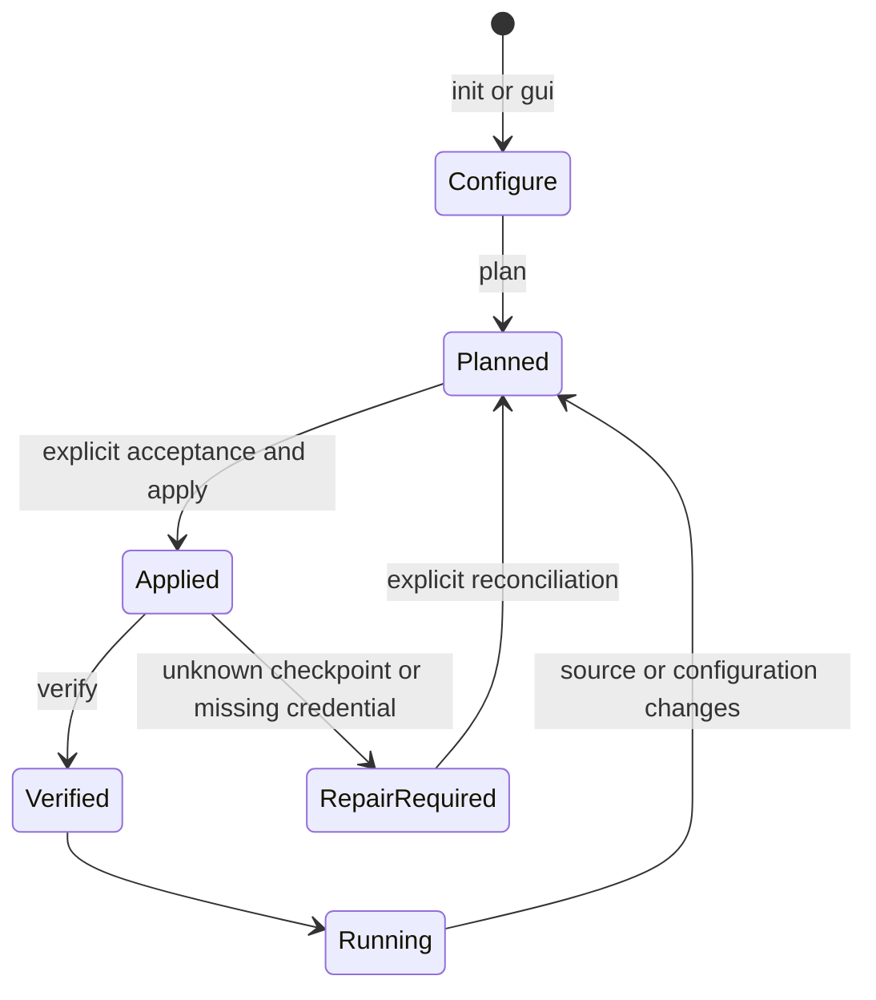
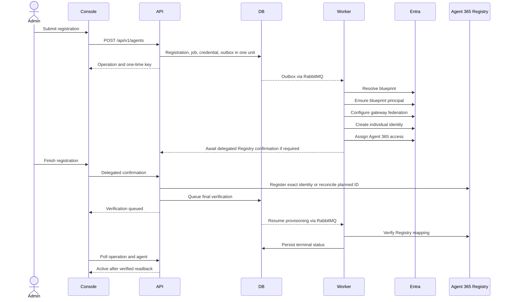
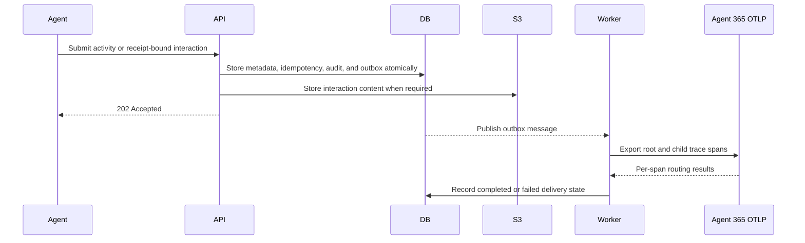

# A365 Custom Gateway Technical Specification

**Document status:** normative description of the implemented release
**Repository:** `patrick-shim/a365-custom-gateway`
**Deployment profile:** `runtime`
**Primary host profile:** Windows x86-64 with Docker Linux containers

## 1. Purpose

A365 Custom Gateway is an identity, protection, observability, and administration
layer for independently hosted AI agents. It does not host the agent's language
model or tools. It gives each external agent an individual Microsoft Entra agent
identity, a Microsoft Agent 365 registration, and a gateway credential, then
enforces configured protection before the external agent calls its model.

The system integrates five boundaries:

1. **External agent ingress** for prompt evaluation, interaction submission, and
   activity submission.
2. **Gateway control plane** for registration, lifecycle, credentials, feature
   configuration, Purview assignment, and audit history.
3. **Microsoft identity and Agent 365** for individual identities, Registry state,
   activity, and observability.
4. **Protection providers** for Prompt Shields and Purview DLP.
5. **Local runtime infrastructure** for durable state, queues, content, and secret
   storage during development and evaluation.

This specification describes what the checked-in release must do. Detailed
controller and DTO definitions remain authoritative for wire contracts, and the
generated OpenAPI document remains authoritative for machine-readable schemas.

## 2. Product principles

- Every agent registration has its own gateway admission credential and its own
  individual Entra agent identity.
- A shared blueprint organizes identities but is never a substitute for the
  individual identity in Purview policy scope or runtime evaluation.
- Prompt protection runs before a model call. Required protection fails closed.
- Purview policy owners author policies. Gateway administrators only discover,
  select, and apply existing compatible policies.
- A queued request, successful scope mutation, observed allow/block result, and
  downstream Microsoft visibility are separate states and must be reported as
  such.
- Setup is plan-based, source-bound, idempotent where reconciliation is safe, and
  conservative around credentials or unknown cloud outcomes.
- Terminal and graphical setup expose the same capabilities through one engine.
- Secrets are returned or displayed only where required and are never committed.

## 3. Scope

### 3.1 Included

- Entra Gateway API and Console application registrations.
- Reusable Entra Agent ID blueprint selection or gateway-owned seed blueprint.
- Per-agent identity creation and Agent 365 Registry confirmation.
- Per-agent gateway API key issuance, validation, listing, and revocation.
- Agent enable, disable, and permanent deregistration workflows.
- Per-agent Prompt Shields settings and inline evaluation.
- Signed discovery of existing compatible Purview DLP policies.
- Reviewed assignment of an existing policy to an exact agent identity.
- Runtime Purview scope computation and `processContent` evaluation.
- Agent activity and AI interaction ingestion.
- Agent 365 direct OpenTelemetry export.
- PostgreSQL state, transactional outbox, RabbitMQ provisioning work, and
  S3-compatible interaction content.
- React administrator Console, React setup interface, terminal setup, generated
  OpenAPI, diagnostics, and regression checks.

### 3.2 Excluded

- Hosting or invoking the external agent's production language model.
- Creating or editing Purview policies, rules, classifiers, sensitive information
  types, thresholds, actions, or exclusions.
- Assuming that policy assignment alone proves enforcement.
- Deleting Entra agent identities, shared blueprints, Purview policies, or audit
  history during gateway deregistration.
- Claiming production readiness for the local Compose topology or the development-
  gated Agent 365 Registry preview.
- A self-contained Linux or cloud Purview management connector in this release.
- Automatically implementing plans marked deferred, including
  `docs/spec/purview-connector-vnext.md`.

## 4. Personas and authority

| Persona | Authority |
| --- | --- |
| Purview policy administrator | Authors and approves Purview policy content and organization-wide governance choices. |
| Gateway Administrator | Registers and deletes agents, confirms Registry operations, configures protection, assigns existing policies, manages credentials, and changes system configuration. |
| Gateway Operator | Performs supported operational and agent state actions that do not require administrator-only authority. |
| Gateway Auditor | Reads supported configuration, activity, and audit evidence. |
| Gateway Support Reader | Reads the limited control-plane surfaces allowed by policy. |
| External agent | Uses only the registration-bound agent ingress credential and endpoints. |

Gateway authorization roles are `Gateway.Administrator`, `Gateway.Operator`,
`Gateway.Auditor`, and `Gateway.SupportReader`. Agent 365 Registry confirmation
also requires a delegated administrator user context with `access_as_user` and the
configured Graph AgentRegistration delegated permissions.

## 5. System context


## 6. Runtime components

| Component | Implementation | Responsibility |
| --- | --- | --- |
| Gateway API | ASP.NET Core 10 | Authentication, authorization, HTTP contracts, orchestration, protection gate, health, and OpenAPI |
| Application layer | .NET 10 | Commands, queries, validators, retry and use-case rules |
| Domain layer | .NET 10 | Entities, enums, interfaces, state transitions, and invariants |
| Infrastructure layer | EF Core/PostgreSQL, RabbitMQ, S3 | Persistence, credential verification, outbox, queue, and interaction content |
| Provisioning worker | .NET 10 | Ordered asynchronous identity and Registry workflow |
| Agent 365 adapter | .NET 10 | Blueprint discovery, identity provisioning, Registry clients, token exchange, and OTLP export |
| Purview adapter | .NET 10 | Runtime Graph evaluation plus signed catalog and assignment protocol |
| Content Safety adapter | .NET 10 | Prompt Shields request and result translation |
| Purview catalog host | .NET 10 Windows executable | Certificate authentication, policy reads, exact-scope mutation, readback, and signed publication |
| Console | React 18, TypeScript, Fluent UI, React Query | Administrator experience and simulator |
| Setup UI | React 18 plus local .NET host | Graphical front end for the shared bootstrap engine |
| Bootstrap engine | PowerShell 7 modules | Configuration, planning, ownership, provisioning, build, lifecycle, and verification |

## 7. Deployment topology

The default Compose project contains seven services:

| Service | Image or build | Default host binding | Restart policy |
| --- | --- | --- | --- |
| `postgres` | `postgres:16-alpine` | `127.0.0.1:5432` | `unless-stopped` |
| `rabbitmq` | `rabbitmq:3.13-management-alpine` | `127.0.0.1:5672`, `127.0.0.1:15672` | `unless-stopped` |
| `s3` | `zenko/cloudserver:latest` | `127.0.0.1:9000` | `unless-stopped` |
| `vault` | `hashicorp/vault:1.17` in development mode | `127.0.0.1:8200` | `unless-stopped` |
| `api` | `a365-gateway-api:dev` by default | `127.0.0.1:5080` | `unless-stopped` |
| `worker` | `a365-gateway-worker:dev` by default | internal | `unless-stopped` |
| `console` | `a365-gateway-console:dev` by default | `127.0.0.1:5081` | `unless-stopped` |

PostgreSQL and the object store use named volumes. The API mounts the Purview
catalog read-only, the assignment transport read/write, and blueprint credentials
read-only. The worker mounts blueprint credentials for owned provisioning work.

The local topology deliberately uses loopback listeners and development service
credentials. The `vault` container is currently an unwired development auxiliary;
the application does not read secrets from it. Bootstrap instead writes ignored
host files and generated container environment values. A production deployment
must replace those assumptions with TLS, network controls, a durable secret
provider, backups, monitoring, and platform-specific workload supervision.

## 8. Bootstrap specification

### 8.1 Entry points

- Windows: `gateway.cmd`
- POSIX shells: `./gateway`
- Shared engine: `bootstrap/bootstrap.ps1`

Supported commands are `init`, `setup`, `gui`, `doctor`, `plan`, `apply`, `up`,
`status`, `verify`, `open`, and `diagnose`.

### 8.2 Configuration

The configuration schema is `bootstrap/config.schema.json`. The only supported
deployment profile is `runtime`. Configuration covers:

- tenant and subscription identifiers;
- environment, region, project name, and owned resource group;
- API and Console ports;
- seed blueprint and explicit Registry preview acknowledgement;
- reviewed Agent 365 manager application IDs;
- explicit Prompt Shields enablement, SKU, and cost/quota acknowledgement;
- explicit Purview enablement and authority acknowledgement.

The selected non-secret configuration is stored in ignored
`bootstrap/config.json`. Bootstrap state and credentials are stored under ignored
`.bootstrap/`. The generated Compose environment is ignored at
`deploy/runtime/.env.runtime`.

### 8.3 Lifecycle



Plans are bound to the exact configuration and source fingerprint. Existing owned
resources are read back before mutation. Bootstrap must not silently rotate a
missing credential, adopt an unrelated resource, or claim success from a persisted
checkpoint alone. Concurrent installers for the same checkout are blocked.

There is no general destroy command. Destructive tenant cleanup requires an
explicit, separately reviewed operation with exact ownership evidence.

### 8.4 Interface parity

Terminal and React setup must expose the same fields, validation, plan, actions,
progress, failure information, and final verification. The browser UI does not
implement cloud provisioning; its local host invokes the shared PowerShell engine
with a one-time session and request validation.

## 9. Identity and authentication

### 9.1 Control plane

The Console signs users in through Microsoft Entra ID. The API validates an access
token issued for the Gateway API audience and applies endpoint-specific Gateway
roles. Administrative access tokens are never accepted as agent credentials.

### 9.2 Agent ingress

The gateway issues a clear agent key once. Only a verifier and metadata are stored.
The client sends the key in `Authorization: Bearer <key>`. Successful validation
creates claims for the registration ID, external agent ID, credential ID, and
`ExternalAgent` role. Disabled, deleting, deleted, expired, or revoked admission
must be rejected.

### 9.3 Microsoft workloads

Provisioning and runtime Microsoft calls use purpose-specific identities and token
providers. Blueprint credentials are keyed by blueprint application ID. Token
caches for Graph protection calls and Agent 365 observability are separate. The
Purview management application and certificate are distinct from per-agent runtime
identity.

## 10. Agent lifecycle

### 10.1 Registration states

`Draft`, `Provisioning`, `AwaitingAdminApproval`, `Active`, `Disabled`, `Failed`,
`Deleting`, `Deleted`, and `RequiresManualIntervention`.

### 10.2 Provisioning workflow



The seven reported steps are: resolve/prepare blueprint, enable/ensure blueprint
principal, connect/configure gateway federation, create agent identity, assign
Agent 365 access, add to Registry, and verify the connection. The Console must
poll an incomplete operation and render terminal success or failure without a
manual refresh.

### 10.3 Disable and enable

Disable is a gateway admission action. It rejects new prompts, activities,
batches, and AI interactions and invalidates outstanding protection receipts.
It does not disable the Entra identity, change Agent 365 Registry state, or mutate
Purview. Enable restores admission for a valid Disabled registration.

### 10.4 Permanent deregistration

Permanent deregistration requires administrator authority, an exact row version,
an explicit confirmation flag, and verified identity/Registry mapping. The API
transitions the registration to `Deleting`, denies new ingress, deletes the exact
Agent 365 Registry entry, and reads back its absence before final local removal.
Unknown outcomes remain visible for reconciliation. Entra identities, blueprints,
Purview policies, local tombstones, and audit history are retained.

## 11. Protection model

### 11.1 Pre-model gate

`POST /api/v1/prompts:evaluate` is the mandatory protection boundary for a model
call. It evaluates the exact prompt and user context under the authenticated agent
registration. Prompt Shields and Purview are separate decisions.

An allowed result includes a short-lived receipt. The receipt binds:

- agent registration and individual Agent 365 identity;
- external interaction ID;
- salted prompt hash;
- tenant user object ID;
- occurrence time;
- protection revision and effective settings;
- current Purview assignment evidence.

A blocked result returns no receipt. Unavailable required protection returns a
service error and no receipt. The agent must not call its model in either case.

`POST /api/v1/ai-interactions` must validate and atomically consume the receipt.
Agent, interaction, prompt, user, time, policy evidence, expiration, replay, or
protection-state mismatches fail.

### 11.2 Prompt Shields

Prompt Shields is independently configurable per agent and backed by Azure AI
Content Safety when enabled. The feature setting does not enable or disable the
agent itself. Required service failure fails closed. The decision and sanitized
telemetry are recorded without placing raw secrets in logs.

### 11.3 Purview management plane

Bootstrap provisions a dedicated Entra management application and Windows
certificate, grants the required Purview DLP management role, and verifies
unattended access. The certificate private key stays with the configured Windows
user.

The catalog host:

- reads existing policies and application rules;
- verifies it connected to the configured tenant;
- produces a bounded, atomic catalog snapshot;
- signs the snapshot with a domain-separated RSA signature;
- processes authenticated, expiring assignment requests;
- adds only the reviewed individual agent target;
- preserves existing inclusions, exclusions, rules, and mode;
- reads the scope back before publishing a signed result.

The API pins the public certificate and validates tenant, signature, schema,
freshness, unique IDs, and policy revision. Missing, invalid, stale, wrong-tenant,
or unavailable data is an error, never a successful empty catalog.

The Windows scheduled task starts a bounded host invocation at user sign-in and
every five minutes. Overlapping runs are ignored. Each provider invocation has a
six-minute deadline; reviewed assignment confirmation has a fifteen-minute window.
Unknown mutation outcomes never authorize an automatic duplicate mutation.

### 11.4 Purview assignment

An administrator reviews `{policyId, revision}` for one active agent. Confirmation
binds the administrator, tenant, agent registration, individual identity,
blueprint relationship, current protection revision, policy, and canonical
provider revision. The assignment transport uses authenticated request and result
domains. A provider revision change requires a new review.

Assignment states distinguish review, application, readback confirmation, runtime
readiness, observed allow, observed DLP block, conflict, and failure. The UI must
not attribute a decision to one policy when other applicable policies may exist.

### 11.5 Purview runtime plane

The API uses the exact individual agent's workload identity to compute protection
scope and call Microsoft Graph `processContent`. Scope and token caches include
the relevant agent, user, and blueprint boundaries. A shared blueprint must not
replace the child identity. Runtime evaluation remains inline and independent of
the management host process lifetime once valid configuration and policy evidence
exist.

## 12. Activity, interaction, and observability flow



An HTTP `202` means the gateway durably accepted work. It does not prove arrival
in Agent 365, Purview AI Explorer, or Defender. Direct OTLP success requires both
an acceptable HTTP response and per-span routing evidence. The root operation is
`invoke_agent`; supported child operations include `chat`, `execute_tool`, and
`output_messages` with one trace hierarchy and conversation ID.

The gateway's Agent 365 export redacts prompt and response bodies. Hunting pivots
are agent application ID, agent name, conversation/session ID, timestamps, action
type, channel, and source. Correlation identifiers remain useful inside gateway
operations even when a downstream surface does not expose them.

## 13. Persistence and consistency

PostgreSQL stores:

- agent registrations and feature configuration;
- ingress credential verifiers and metadata;
- provisioning jobs and ordered step results;
- activity receipts and AI interaction metadata;
- prompt evaluation receipts and Purview decisions;
- immutable assignment reviews and operation status;
- system configuration and mutation reviews;
- audit events, idempotency records, and outbox messages.

Interaction content may be stored in the S3-compatible object store and referenced
by URI rather than placed in relational rows. PostgreSQL concurrency tokens guard
reviewed updates. Protection revisions invalidate stale receipts and reviews.
Idempotency records bind a key to the canonical request hash and prevent a key
from authorizing different content.

The transactional outbox is written with business state. The relay publishes to
RabbitMQ with confirmations. Workers must tolerate redelivery and reconcile
provider state before repeating an operation with external side effects.

## 14. HTTP API

### 14.1 Authentication schemes

| Scheme | Credential | Endpoints |
| --- | --- | --- |
| `EntraBearer` | Entra access token for Gateway API audience | Control-plane and management routes |
| `AgentKey` | Gateway-issued registration-bound secret | Runtime agent routes |

Both use the `Authorization: Bearer` header. The OpenAPI operation security
requirement distinguishes them.

### 14.2 Control-plane routes

| Method and route | Purpose |
| --- | --- |
| `GET /api/v1/agent-identity-blueprints` | List selectable blueprints |
| `POST /api/v1/agents` | Create registration, operation, and one-time key |
| `GET /api/v1/agents` | Search and cursor-paginate registrations |
| `GET /api/v1/agents/{id}` | Read agent and protection state |
| `PATCH /api/v1/agents/{id}/features` | Review and update feature settings |
| `POST /api/v1/agents/{id}:enable` | Restore gateway admission |
| `POST /api/v1/agents/{id}:disable` | Block gateway admission |
| `DELETE /api/v1/agents/{id}` | Confirm permanent deregistration |
| `POST /api/v1/agents/{id}:retry-provisioning` | Retry an eligible failed workflow |
| `GET /api/v1/agents/{id}/credentials` | List credential metadata |
| `POST /api/v1/agents/{id}/credentials` | Issue a new one-time key |
| `DELETE /api/v1/agents/{id}/credentials/{credentialId}` | Revoke a key |
| `GET /api/v1/agents/{id}/audit-events` | Read agent audit history |
| `GET /api/v1/agents/{id}/provisioning-history` | Read provisioning history |
| `GET /api/v1/operations/{id}` | Read authoritative operation status |
| `POST /api/v1/operations/{id}:complete-agent365-registration` | Complete delegated Registry confirmation |
| `GET /api/v1/system/config` | Read supported system settings |
| `PATCH /api/v1/system/config` | Review and update supported system settings |

### 14.3 Purview routes

| Method and route | Purpose |
| --- | --- |
| `GET /api/v1/protection/purview/policies` | Read the verified existing-policy catalog |
| `GET /api/v1/agents/{id}/purview-policies` | Read assignment and enforcement evidence |
| `POST /api/v1/agents/{id}/purview-policies/review` | Create an immutable assignment review |
| `POST /api/v1/agents/{id}/purview-policies/{operationId}/confirm` | Confirm the reviewed assignment |

There is no current API for initial Purview connection, policy authoring, scope
removal, or classifier/SIT management.

### 14.4 Agent ingress routes

| Method and route | Purpose |
| --- | --- |
| `GET /api/v1/agent-runtime/readiness` | Read authenticated runtime readiness |
| `POST /api/v1/prompts:evaluate` | Execute the pre-model protection gate |
| `POST /api/v1/ai-interactions` | Submit a receipt-bound interaction |
| `POST /api/v1/agent-activities` | Submit one activity |
| `POST /api/v1/agent-activities:batch` | Submit an activity batch |

### 14.5 Service and documentation routes

- `GET /health` for liveness.
- `GET /health/ready` for readiness including database access.
- `GET /health/checks` for framework health output.
- `/docs` redirects to the Scalar interactive reference.
- `/openapi/v1.json` and `/openapi/v1.yaml` expose the generated schema.

### 14.6 Protocol rules

- Mutation endpoints use the documented UUID v4 `Idempotency-Key`.
- Reviewed protection mutations use `If-Match` and exact row-version fields.
- An idempotency key is reused only for a retry of the identical request.
- Errors use `application/problem+json` with a stable error code and correlation
  ID where available.
- One-time credentials use no-store responses and are never returned again.
- Request limits and ingress rate limits are enforced before use-case execution.
- Public schema access does not bypass endpoint authentication.

The checked-in `docs/api/openapi.yaml` must match the schema generated by the
running API after contract changes.

## 15. Console requirements

The Console must provide:

- Entra sign-in and role-aware navigation;
- dashboard health without representing health as enforcement proof;
- searchable agent list with status, Prompt Shields state, test action, and last
  activity;
- registration flow with automatic status polling and terminal feedback;
- detail tabs for Prompt Shields, Data protection, Identity, API key, Activity,
  and Test Agent;
- policy catalog and per-agent assignment with explicit progress and failure;
- Purview connection diagnostics;
- bulk Manage Agents actions for Disable, Enable, and confirmed deletion;
- persistent light/dark theme;
- responsive layouts without unbounded page growth or duplicate polling output;
- accessible labels, keyboard operation, visible focus, and reduced-motion-safe
  animation.

The Test Agent drawer fixes the selected external agent ID, keeps the pasted key
in component memory only, clears it on send/close, and calls the real prompt,
activity, and interaction endpoints. Allowed requests use a clearly labeled
simulated response; no model is invoked. Results distinguish allowed, blocked,
failed, partial, and unconfirmed downstream processing.

## 16. Reliability and failure semantics

- Docker services restart with Docker under `unless-stopped`.
- Database, broker, and object-store dependencies have health checks.
- Outbox state survives API failure between database commit and publish.
- Provider requests have bounded timeouts and cancellation.
- Unavailable required protection fails closed.
- Stale or invalid Purview catalogs are errors, never empty success.
- Unknown Registry or assignment mutation outcomes remain reconcilable and are
  not blindly retried.
- Console polling stops at terminal state and never appends duplicate status UI.
- Health, provisioning, policy assignment, enforcement, export, and destination
  visibility are reported independently.
- A host reboot requires Docker to start and the Purview certificate-owning
  Windows user to sign in for recurring catalog refreshes.

## 17. Security and privacy requirements

- Never log or commit agent keys, client secrets, private certificates, access or
  refresh tokens, assignment transport keys, raw prompt bodies, or user content.
- Use exact tenant, application, blueprint, identity, and policy identifiers at
  every external mutation boundary.
- Validate ownership before modifying cloud resources.
- Apply least-privilege Gateway roles and keep control-plane and agent credentials
  separate.
- Store only salted prompt hashes in protection receipts.
- Keep Purview management private keys outside Linux containers and PostgreSQL.
- Sign catalog snapshots and authenticate assignment request/result envelopes with
  separate domains.
- Reject wrong-tenant, stale, replayed, mismatched, or expired evidence.
- Sanitize diagnostics and keep clear credentials out of support bundles.
- Bind non-development deployments to HTTPS and use a durable production secret
  provider.

## 18. Expected outcomes and acceptance criteria

A release is complete only when the applicable checks demonstrate:

1. A clean terminal and graphical setup produce the same reviewed deployment.
2. Docker build and startup succeed and all required services become healthy.
3. Console authentication and Gateway role authorization work.
4. A new agent completes all seven provisioning steps and becomes Active without
   requiring a manual page refresh.
5. A one-time agent key authenticates only its registered agent.
6. Disable blocks that agent at gateway ingress and Enable restores it without
   changing Agent 365 or Entra state.
7. Permanent deregistration removes the verified Registry entry and retains the
   documented identities, policies, tombstone, and audit evidence.
8. Prompt Shields can be enabled and disabled independently and produces the
   expected allow/block behavior.
9. Existing Purview policies appear from a current signed catalog without the
   gateway creating policy content.
10. A reviewed policy assignment targets one individual agent identity, preserves
    unrelated scope, and is confirmed by readback.
11. A normal prompt is allowed, a matching synthetic-sensitive prompt is blocked,
    and a same-blueprint sibling is tested independently.
12. Allowed receipt-bound interactions and activities are durably accepted and
    processed.
13. Agent 365 observability export reports per-span routing success and can be
    found by agent application ID after downstream ingestion delay.
14. Docker restart restores the Compose services and host sign-in resumes the
    recurring Purview catalog task.
15. Generated OpenAPI, checked-in OpenAPI, README, this specification, and detailed
    architecture documents agree with the implementation.

## 19. Repository structure

```text
.
├── gateway / gateway.cmd           Cross-platform and Windows entry points
├── Gateway.slnx                    Root .NET solution
├── global.json                     Pinned .NET SDK band
├── bootstrap/                      Shared setup engine, schema, modules, tests
├── deploy/runtime/                 Docker Compose topology and runtime template
├── infrastructure/bicep/           Optional Content Safety provisioning
├── operations/                     Operational boundaries and runbooks
├── src/
│   ├── ExternalAgent.Sample/       Model-stub integration sample
│   ├── Gateway.Api/                HTTP host and OpenAPI
│   ├── Gateway.Application/        Use cases and validation
│   ├── Gateway.Domain/             Entities and invariants
│   ├── Gateway.Contracts/          Public DTOs, requests, and responses
│   ├── Gateway.Infrastructure/     Persistence, queue, storage, credentials
│   ├── Gateway.Agent365/           Entra/Agent 365 adapters
│   ├── Gateway.Purview/            Purview runtime and transport
│   ├── Gateway.ContentSafety/      Prompt Shields adapter
│   ├── Gateway.Observability/      Gateway service telemetry
│   ├── Gateway.Provisioning.Worker/ Async provisioning worker
│   └── Gateway.Purview.CatalogHost/ Windows management host
├── web/
│   ├── console/                    React administrator Console
│   └── setup/                      React bootstrap UI
├── tools/
│   ├── Gateway.Setup/              Local setup host
│   └── scripts/                    Setup, diagnostics, maintenance
├── tests/                          Regression and opt-in integration programs
└── docs/                           API, architecture, Console, runtime, plans
```

Generated or deployment-specific paths such as `.bootstrap/`, `bin/`, `obj/`,
`node_modules/`, coverage output, `bootstrap/config.json`, and
`deploy/runtime/.env.runtime` are not source and must remain ignored.

## 20. Validation requirements

At minimum, relevant changes run:

```powershell
dotnet build Gateway.slnx
pwsh -NoProfile -File tools/scripts/maintenance/Test-RepositoryLayout.ps1
npm --prefix web/console run check:reachability
npm --prefix web/console run typecheck
npm --prefix web/console test
npm --prefix web/setup test
```

Use the executable .NET regression programs and bootstrap tests listed in
`tests/README.md` for the affected area. Integration tests require explicit
environment variables and isolated resources. Missing prerequisites produce a
skip, not a false pass. Live Purview enforcement uses the explicitly gated
`tools/scripts/diagnostics/Test-GatewayAgentDlp.ps1` probe.

## 21. Current constraints and deferred work

- Purview catalog and assignment management depends on a Windows scheduled task,
  its certificate-owning user, and that user's sign-in.
- The local Compose stack is not a hardened production deployment.
- Agent 365 Registry preview requires explicit development acknowledgement.
- Microsoft service ingestion is asynchronous; local acceptance is not immediate
  destination visibility.
- Purview scope can be influenced by other applicable policies, so a single
  assignment cannot be treated as exclusive causality.
- The approved future-release direction and development milestones are documented
  in `SPEC-VNEXT.md` and remain on hold until explicitly requested.

## 22. Supporting documents

- `docs/api/api-contract.md` — human-readable API behavior
- `docs/api/openapi.yaml` — checked-in machine-readable contract
- `docs/architecture/system-architecture.md` — component boundaries
- `docs/architecture/data-model.md` — persistence design
- `docs/architecture/protection-configuration.md` — concurrency and review rules
- `docs/architecture/purview-policy-consumption.md` — policy ownership and scope
- `docs/architecture/purview-catalog-host.md` — Windows catalog/assignment host
- `docs/runtime/README.md` — operating and recovery guidance
- `bootstrap/README.md` — setup behavior
- `tests/README.md` — validation matrix
- `SPEC-VNEXT.md` — approved future specification and milestone plan
- `AGENTS.md` — implementation governance for contributors and coding agents
