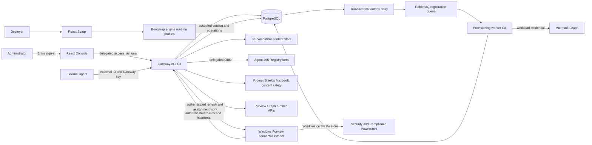

# A365 Custom Gateway architecture

## Purview responsibilities

The [policy-consumption decision](purview-policy-consumption.md) describes catalog and assignment behavior.
Purview policy owners manage SITs/classifiers, rules, thresholds, actions, and
modes. Gateway administrators select existing compatible policies from Purview
and apply them to the exact individual agent identity, preserving all unrelated
targets and exclusions. Never silently broaden an agent choice to its blueprint.

Console structure: Data protection → Policies; each agent has a Data protection
tab; Settings contains Gateway settings and the persisted Purview connection,
Connect, and Policy Refresh experience. Tenant provisioning and management-
credential verification belong in bootstrap. Management
PowerShell access and runtime Graph processContent permissions are separate.
The gateway exposes prompts:evaluate and calls Purview; Purview does not call a
gateway processContent endpoint. Classifier/policy-rule editing stays in Purview.

Policies come from the existing Purview catalog and assignments target individual
agent identities. Assignment, synchronization, verified enforcement, and failures remain
separate states. Completion requires normal allow and synthetic sensitive block
through the gateway API plus a same-blueprint sibling isolation check. Follow the
decision document for current implementation and evidence; plans are not proof.

How the system is built. For **why** it exists, scope, UI platform, and
**runtime** requirements, see the [product brief](../spec/product-brief.md).

## Objective (architecture view)

The Gateway is a control plane that connects independently hosted agents to
**Entra, Graph, Agent 365, Purview, and Prompt Shields**. Each registration binds:

- an external agent ID supplied at registration;
- a reusable Agent Identity blueprint;
- a distinct child Entra Agent ID;
- a Gateway credential lifecycle.

External agents keep hosting and model calls. The Gateway owns registration,
ingress credentials, evaluate/ingest receipts, durable provisioning, and
Purview / Prompt Shields administration.

The tested local deployment uses standard containerized data services rather than
Azure SQL, Service Bus, Key Vault, Container Apps, ACR, or Blob. Microsoft product
APIs remain required for the gateway's identity, governance and observability work.

This guide describes the Docker Compose runtime.

## Current runtime infrastructure

| Concern | Implemented technology | Role |
|---|---|---|
| Relational state | **PostgreSQL** | Authoritative Gateway state (EF Core) |
| Messaging | **RabbitMQ** | Provisioning and activity work after transactional outbox |
| Deployment secrets | Ignored host files plus generated Compose environment | Current local-development credential delivery |
| Content store | **S3-compatible** Zenko CloudServer | Protected interaction content |
| Compute | **Docker Compose** | API, worker and Console; local Windows Purview catalog host |
| Images | Local OCI-compatible images | Bootstrap-built API, worker and Console images |
| Telemetry | Agent 365 OTLP; optional Azure Monitor | Sanitized spans and activity export according to agent configuration |
| Ingress | Loopback HTTP by default; configurable trusted proxy networks | Local access and forwarded-scheme validation |

The base Compose file also starts HashiCorp Vault 1.17 in development mode. No
application service currently uses a Vault client, and OpenBao, Kubernetes and
cloud-host deployment manifests are not implemented in this repository.

### Essential Microsoft product services (not infrastructure)

| Integration | Why it is essential |
|---|---|
| Entra ID / MSAL | Operator sign-in and API authorization |
| Microsoft Graph + Agent 365 Registry | Identity blueprints, child Agent IDs, Registry |
| Agent 365 observability | Default sanitized activity export |
| Purview + runtime connector listener | Explicit existing-policy discovery, exact agent assignment and runtime evidence |
| Prompt Shields | Pre-model prompt-attack evaluation |

These are SaaS/API dependencies for the product's purpose. The current database,
message bus, object store and application processes run in local Compose.

## System context

## Identity and authority

One Gateway manages many registrations; a blueprint can be shared. Each
registration has its own child identity and ingress key. External callers present
the Gateway key and external ID; they do not choose a cloud managed identity.

| Actor | Authentication and boundary |
|---|---|
| Administrator in hosted UI | Entra OpenID Connect; API enforces delegated scope, tenant, user, role |
| API to Registry | User-only on-behalf-of token with reviewed Registry scopes |
| Worker to Graph | Bootstrap-provisioned application credential with reviewed role allowlist |
| External agent | Gateway credential bound to one registration |
| API to Prompt Shields | Workload credential to the configured provider |
| Purview runtime | Individual agent token obtained through its own blueprint credential |
| API to connector listener | Authenticated files bound to tenant, connector, operation, generation, request, action, and deadline; assignment files additionally bind exact agent, policy, and review |
| Catalog host to compliance | Dedicated certificate in the bootstrap account Windows certificate store |

Gateway keys are ingress credentials. Clear value returned once; storage keeps a
salted verifier. UI role visibility never replaces API authorization.

The API admits forwarded scheme information only from reviewed trusted proxy
networks (`GatewayIngress:TrustedProxyNetworks`), before authentication. Empty
lists trust no forwarded scheme; direct HTTPS remains supported. See the
[HTTPS ingress contract](../api/api-contract.md#https-ingress).

### UI clients

React Console is the deployed administrator UI. React Setup and the terminal
installer use the same runtime bootstrap engine. Both setup interfaces share the same engine.

## Deployment and lifecycle

Bootstrap implements Plan, Apply/Up, and Verify for runtime Docker Compose.
The React installer and terminal share one configuration and execution engine.
Known interrupted checkpoints are reconciled through exact ownership readback;
Prompt Shields and Purview remain
independently selectable. Initial connection settings and product provisioning
belong in bootstrap; local connector verification, Policy Refresh, and existing-
policy selection belong in the Console. Page/GET access and idle or restart
recovery do not create a new provider operation; recovery may resume an already
accepted, unexpired operation.

Registration and protection remain separate lifecycles:

1. Persist the registration, provisioning job and outbox work.
2. Resolve or create the reusable blueprint and principal, configure federation,
   create the child identity, assign observability access.
3. Pause for the signed-in Administrator's delegated Registry completion.
4. Reverify identity, federation, observability and token mapping before Active.
5. Configure optional protection through reviewed application operations.

The seven persisted registration stages stay independent of protection
administration. The worker never creates a Registry registration. Before its one
delegated POST, the API persists a creator-bound planned Registry ID. Unknown
outcomes permit exact-ID readback only. Registry acceptance queues final
verification rather than repeating creation.

Registry beta remains a gated development capability; staging and production
admission stay closed.

Bootstrap and maintenance authorize different lifecycles. Neither may adopt a
deliberately deleted environment by editing checkpoint fields.

## Registration and individual-agent protection

Registration creates the agent identity and Registry entry. Administrators select
existing Purview policies separately on the agent's Data protection tab. Assignment
targets the individual agent identity, never its blueprint. Policy definitions and
classifiers are authored in Purview. Initial tenant setup belongs in bootstrap;
ongoing connector verification, manual refresh, and diagnostics belong in
Settings.

Only individual policy assignments are stored. Assignment, synchronization and verified
enforcement remain distinct. See the [protection guide](protection-configuration.md).

## Data plane and prompt receipts

The API authenticates the Gateway credential before trusting the external ID.
Registration-scoped idempotency and database locks protect repeated submissions.
Approved interaction content goes to the configured **S3-compatible** content
store; observability and queue records contain sanitized metadata only.

Prompt evaluation before the model, allow-receipt binding, single-use consumption,
and fail-closed enforcement semantics are unchanged. Simulation does not claim
enforcement; offline processing cannot establish response-side blocking.

## Durability and operational boundaries

**PostgreSQL** owns Gateway state. State transitions and dispatch records
use a transactional outbox. Logical queues remain:

- registration: `gateway-provisioning-v3`

Transport is **RabbitMQ**; consumers stay duplicate-safe and recover
uncertain provider outcomes by exact readback.

The local Purview connector uses a separate authenticated filesystem transport
because its certificate remains in the Windows user's certificate store. The API
persists Connect/RefreshCatalog operations before publishing commands, accepts
only exactly bound results, and stores verified catalog snapshots in PostgreSQL.
The transport is not catalog authority and its accepted command/result files are
removed only after an authenticated host checkpoint covers the durable terminal
operation.

Approved runtime sample tests keep ephemeral raw samples; durable operations keep
consent hashes and sanitized outcomes.

Telemetry has a narrower delivery guarantee than the outbox. Agent 365 OTLP or
optional Azure Monitor emission does not by itself prove visibility in every
Microsoft 365, Purview or Defender destination.

Runtime maintenance uses the [runtime rebuild instructions](../runtime/README.md#rebuild-after-code-changes).

## Current management and ingestion boundaries

Agent listing uses cursor pagination and server-side filters. Role checks remain
server-side. The public activity contract includes `Custom`, while the Agent 365
exporter maps only its supported operation types. Provider acceptance does not
prove downstream destination visibility.

## Security invariants

- Workload credentials and delegated Entra access are least-privilege.
- Delegated Administrator-only Registry completion with one POST per lineage.
- Reviewed confirmation, concurrency, and exact scope checks for shared policy.
- No clear credentials, tokens, or raw content in logs, queues, or operational receipts.
- Clear credentials and private keys remain in ignored bootstrap files, generated
  runtime configuration, or the Windows certificate store; they never belong in
  source control or application images. A production secret provider is deferred.
- Safe RFC 9457 errors and correlation IDs.
- Fail-closed enforcement when required runtime provider proof is missing or
  invalid. An aged display catalog blocks new assignment review/confirmation but
  does not by itself expire a durable confirmed binding.
- The tested local baseline does not require Azure PaaS for its database, bus,
  object store or compute.

See the [data model](data-model.md), [API contract](../api/api-contract.md),
[provider contracts](microsoft-capabilities.md) and
[Runtime catalog host](purview-catalog-host.md).
