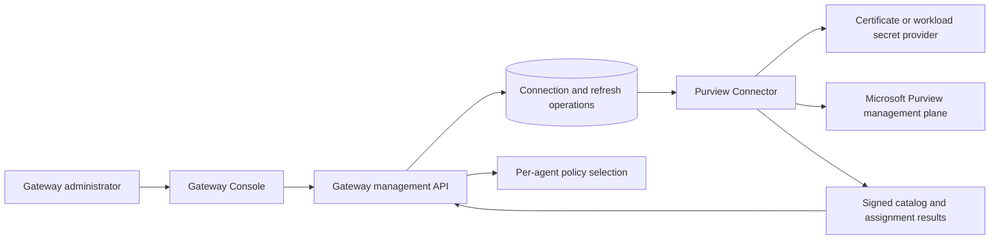

# Purview Connector vNext

**Status:** Approved direction; implementation deferred to the next version increment.

This focused connector design supports the authoritative future-release
specification and milestone plan in [`../../SPEC-VNEXT.md`](../../SPEC-VNEXT.md).
Where the two documents differ, the root vNext specification governs.

## Objective

Replace the current host-bound Windows scheduled-task dependency with an explicit
Purview Connector lifecycle that bootstrap installs and the Gateway Console
operates. The connector discovers existing Purview DLP policies and
applies reviewed policy targets to individual agent identities. It does not
author policies, rules, classifiers, sensitive information types or exclusions.

The release must support the current local Windows deployment and establish a
clean path to remote cloud hosting without changing the per-agent policy model.

## Product experience

Data Protection will include a Purview connection card with a short explanation:

> Connect the gateway to Microsoft Purview to retrieve the existing DLP policy
> catalog and manage reviewed per-agent policy assignments.

The primary action and status will follow this lifecycle:

| State | Primary action | Meaning |
| --- | --- | --- |
| Not configured | **Connect to Purview** | No verified management connection exists. |
| Connecting | Disabled progress action | The gateway is validating permissions and retrieving the first catalog. |
| Connected | **Refresh catalog** | A recent signed, tenant-bound catalog is available. |
| Refreshing | Disabled progress action | An asynchronous catalog refresh is running. |
| Degraded | **Try refresh** | A previous catalog exists, but the latest refresh failed or is approaching expiry. |
| Disconnected | **Reconnect** | Credentials, permissions or the connector runtime require repair. |

The card will show the tenant, connector location, last successful refresh,
next scheduled refresh, policy count and current error summary. Detailed errors
will use sanitized codes and correlation identifiers. Certificates, tokens and
raw provider responses will never be returned to the browser.

The policy catalog and per-agent assignment screens remain separate from the
connection control. Connecting enables discovery; it does not select or apply a
policy. Policy assignment continues to target the exact individual agent identity.

## Bootstrap responsibilities

Bootstrap will remain the authority for durable setup. Terminal and graphical
bootstrap must provide the same behavior:

1. Collect the Purview tenant, organization and deployment profile.
2. Provision or reconcile the dedicated Entra management application.
3. Provision certificate authentication and the minimum required Purview role.
4. Configure the deployment's secret provider without exposing private material
   to the Console or application database.
5. Install or deploy the Purview Connector runtime.
6. Start a first connection verification and catalog refresh.
7. Record connector identity, ownership and health metadata in bootstrap state.
8. Verify restart recovery before reporting setup complete.

Reconciliation must be idempotent. Missing credentials stop with a repair action;
bootstrap must not silently rotate credentials, adopt unrelated resources or
recreate Purview policies.

## Architecture

The Purview Connector is a management-plane component. Prompt evaluation remains
in the gateway API and must not wait for an interactive PowerShell session.

The connector will expose one implementation boundary for catalog reads and
assignment writes. The gateway will continue to validate the signed envelope,
tenant, catalog age, reviewed revision and individual target before accepting a
result. A successful connection or catalog read is not proof of DLP enforcement.

The management API will create durable asynchronous operations rather than
holding an HTTP request open while Microsoft services respond. Proposed endpoints:

| Method and route | Purpose |
| --- | --- |
| `GET /api/v1/protection/purview/connection` | Read authoritative connector status and freshness. |
| `POST /api/v1/protection/purview/connection` | Begin initial connection or repair using bootstrap-owned configuration. |
| `POST /api/v1/protection/purview/connection/refresh` | Request an immediate catalog refresh. |
| `GET /api/v1/operations/{operationId}` | Read connection or refresh progress and sanitized failure details. |

The final routes and schemas must be represented in OpenAPI before release.
Connection mutation requires the existing Gateway Administrator authorization
boundary and produces an audit record.

## Deployment profiles

### Local Windows

Bootstrap installs a bounded, supervised connector runner under the Windows
account that owns the certificate. The Console controls it through the management
API. Windows sign-in, task state, last execution result and catalog freshness are
reported as connector health instead of remaining hidden host requirements.

### Container-capable local or server deployment

A dedicated `purview-connector` service is preferred over embedding management
work in the API container. Container support is conditional on validating the
exact Microsoft Purview management commands, authentication mode and module
support on the target operating system. The current Windows certificate-store
implementation must not simply be copied into a Linux image.

### Remote cloud

Run the same connector contract as a managed worker or scheduled job. Private
credentials belong in the platform secret store, such as Azure Key Vault, and
must be injected only into the connector runtime. The API and connector exchange
authenticated operations and signed results over a durable transport. The cloud
profile must tolerate instance replacement and must not depend on an interactive
administrator session.

## Reliability and security requirements

- Run a bounded refresh immediately after connection and on a recurring schedule.
- Recover automatically after host, process, container and cloud-instance restarts.
- Keep the last successful catalog identifiable, but mark stale data clearly and
  block new assignments once the trusted freshness window expires.
- Never substitute an empty catalog or unverified cache for a failed provider read.
- Retry read-only catalog retrieval safely. Preserve the existing reviewed-request
  and authenticated-result protocol for assignment writes so unknown outcomes do
  not authorize duplicate mutations.
- Pin the publisher trust material and validate tenant, signature, age, schema and
  policy compatibility before use.
- Keep certificate private keys, tokens and assignment transport keys out of the
  browser, logs, support bundles and PostgreSQL application rows.
- Record connection, refresh, repair and assignment actions in the audit trail.

## Migration

The upgrade must detect and reuse an owned management application, certificate,
role group, policy catalog and current per-agent assignments. It must not recreate
Purview policies or change their rules. Bootstrap installs the new connector,
proves a successful signed refresh, switches the API to the new connector status,
and only then retires the former Windows task or process.

Existing agents and API keys remain valid. Assignment state remains bound to the
same agent identity and policy revision. Migration failure leaves the previous
working connector intact and reports a repairable operation.

## Delivery sequence

1. Define connector status, operation and health contracts in application code
   and OpenAPI.
2. Place the current Windows implementation behind the connector boundary and
   expose Connect, Refresh and diagnostics through the management API.
3. Add the Data Protection connection card and state-driven interaction.
4. Add bootstrap installation, reconciliation, upgrade and rollback behavior.
5. Validate a container-capable Microsoft management path, then implement the
   remote worker profile with platform secret storage.
6. Run local reboot, Docker restart, process termination and cloud instance
   replacement tests before enabling the new profile by default.

## Release acceptance

The version is complete when all of the following are demonstrated:

- A clean bootstrap reaches **Connected** without a separately launched terminal.
- Restarting the connector, Docker engine and host recovers catalog refreshes.
- A terminated connector is restarted and produces a new signed catalog before
  the current catalog expires.
- Connection and refresh progress is clear in the Console and never grows or
  remains animated after a terminal state.
- Existing Purview policies appear without creating or modifying policy content.
- A selected policy is assigned to one agent identity, blocks a matching test,
  and leaves a sibling agent outside the selected policy scope.
- Prompt Shields remains independently configurable and testable.
- An expired, wrong-tenant or invalidly signed catalog fails closed with a clear
  repair action.
- Local upgrade preserves agents, keys, assignments and owned cloud resources.
- The remote profile survives worker replacement without interactive sign-in.
- OpenAPI, bootstrap, runtime, architecture and operator documentation match the
  released behavior.

## Explicitly outside this increment

- Creating or editing Purview policies, rules, classifiers or sensitive
  information types.
- Changing the policy administrator's ownership of policy content.
- Treating catalog connectivity or assignment success as enforcement proof.
- Coupling Prompt Shields enablement to Purview connection state.

## Pickup instruction

Use the request **“Implement the Purview Connector vNext plan”** and reference
this document. Begin with the connector status and operation contracts, then
reconcile implementation decisions against current Microsoft Purview management
support before selecting the remote runtime.
