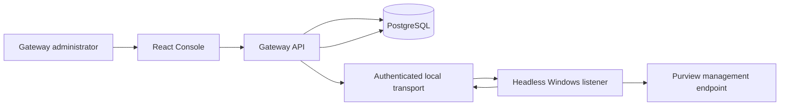

# Manual Purview Manual sync — Local Implementation Record

**Status:** local Windows implementation complete; Purview regression suites
passed; broader repository, live tenant, and restart acceptance not yet claimed

**Scope decision:** 2026-10-22, local M1–M5 implemented; server/cloud M6 remains
on hold until the operator explicitly releases it

**Current product specification:** [SPEC.md](../../SPEC.md)

**Remaining milestones and release gates:** [SPEC-VNEXT.md](../../SPEC-VNEXT.md)

## 1. Implemented outcome

Gateway administrators explicitly connect to Purview and request policy-catalog
refreshes from the Console. Initial bootstrap may retrieve and publish one verified
catalog. After setup, a full provider catalog read occurs only for an accepted
**Connect to Purview**, **Manual sync**, **Retry manual sync**, or
**Reconnect** operation.

Page load, browser focus, status polling, policy GET, listener heartbeat, elapsed
time, ordinary API restart, Docker restart, and listener startup do not create a
provider catalog read. Restart recovery may resume an already accepted operation
within its original deadline.

Policy authorship remains in Purview. The Gateway discovers existing compatible
policies and adds only a reviewed individual agent target. It does not create or
edit policies, rules, sensitive information types, classifiers, exclusions,
actions, or policy mode. The standalone policy-owner utility remains outside the
Gateway runtime and connector.

Runtime `processContent` evaluation is separate from catalog management. An aged
display catalog does not by itself stop an agent with a valid confirmed assignment
and required live runtime evidence. Required runtime protection still fails closed.

This current-release baseline distinguishes the signed catalog's internal
`definitionRevision` from its public whole-scope `revision`. Public `revision`
preserves the exact deployed legacy digest, including policy/rule provider
timestamps and legacy array behavior, and is submitted by the client for
stale-review/write protection. Internal `definitionRevision` excludes all
locations/targets, provider timestamps, and policy display name. It sorts only
known outer set-like collections and preserves unknown nested-array order. Adding
another individually reviewed identity changes public `revision`, but it does not
invalidate existing assignments whose internal definition revision is unchanged
and whose exact all-accounts targets remain. A pre-upgrade assigned legacy digest
is rebased only on exact current-public-revision, target, and compatibility
evidence. This clarification fixes current reconciliation behavior; it does not
activate the held server/cloud milestone.

## 2. Runtime architecture

The Gateway API never invokes the PowerShell provider directly from an HTTP
request. It records a durable operation in PostgreSQL. A background dispatcher
publishes a typed command to the authenticated local transport. The logon-started
Windows listener executes the bounded provider child, publishes one authenticated
result, advances an authenticated checkpoint, and emits heartbeat evidence. The
API accepts the result into PostgreSQL before it removes authenticated transport
files covered by that checkpoint.

Commands, results, heartbeat, and checkpoint use separate HMAC-SHA256 domains and
bind the tenant, connector, operation, action, generation, request hash, and time
window as applicable. An old generation, wrong tenant or connector, invalid MAC,
expired command, oversized message, or replay cannot replace accepted state.

The provider child is bounded to six minutes. Connect and refresh operations have
a ten-minute deadline. Safe retry and crash recovery keep the original operation
identity and deadline; they do not create a schedule.

An authenticated, correctly bound result completed after that deadline is
`TimedOut`, including cancellation finishing just after expiry. Its digest is
retained, the prior catalog is preserved, and invalid authentication or operation
binding remains a separate failure.

## 3. Source of truth and migration

PostgreSQL is authoritative after migration:

- `PurviewConnectorStates` stores the six-state connection projection and latest
  accepted catalog metadata;
- `PurviewConnectorOperations` stores durable Connect and RefreshCatalog work;
- `PurviewCatalogSnapshots` stores each validated accepted catalog, its tenant,
  connector, operation, generation, canonical hash, timestamps, and counts.

`GET /api/v1/protection/purview/policies`, assignment review, and assignment
confirmation read the latest accepted PostgreSQL snapshot. Their response source
is `AcceptedPurviewConnectorSnapshot`.

The former signed-file catalog is not the current runtime authority. It is accepted
only as a one-time migration source when connector state is empty. The X.509
signature, tenant, schema, completeness, uniqueness, freshness for management,
public whole-scope `revision`, and internal `definitionRevision` are verified
before import.

During a clean or migrated bootstrap, the catalog already read and verified by
bootstrap is handed to the listener publication path. Bootstrap does not perform a
second catalog read merely to seed PostgreSQL. It replaces the exact owned previous
task with one logon-only listener task under the certificate-owning Windows user.
That task has no recurring catalog-read trigger and opens no visible terminal.

The current local profile still depends on that user signing in. Pre-logon service
operation, Linux, containers, and cloud-managed workers belong to held M6.

## 4. Provider-work triggers

| Event | Implemented management-plane behavior |
| --- | --- |
| Bootstrap publication | Accept the one bootstrap-verified catalog through the authenticated result path; no second provider read. |
| Connect/Reconnect | Create one durable VerifyConnection operation and retrieve one complete catalog. |
| Manual sync/Retry | Create one durable RefreshCatalog operation and retrieve one complete catalog. |
| Page load, browser focus, GET polling | Read PostgreSQL only. |
| Policy catalog GET | Return the latest accepted PostgreSQL snapshot only. |
| Idle listener or heartbeat | Check local work and report liveness only. |
| API, Docker, or listener restart | Restore local state and recover an accepted operation if eligible; do not create a refresh. |
| Assignment review/confirm | Use the accepted cache without age expiry; bind its exact revision and individual identity, then verify the selected policy live on execution. |
| Assignment execution | Read the selected policy live, preserve unrelated scope, apply only the reviewed individual target, and read back the result. |
| Prompt/response evaluation | Use the runtime Graph protection path; never invoke management PowerShell or an implicit catalog refresh. |

A policy added after the last successful inventory read appears only after the
administrator requests Manual sync.

Connector submissions and dispatcher transitions share one tenant serialization
boundary. A transient PostgreSQL serialization or deadlock conflict before commit
is retried a bounded number of times with a fresh transaction and authoritative
state read. Every attempt preserves the same idempotency key, request hash,
`If-Match` value, actor, and correlation. A semantic `409` or `412` outcome is not
retried. Only a committed operation may publish a command, so contention cannot
create a second operation or provider read.

## 5. API and state contract

The implemented Administrator-only routes are:

| Method and route | Behavior |
| --- | --- |
| `GET /api/v1/protection/purview/connection` | Return persisted connection, heartbeat, catalog, operation, failure, and row-version state. It performs no provider read. |
| `POST /api/v1/protection/purview/connection` | Accept a Connect operation. Body: `{"confirmConnection":true}`. |
| `POST /api/v1/protection/purview/connection/refresh` | Accept a Manual sync operation. Body: `{}`. |
| `GET /api/v1/operations/{operationId}` | Return durable operation progress and terminal outcome. |

Mutations require a canonical lowercase UUIDv4 `Idempotency-Key` and the current
`If-Match` row version. `If-Match: *` is accepted only for the initial connection.
A successful submission returns `202 Accepted` with an operation reference. It is
not proof that a catalog was retrieved or that a Microsoft service ingested data.

Connection states are:

- `NotConfigured`
- `Connecting`
- `Connected`
- `Refreshing`
- `Degraded`
- `Disconnected`

Operation states are:

- `Pending`
- `Running`
- `Succeeded`
- `Failed`
- `NeedsAttention`
- `TimedOut`
- `Cancelled`

Only one connector operation runs for the tenant at a time. Duplicate idempotency
keys replay the same accepted operation only when the exact request hash matches.
Conflicting work and stale row versions fail without creating provider work.

## 6. Console behavior

Settings / Purview exposes the connection card and the state-appropriate action:

| State | Primary action |
| --- | --- |
| `NotConfigured` | **Connect to Purview** |
| `Connecting` | Disabled progress action |
| `Connected` | **Manual sync** |
| `Refreshing` | Disabled progress action; keep the previous accepted catalog visible |
| `Degraded` | **Retry manual sync** |
| `Disconnected` | **Reconnect** |

The card distinguishes listener heartbeat, last attempted refresh, last successful
refresh, catalog retrieval time, catalog verification, policy counts, current
operation, and sanitized failure details. It states that refresh is manual and
shows no next scheduled refresh.

The Console polls an active operation every three seconds by replacing current
state. It stops on an authoritative terminal status or an operation-status read
error. Repeated `Pending` or `Running` responses remain liveness evidence even
when step and percentage do not change; a catalog provider read may legitimately
take several minutes. The server-owned operation deadline bounds polling. A read
error stops animation and automatic polling and offers an explicit status check.
The Console does not append progress components or let the page grow indefinitely.

## 7. Failure, catalog retention, and assignments

A failed or timed-out refresh never becomes an empty success. The previous accepted
catalog remains available and visibly dated. The connection becomes `Degraded`
when an accepted snapshot exists and `Disconnected` when none exists.

The accepted catalog has no age expiry and stays usable for selection and review
through sync failures or management unavailability. **Manual sync** replaces it
only after a successful read. Selected-policy live revision and target checks
still guard assignment writes; Graph scope and inline verdicts remain fail closed.
Persistent reuse is separate from connector-result validation: a successful
provider operation still requires catalog evidence retrieved within fifteen
minutes of that operation's completion.

After each accepted refresh, the Gateway reconciles current confirmed assignments
against internal `definitionRevision` and exact all-accounts target evidence.
Public whole-scope `revision` is retained for review/write concurrency and may
change when another target is added without invalidating an existing binding. An
assignment becomes `NeedsAttention` if its policy was removed, its individual
target disappeared or no longer has exactly Tenant/All with no exclusions, its
material rule/mode/definition changed, or the policy became incompatible. Only the
affected agent's protection revision changes so stale receipts cannot be used.

Listener readiness is derived from persisted authenticated heartbeat evidence.
The five-second heartbeat interval has a thirty-second stale boundary. Crossing it
outside active work changes a connection with an accepted snapshot to `Degraded`
with `PURVIEW_CONNECTOR_UNAVAILABLE`, retaining that snapshot; without a snapshot
the connection becomes `Disconnected`. Recovery of the authenticated heartbeat
restores only the liveness-induced state and performs no provider read.
The Gateway does not rewrite the policy automatically; an administrator must
refresh, review, and apply again if the assignment remains appropriate.

## 8. Verification boundary

Repository and offline tests cover:

- legal connection and operation transitions, idempotency, concurrency, deadlines,
  dispatcher-versus-submission serialization retry with one accepted operation,
  and retained-catalog failure behavior;
- command/result/heartbeat/checkpoint authentication, replay rejection, crash-window
  command republication, terminal cleanup, and idle no-provider-read behavior;
- one-time signed-file import and accepted PostgreSQL catalog reads;
- assignment reconciliation to `NeedsAttention` and protection-revision change;
- Console six-state rendering, duplicate submission control, terminal/stalled
  polling, and stable page content;
- bootstrap publication, exact-task migration, a single logon-only trigger, and
  absence of a periodic catalog action.

These tests do not prove a live tenant catalog read, live per-agent policy mutation,
Docker-engine restart, Windows restart/sign-in recovery, Purview enforcement,
same-blueprint sibling isolation, or downstream Agent 365/Purview/Defender
visibility. Those checks require explicit gating and dedicated synthetic resources
and remain unverified until actually run.

The Purview consumption test project builds and all five of its executable
regression suites pass. Console and bootstrap coverage above is part of the
applicable broader repository gate; this record does not silently convert an
unrun check into a pass.

## 9. Held server/cloud milestone

M6 remains on hold. It requires a separately proven non-interactive authentication
path, platform secret provider, durable remote transport, supervised connector
deployment, instance replacement, upgrade/rollback, and restart evidence. The local
implementation must not be described as Linux, container, or cloud-managed Purview
catalog support.
