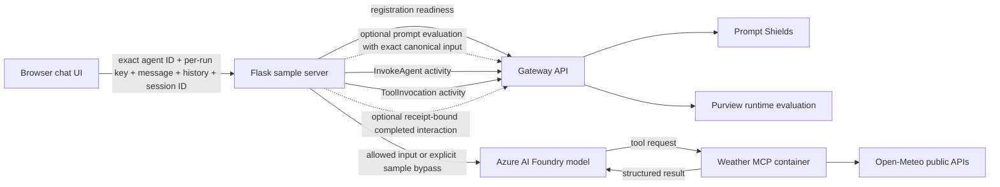

# Python Foundry and MCP Weather Agent

This standalone sample is a small Flask chat application for demonstrating an
external agent against a running A365 Custom Gateway. The operator selects any
valid, Active registered external agent by entering its exact ID and matching
Gateway key, then the app calls a real Azure AI Foundry chat model and obtains
current weather through a separately supervised MCP container backed by the public
Open-Meteo APIs. There is no default or fallback agent identity.

The sample is not part of the Gateway Docker Compose runtime and does not modify
Gateway configuration or source. Its MCP service is sample-owned Docker work; the
Flask UI is a separate loopback host process. On Windows, an optional current-user
logon task can restore that Flask process after sign-in without opening a terminal.

Its dark burgundy brand deliberately distinguishes this client from the blue
Gateway Console. Semantic success, warning, failure, disabled, focus, and
unevaluated treatments retain accessible, distinct colors and reduced-motion
behavior.

## What the sample proves

For each submitted message, the app performs these processing steps in order. Two
request-scoped switches select prompt and response evaluation. Both default on,
are kept only in page memory, and return to on after reload or conversation reset.
The visible timeline starts with Gateway admission; canonical input construction
is a server-side prerequisite rather than a separate displayed stage.
For every Gateway request that is actually attempted, its stage also shows the
uppercase HTTP method and relative route used by the client. This small descriptor
makes the integration surface visible without showing a host, query string, header,
credential, idempotency value, body, prompt, or response. Existing correlation and
conditional reconciliation references remain separate stage metadata. Model and MCP execution
are not mislabeled as Gateway calls, and skipped phases have no executed-call trace.

1. **Agent selection** — accept a valid exact `externalAgentId` and its matching
   Gateway key. The server validates the ID before any side effect, and the Gateway
   verifies the case-sensitive ID/key pair before Foundry or MCP can run.
2. **Canonical model input** — combine the server-owned system instruction, prior
   displayed conversation history, and current message. The browser keeps that
   history in memory only and sends `message`, `history`, and `sessionId` to Flask.
3. **Gateway admission** — call `GET /api/v1/agent-runtime/readiness` to confirm
   that the registered agent is active and admitted before starting the selected
   sample flow.
4. **Gateway input evaluation** — when selected, send the exact canonical model
   input to `POST /api/v1/prompts:evaluate` with the selected agent's key. Continue only
   when `evaluationId` equals `evaluationReceiptId` and Purview reports an
   explicit permitted allow state: `Allowed`, `AuditOnly`, `AuditLogged`,
   `PurviewDisabled`, `SimulationUnavailable`, or `SimulatedBlock`.
5. **Invoke activity telemetry** — submit an `InvokeAgent` signal through
   `POST /api/v1/agent-activities`. The app fails closed without calling Foundry when
   this pre-model intake is failed or unconfirmed.
6. **Foundry model call** — continue after the Gateway returns an allow result and
   valid receipt, or after admission and activity intake in the explicitly
   unevaluated sample mode.
7. **MCP tool execution** — when the model requests current weather, call the
   weather MCP container over Streamable HTTP. The server resolves a location and
   returns current conditions through Open-Meteo, then the app submits a separate
   `ToolInvocation` activity signal through `POST /api/v1/agent-activities`. A
   failed or unconfirmed post-model activity is shown as a warning. When response
   evaluation is selected, the protected interaction is still submitted once.
8. **Gateway interaction submission** — when response evaluation is selected, send
   the exact canonical model input, candidate model response, user context, and receipt to
   `POST /api/v1/ai-interactions`.
9. **Safe display** — in full evaluation mode, show the model response only after
   the Gateway accepts the completed interaction. When response evaluation is
   skipped, show it as an `unevaluated` result with a persistent warning.

The valid combinations are:

| Prompt | Response | Behavior |
| --- | --- | --- |
| On | On | Full receipt-bound prompt and completed-interaction evaluation. |
| On | Off | Prompt is evaluated before Foundry; response evaluation and completed-interaction intake are skipped. |
| Off | Off | Both content-evaluation calls are skipped; admission and activity telemetry remain required. |
| Off | On | Invalid. The UI forces response off, and Flask rejects a contradictory request before side effects. |

These switches do not modify the registered agent or Gateway settings. Activity
telemetry is separate from content evaluation. An unevaluated result is not a
Gateway allow, completed-interaction acceptance, or proof of downstream visibility.

Prompt Shields is an input-only check. Purview can evaluate both the prompt and
the completed interaction, including the model response. A response rejected by
Purview is withheld from the chat transcript and presented as a blocked result.

An HTTP `202 Accepted` from the interaction endpoint means the Gateway accepted
the work for processing. It does not prove that Agent 365, Purview AI Explorer,
Defender, or any other downstream service has ingested or displayed it.

## Architecture



The operator enters the exact registered external agent ID and its matching
Gateway key for each test run. For this loopback POC, both fields are saved in that
browser profile's `localStorage`, restored after reload, and removable through the
visible clear-saved-credentials action. The selected ID binds the active
conversation; changing it starts a new session and clears prior history so content
and telemetry cannot cross registrations. Neither value enters a URL, transcript,
result, response, server cache, or application log, and Flask never persists,
logs, caches, or echoes the key. A Foundry access
token never reaches the browser. Azure Identity obtains that token through the asynchronous
`DefaultAzureCredential` from the signed-in developer identity or a deployed
managed identity; no Foundry client secret is accepted by the browser. Each model
turn creates and closes its Foundry
client and credential in the same request event loop. Sequential or concurrent
Flask requests therefore never reuse an async HTTP or identity transport from a
different or already closed loop, and credential acquisition is cancellable with
the rest of the turn. Credential cleanup still runs when Foundry client cleanup
reports an error.

## Prerequisites

- A running Gateway API, normally `http://127.0.0.1:5080`.
- Any Active registration whose exact external agent ID is available to enter in
  the UI.
- The matching Gateway key that was revealed once and saved when the agent was
  registered. The same key authenticates each request for that registration.
- The Entra object ID used as the interaction's tenant user context.
- An Azure AI Foundry chat-model deployment and its Azure OpenAI-compatible
  resource-root endpoint/model configuration. The endpoint must be a plain HTTPS
  resource root whose host ends in `.cognitiveservices.azure.com` or
  `.openai.azure.com`, such as
  `https://your-resource.cognitiveservices.azure.com/`. A Foundry project URL
  containing `/api/projects/...` and an arbitrary HTTPS host are not accepted.
- Azure CLI for local authentication and user-object-ID discovery.
- An Azure identity available through `DefaultAzureCredential`. For local use,
  sign in with Azure CLI; in hosted infrastructure, assign the workload a managed
  identity. In either case, grant that identity a tenant-approved Foundry
  data-plane role that permits chat completion on the configured deployment.
- Python 3.11 or later with the `venv` module. On Ubuntu, install the matching
  `python3-venv` package when it is not already present.
- Install `requirements.txt` as shown below; it includes `aiohttp`, which the
  asynchronous Azure Identity credential transport requires.
- Docker Engine with the Compose plugin for the weather MCP service.
- Internet access from the sample process to the configured Foundry endpoint and
  `geocoding-api.open-meteo.com` / `api.open-meteo.com`.

Open-Meteo does not require an API key for this demonstration. Follow its terms
and usage limits; the sample applies bounded timeouts and does not use it as a
Gateway dependency.

## Configuration

Copy the checked-in `.env.example` to an ignored `.env` file and configure the
non-Gateway-key server-side values:

```powershell
Copy-Item .env.example .env
```

```bash
cp .env.example .env
```

Edit `.env` with a local editor. Do not put the Gateway key in `.env` or on a
command line. Enter it only in the sample's designated password field; this local
POC saves it in the current browser profile until you use **Clear saved agent**.
For local development, sign in first and obtain the signed-in user's
Entra object ID with:

```powershell
$GatewayTenantId = Read-Host "Gateway tenant ID"
az login --tenant $GatewayTenantId
az account show --query tenantId --output tsv
az ad signed-in-user show --query id --output tsv
```

```bash
read -r -p "Gateway tenant ID: " GATEWAY_TENANT_ID
az login --tenant "$GATEWAY_TENANT_ID"
az account show --query tenantId --output tsv
az ad signed-in-user show --query id --output tsv
```

Confirm that the reported tenant is the same tenant as the Gateway registration,
then use that object ID as `GATEWAY_TENANT_USER_ID`. A hosted deployment must use the
tenant user context required by its own interaction instead of assuming the
managed identity's service-principal object ID is a user ID.

| Variable | Purpose |
| --- | --- |
| `GATEWAY_BASE_URL` | Gateway listener; defaults to `http://127.0.0.1:5080` |
| `GATEWAY_TENANT_USER_ID` | Entra user object ID bound to evaluations and interactions |
| `FOUNDRY_ENDPOINT` | Azure OpenAI-compatible HTTPS resource root under `.cognitiveservices.azure.com` or `.openai.azure.com`, with no path, query, or fragment |
| `FOUNDRY_MODEL` | Foundry deployment name |
| `FOUNDRY_API_VERSION` | Azure OpenAI API version; defaults to `2024-12-01-preview` |
| `MCP_SERVER_URL` | Weather MCP Streamable HTTP endpoint; defaults to `http://127.0.0.1:5091/mcp` |
| `WEATHER_TIMEOUT_SECONDS` | Open-Meteo timeout inside the MCP container; defaults to 10 seconds |
| `FLASK_HOST` | Lexical loopback listener (`127.0.0.1`, `::1`, or `localhost`); defaults to `127.0.0.1` |
| `FLASK_PORT` | Sample port; defaults to `5090` |
| `GATEWAY_TIMEOUT_SECONDS` | Gateway request timeout; defaults to 10 seconds and cannot exceed 20 seconds |
| `FOUNDRY_TIMEOUT_SECONDS` | Foundry request timeout; defaults to 60 seconds |
| `MCP_TIMEOUT_SECONDS` | MCP request timeout; defaults to 15 seconds |
| `CHAT_TURN_TIMEOUT_SECONDS` | Server-owned deadline for the entire chat turn; accepts 30–90 seconds and defaults to 90 |

`FOUNDRY_MODEL` is the configured deployment name, which may differ from the base
model family. For each turn, the app creates `AsyncAzureOpenAI` with a bearer-token
provider from `azure.identity.aio.DefaultAzureCredential` and the
`https://cognitiveservices.azure.com/.default` scope, then closes both when that
turn ends. Never commit the local `.env` or place credentials in command history,
screenshots, issues, test snapshots, or support bundles. The registered agent key
is the only credential accepted by the browser, and only through the designated
password field. The external agent ID is entered beside it and is not supplied by
server configuration. Both are stored locally by this POC UI until explicitly
cleared.

## Local browser API

The browser uses two same-origin Flask routes. `POST /api/chat` accepts the exact
external agent ID and matching Gateway key for the current run; neither route
returns the key, and neither accepts or returns a Foundry token. Both routes use
non-cacheable responses. Flask rejects a request
whose lexical `Host` is not loopback; API calls with an `Origin` must match that
trusted host exactly.

`GET /api/status` returns sanitized service state only. It does not select, lock,
or verify an agent identity:

```json
{
  "services": {
    "gateway": { "status": "Credential required", "detail": "..." },
    "foundry": { "status": "Configured", "detail": "..." },
    "mcp": { "status": "Ready", "detail": "..." }
  }
}
```

`Foundry: Configured` is not a live model probe. The deployment is tested only
during a chat request after Gateway admission and the selected prompt-evaluation
boundary. The unauthenticated status
route does not retain or probe with an external agent ID or Gateway key; Gateway
admission is checked inside each chat request after the operator supplies the exact
ID/key pair.
The MCP status check is live and bounded.

`POST /api/chat` accepts:

```json
{
  "externalAgentId": "my-registered-agent",
  "gatewayAgentKey": "<registered-agent-key-entered-for-this-run>",
  "message": "What is the current weather in Seoul?",
  "history": [
    { "role": "user", "content": "Hello" },
    { "role": "assistant", "content": "How can I help?" }
  ],
  "promptEvaluationEnabled": true,
  "responseEvaluationEnabled": true,
  "sessionId": "00000000-0000-4000-8000-000000000001"
}
```

`externalAgentId` and `gatewayAgentKey` are required for every test run. The ID
must satisfy the Gateway's 3–128-character syntax and is rejected before any
external side effect when invalid. The exact value is used case-sensitively for
prompt evaluation, activities, and completed-interaction intake. Readiness first
authenticates the supplied key and checks its registration state; the first
body-bearing Gateway call compares the selected ID with that authenticated
registration. A mismatched ID/key pair stops before Foundry or MCP.

The key is stored only in this loopback POC's browser `localStorage` and current
Flask request memory, is used only for the selected registration's Gateway calls,
and is never copied into response bodies, diagnostics, transcripts, logs, server
caches, or server configuration. The UI states that it is stored locally and
provides a one-step action that removes both the saved ID and key.

The selected ID is restored for convenient consecutive testing. Changing it
creates a new session ID and clears prior history. No configured identity supplies
a default or fallback.

`promptEvaluationEnabled` and `responseEvaluationEnabled` accept JSON booleans
only and default to `true` when omitted. A request that enables response evaluation
while disabling prompt evaluation is rejected with `400` before the workflow or
any external side effect begins.

History contains earlier displayed turns from the current in-memory browser
conversation. When prompt evaluation is on, that complete history is part of the
canonical input evaluated before the model call. The server returns this shape:

```json
{
  "outcome": "allowed",
  "answer": "The accepted model answer appears here.",
  "message": "The Gateway accepted the protected interaction.",
  "stages": [
    {
      "id": "prompt-evaluation",
      "label": "Gateway prompt evaluation",
      "status": "allowed",
      "detail": "...",
      "gatewayRequest": {
        "method": "POST",
        "route": "/api/v1/prompts:evaluate"
      },
      "correlationId": "..."
    }
  ],
  "sessionId": "00000000-0000-4000-8000-000000000001"
}
```

`outcome` is `allowed`, `unevaluated`, `blocked`, `failed`, or `unconfirmed`. For a
completed workflow Flask maps these to HTTP `200`, `200`, `403`, `502`, and `503`,
respectively. `unevaluated` includes the candidate answer but explicitly means the
selected content-evaluation phase and completed-interaction intake were skipped.
`gatewayRequest` is present only when that stage represents an attempted Gateway
request. Its `method` and `route` are selected from server-owned endpoint
descriptors and contain no user input or secret-bearing request data. The exact
allowlist is `GET /api/v1/agent-runtime/readiness`,
`POST /api/v1/prompts:evaluate`, `POST /api/v1/agent-activities`, and
`POST /api/v1/ai-interactions`.
Request validation uses `400`, `413`, or `415`; origin rejection uses `403`; and an
unexpected server failure uses `500`. `reconciliationReference` is present only
for an uncertain Gateway mutation and contains its opaque idempotency value. The
internal Gateway interaction call can return `202 Accepted`, but the browser
receives `200` only after the sample has classified that intake as an allowed
completed turn. Neither status proves downstream visibility. If an HTTP error
status ever contradicts an `allowed` body, the browser changes the result to
`unconfirmed` before rendering, removes the answer, and does not add it to chat
history.

## Run

From this directory, start and verify the separately supervised weather MCP
container:

```powershell
docker compose up -d --build --wait --wait-timeout 60
docker compose ps
Invoke-RestMethod http://127.0.0.1:5091/health
```

```bash
docker compose up -d --build --wait --wait-timeout 60
docker compose ps
curl --fail --silent --show-error http://127.0.0.1:5091/health
```

The health response is `{"status":"healthy"}`. Then prepare and start the Flask
process on Windows:

```powershell
python -m venv .venv
.\.venv\Scripts\Activate.ps1
python -m pip install -r requirements.txt
python app.py
```

For automatic recovery after a Windows restart, stop the foreground Flask process
after verifying it once, return to the repository root, and install the optional
current-user supervisor:

```powershell
pwsh -NoProfile -File tools/scripts/setup/Set-WeatherAgentSampleStartup.ps1 -Mode Install
```

The installer validates the sample virtual environment and `.env`, registers one
logon-only task for this exact checkout, and starts it immediately. Its action is
the virtual environment's `pythonw.exe` running `app.py` directly with the sample
directory as the working directory. It has no repeating trigger, PowerShell/cmd
wrapper, elevation, or visible terminal. Check or remove it with:

```powershell
pwsh -NoProfile -File tools/scripts/setup/Set-WeatherAgentSampleStartup.ps1 -Mode Status
pwsh -NoProfile -File tools/scripts/setup/Set-WeatherAgentSampleStartup.ps1 -Mode Remove
```

On Linux or macOS:

```bash
python3 -m venv .venv
source .venv/bin/activate
python -m pip install -r requirements.txt
python app.py
```

Then open `http://127.0.0.1:5090`, enter the exact external agent ID and saved key
for any Active registration, and submit a test message. The sample restores both
fields from this browser profile on later visits until **Clear saved agent** is
used. Changing the selected ID starts a new session with empty history. Evaluation
switches apply to the next request only and are never stored outside the current
page.

The sample Compose project contains only the MCP weather service. Its container
has a health check and `unless-stopped` restart policy, so Docker restores it after
an engine or host restart when Docker itself starts. The Flask app remains a
loopback-only development process for local/private demonstration; the optional
Windows task restores it at the owning user's logon and retries a failed process a
bounded number of times. The Docker and Windows supervisors are independent. A
manually stopped MCP container remains stopped, and the Flask task cannot run while
that Windows user is not logged on. The sample has no end-user authentication or
authorization and is not a production or Internet-facing server.

The server owns a configurable 30–90-second whole-turn deadline that defaults to
90 seconds, shorter than the browser's 120-second request timeout. Expiration cancels asynchronous Foundry/MCP work and
prevents later workflow stages from starting. An already-started Gateway request
remains bounded by the configured 10-second default and 20-second maximum. A
timed-out turn is `unconfirmed` and never releases a candidate response.

Before hosting it remotely, add a production WSGI server, HTTPS, network access
controls, and real caller authentication and authorization, then use managed
identity for Foundry. A containerized Flask service must reach MCP through an HTTPS
private endpoint or trusted TLS proxy: the sample deliberately rejects plain HTTP
for non-loopback `MCP_SERVER_URL` values, and the bundled MCP container itself does
not terminate TLS.

If your network requires a Python package mirror, set `PIP_INDEX_URL` (and, only
when required by that trusted mirror, `PIP_TRUSTED_HOST`) in the shell before the
Compose build. Use credential-free mirror URLs only: Docker build arguments and
provenance may expose their values. This sample does not implement an authenticated
package-mirror secret mount.

The implementation's `.env.example`, dependency file, and tests remain the
authority for exact startup options. The sample fails startup with a sanitized
configuration message when a required server-side value is absent.

## Expected behavior

- A normal prompt proceeds through Gateway input evaluation, pre-model
  `InvokeAgent` activity intake, Foundry, optional MCP current-weather lookup and
  `ToolInvocation` activity intake, and receipt-bound interaction submission.
- With response evaluation off, the candidate is shown as unevaluated and no
  completed interaction is submitted. With both evaluations off, neither content
  evaluation endpoint is called. Both modes retain Gateway admission and activity
  telemetry and make no protection or downstream-visibility claim.
- A prompt blocked by Prompt Shields or Purview never reaches Foundry or MCP.
- A response that claims allow but has mismatched receipt IDs, or a blocked,
  skipped, unknown, or contradictory Purview status, fails closed before Foundry.
- Required protection unavailability fails closed and does not call the model.
- Failure to confirm the pre-model `InvokeAgent` activity also fails closed before
  Foundry runs. A post-model `ToolInvocation` activity failure is shown as an
  unconfirmed warning while the receipt-bound interaction is still submitted once.
- A candidate response blocked by Purview is not shown as a successful assistant
  message.
- A changed or expired protection receipt is reported as a failed, retryable turn,
  not as a Prompt Shields or Purview block. Start a new turn to obtain a current
  receipt. A same-evidence catalog refresh does not invalidate an in-flight receipt.
- Each UI stage reaches a terminal allowed, blocked, failed, or accepted state;
  animations do not continue after that state.
- Every attempted Gateway stage reports the correct allowlisted method and relative
  route in `gatewayRequest`. Skipped, local-validation, Foundry, and MCP-only stages
  omit it, and the descriptor contains no host, query string, header, credential,
  idempotency value, body, prompt, response, or user context.
- The app labels `202 Accepted` as Gateway intake and provides correlation data for
  later investigation without claiming downstream visibility.

## Retry and privacy rules

The sample does not blindly retry model calls, tool calls, or Gateway mutations.
If a Gateway request has an unknown outcome, the turn ends as `unconfirmed`. The
current sample has no resume operation that can repeat the exact body with its
original idempotency key. The affected stage exposes that opaque key as a
reconciliation reference, together with any Gateway correlation ID, so an operator
can investigate the exact mutation without exposing credentials or content.
Unexpected successful HTTP status codes are also treated as unknown outcomes.
Reconcile the uncertain outcome before starting a new chat action; the new action
uses new interaction and idempotency identifiers.

The same withholding rule applies when the browser receives an allowed body with
a non-success HTTP status: the candidate answer is neither displayed nor retained.
The server cancels a turn at its configured whole-turn deadline so a browser
transport timeout cannot silently permit later model/tool work or Gateway
mutations to continue.

The sample does not emit structured application logs for stage payloads, prompts,
responses, weather results, keys, tokens, or provider bodies. Flask's development
server can emit ordinary access lines with the request method, route, and status.
Sanitized stage status, timing, correlation data, and the allowlisted HTTP method
and relative route in `gatewayRequest` are returned to the active browser UI
instead. Chat content stays in the in-memory browser/server exchange
and is submitted to the Gateway only through the documented runtime contracts.

The MCP tool returns current conditions for one requested location per invocation.
It does not provide future forecasts; questions about multiple locations may cause
the model to invoke the current-weather tool once for each location. Expected
validation, not-found, timeout, and upstream failures return a sanitized MCP tool
error classified through the MCP SDK's expected `ToolError` path, without logging
a traceback, requested location, or provider response.

## Related documentation

- [Project README](../../README.md)
- [Technical specification](../../SPEC.md)
- [Gateway API contract](../../docs/api/api-contract.md)
- [Interactive API reference](http://127.0.0.1:5081/docs)
